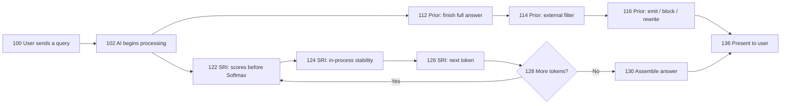
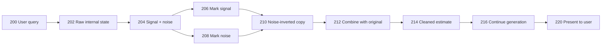
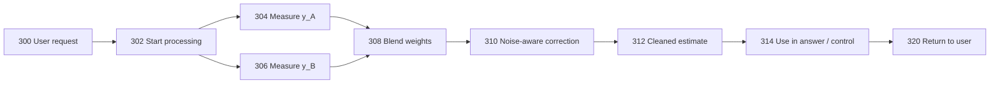
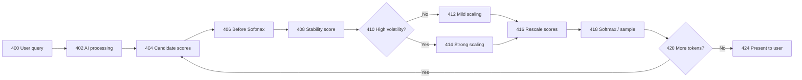
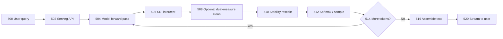
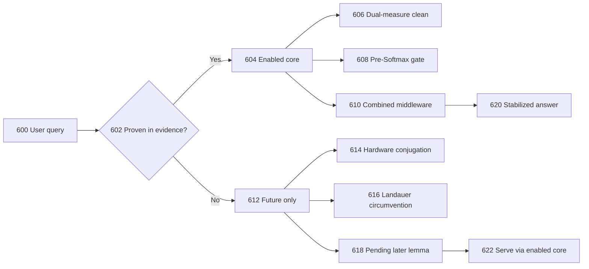
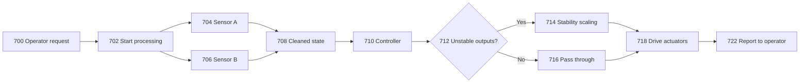
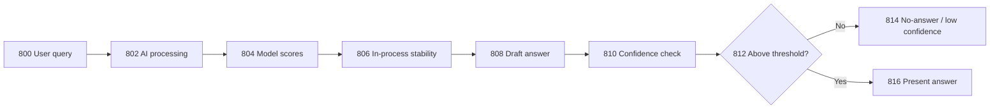

# Patent figures — landscape (downloadable)

All figures use **left → right** layout so text stays readable in Google Docs / Word (landscape page).  
**Download PNG/SVG:** [`figures/`](figures/) — open a file, or grab [`figures/sri-patent-figures-landscape.zip`](figures/sri-patent-figures-landscape.zip).

| FIG. | Download PNG | Download SVG | Title |
|---|---|---|---|
| **FIG. 1** | [fig-01.png](figures/fig-01-user-query-paths.png) | [fig-01.svg](figures/fig-01-user-query-paths.svg) | User query: post-filter vs SRI |
| **FIG. 2** | [fig-02.png](figures/fig-02-signal-noise-cancel.png) | [fig-02.svg](figures/fig-02-signal-noise-cancel.svg) | Signal–noise cancellation |
| **FIG. 3** | [fig-03.png](figures/fig-03-dual-measurement.png) | [fig-03.svg](figures/fig-03-dual-measurement.svg) | Dual-measurement cleaned estimate |
| **FIG. 4** | [fig-04.png](figures/fig-04-stability-gate.png) | [fig-04.svg](figures/fig-04-stability-gate.svg) | Pre-Softmax stability gate |
| **FIG. 5** | [fig-05.png](figures/fig-05-chat-intercept.png) | [fig-05.svg](figures/fig-05-chat-intercept.svg) | Full chat turn with SRI |
| **FIG. 6** | [fig-06.png](figures/fig-06-claim-boundary.png) | [fig-06.svg](figures/fig-06-claim-boundary.svg) | Enabled vs future claims |
| **FIG. 7** | [fig-07.png](figures/fig-07-dual-sensor-control.png) | [fig-07.svg](figures/fig-07-dual-sensor-control.svg) | Dual-sensor control |
| **FIG. 8** | [fig-08.png](figures/fig-08-confidence-gate.png) | [fig-08.svg](figures/fig-08-confidence-gate.svg) | Present or refuse |

Regenerate: `bash docs/patent-provisional/figures/render-landscape.sh`

---

## FIG. 1 — User query: post-filter path vs SRI path

*Reference numerals 100–136. Landscape.*

**Drafting note:** Same user query; prior art filters after a full answer; SRI steadies scores before each next-token choice.

---

## FIG. 2 — User query through signal–noise cancellation

*Reference numerals 200–220. Landscape.*

**Drafting note:** Conceptual cancellation on a live user turn.

---

## FIG. 3 — User request → dual-measurement cleaned estimate

*Reference numerals 300–320. Landscape.*

**Drafting note:** Dual measurements only — no hidden true noise input. Prefer for Lemma Z1 claims.

---

## FIG. 4 — User query → pre-Softmax stability gate → reply

*Reference numerals 400–424. Landscape.*

**Drafting note:** Softmax only after rescaling.

---

## FIG. 5 — Full chat turn with SRI intercept

*Reference numerals 500–520. Landscape.*

**Drafting note:** Primary system embodiment for chat / API.

---

## FIG. 6 — Enabled claims vs future embodiments

*Reference numerals 600–622. Landscape.*

**Drafting note:** Softwalls stay future-only.

---

## FIG. 7 — Operator request → dual-sensor control

*Reference numerals 700–722. Landscape.*

**Drafting note:** Non-LLM embodiment with user/operator bookends.

---

## FIG. 8 — User query → confidence gate → present or refuse

*Reference numerals 800–820. Landscape.*

**Drafting note:** User query in; present or refuse out.

---

## Counsel usage

1. Prefer downloaded **PNG** in Google Docs (landscape page orientation).  
2. Formal drawing priority: **FIG. 1, 4, 5, 8**, then **FIG. 3**.  
3. Source Mermaid above stays citation-ready for edits.  
