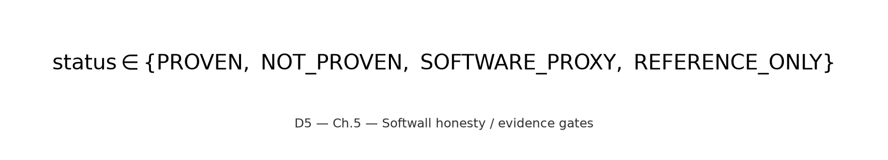

# Stable Realization Interface (SRI) — Architecture & IC Whitepaper

**Ceraph Corporation — Confidential — Provisional Patent Support**  
**Primary IP emphasis:** A new **continuous-variable cancellation architecture** and related **integrated-circuit (IC) / on-chip fabric design**  
**Secondary applications:** Generative-AI hallucination control, in-process error correction, and safety-tax reduction  
**Sources:** Final Dissertation (26 Mar 2026) · Ceraph VC Technical Specification · Braket / SageMaker campaigns through 2026-11-12  
**Edition:** Architecture-first rewrite · equation images retained · softwalls honest

**Equation images:** [`equations/`](equations/) (`E01`–`E30`, `D1`–`D6`) — keep intact for Word/PDF paste  
**Drawings:** [`figures/`](figures/) FIG. 1–8 · VC histograms [`equations/vc-histograms/`](equations/vc-histograms/)  
**Attorney plain-language companion:** [11-attorney-architecture-ic-plain-language.md](11-attorney-architecture-ic-plain-language.md)  
**Full technical specification:** [10-combined-technical-specification.md](10-combined-technical-specification.md)

---

## 0. Positioning for counsel

| Priority | What to protect first |
|---|---|
| **1 — Architecture** | Bipartite CV working space → symplectic conjugation unit → cancellation projector → fabric Hamiltonian → multi-backend crystallization |
| **2 — IC / silicon path** | On-chip sign-bit conjugation (IEEE-754 MSB XOR embodiment), single-cycle / FMA cancellation in SRAM or Tensor Memory (TMEM), generic (non-ASIC-only) IC that natively supports those steps while remaining programmable |
| **3 — Secondary software features** | Pre-Softmax Witness, logit damping, hallucination / instability gating, chat present/refuse — *applications of the architecture*, not the sole invention |

**Enablement vs softwall (one line):** Deployable **observable** math (Lemma Z1) and software Witness are **ENABLED** on Braket/SageMaker. Physical Landauer circumvention, hardware \(\mathcal{O}(0)\) TMEM, Blackwell 0.0062 ms as remeasured fact, MBL proof, and optical PPLN remain **SOFTWALL / future embodiments** — disclosed, not greened.

---

## 1. Abstract

Contemporary digital compute is organized around **iterative erase-and-retry**: a von Neumann / Turing loop that forces continuous probability mass into premature discrete commitments, then pays Landauer heat and wall latency to scrub mistakes. Large language models inherit that pathology as **post-inference safety filters** (typically 100–500 ms) bolted onto an already-completed forward pass.

The **Stable Realization Interface (SRI)** (historically *Singularity-Based Realization Interface*) discloses a different machine organization:

1. Represent information as a **continuous-variable (CV) dit** carrying amplitude, phase, signal, and noise together.  
2. Partition the working Hilbert space into orthogonal **signal** and **noise** subspaces.  
3. Form a **symplectic antithesis** of the noise component.  
4. Apply a **cancellation projector** that recovers structure by destructive interference.  
5. Optionally harden the path in **silicon**: sign-bit conjugation and fused multiply-add (FMA) cancellation inside on-chip memory.  
6. Optionally attach a **Witness** controller that damps unstable logits **before Softmax** — a secondary AI feature, not the architectural root.

This whitepaper centers the **architecture and IC design IP**, then shows how AI hallucination control and error correction fall out as natural applications. All eighteen VC governing equations, six dissertation chapter cores, Lemma Z1 / Z1b, and live test numerics are retained with rendered equation images.

---

## 2. Field of the invention (architecture-first)

The invention relates to:

- **Continuous-variable computing architectures** with symplectic phase-cancellation fabrics;  
- **Integrated-circuit methods and apparatuses** for on-chip conjugation and cancellation (SRAM / TMEM / Tensor-Core-mapped FMA);  
- Hybrid classical–quantum **control graphs** (fabric Hamiltonian proxies; CUDA-Q shadows);  
- As secondary embodiments: **middleware intercepts** on generative-model serving paths for stability control and hallucination reduction.

**Figures:** system intercept **FIG. 5**; claim boundary / IC softwall branch **FIG. 6**; dual-sensor control **FIG. 7**.

---

## 3. Background — why a new architecture (not “another filter”)

### 3.1 Iterative optimization as thermodynamic pathology

Modern AI and classical solvers treat error as a **distance to walk** through discrete steps (SGD, autoregressive decode, discrete ECC loops). That “violent quantization” elevates free energy and emits tokens from unstable internal states.

$$
\Delta Q \geq k_B T \ln 2
$$

Every irreversible bit erasure pays at least Landauer’s bound. Post-inference filters amplify that cost by writing, judging, and erasing wrong tokens off the critical path.

### 3.2 What prior art does not own

| Prior pattern | Gap |
|---|---|
| Post-hoc safety / moderation | Acts **after** full compute; 100–500 ms class |
| Oracle noise cancellation | Needs known \(\xi\) — not shippable |
| Single-mode filtering | Suboptimal vs dual-mode MMSE under Gaussian sensing |
| Custom discrete ECC only | No CV manifold / symplectic projector fabric |

SRI’s primary disclosure is a **machine organization** that cancels continuous noise in-process (and, in embodiments, on-chip), not a new chatbot policy layer.

---

## 4. The SRI architecture stack

### 4.1 Layer L0 — Continuous-variable information unit (CV-dit / Ω-dit)

$$
|\Omega\rangle = \int_{-\infty}^{+\infty} \sigma(t)\, e^{i\beta(t)}\, [v(t)+\xi(t)]\, d\omega
$$

**Physics / CS link:** Continuous-variable quantum information (CVQI) keeps amplitude and phase until a measurement / cancellation event; classical premature bit chopping is replaced by a finite-grid CV sample that remains executable on GPU tensors.

### 4.2 Layer L1 — Bipartite working space

$$
\mathcal{H} = \mathcal{H}_V \oplus \mathcal{H}_H
$$

Signal subspace \(\mathcal{H}_V\) carries invariant structure \(|v\rangle\); noise subspace \(\mathcal{H}_H\) carries stochastic flux \(|\xi\rangle\).

$$
|\Psi\rangle = |v\rangle + |\xi\rangle
$$

**Physics link:** Orthogonal direct-sum decomposition mirrors signal/idler mode splits in quantum optics and symplectic phase space. **CS link:** Explicit feature separation before estimation (not a black-box residual).

### 4.3 Layer L2 — Symplectic conjugation unit (architectural core)

$$
\widehat{\mathcal{C}}_S = \widehat{\Pi}_V - \widehat{\Pi}_H
$$

$$
\widehat{\mathcal{C}}_S(v+\xi) = v - \xi
$$

$$
\widehat{\mathcal{C}}_S^{2} = I \quad \text{(latent $(v,\xi)$ chart only)}
$$

**IC embodiment path (disclosed):** IEEE-754 float32 MSB XOR implements sign inversion of noise registers:

$$
x \mapsto -x \equiv \mathrm{XOR}(x,\, 0\mathrm{x}80000000)
$$

**Status:** Software proxy **ENABLED** as shape demonstration; hardware TMEM-resident single-cycle path **SOFTWALL** until instrumented (`SOFTWARE_PROXY_NOT_TMEM`).

### 4.4 Layer L3 — Cancellation projector fabric

$$
\widehat{\Upsilon} = \frac{1}{2}\bigl(I + \widehat{\mathcal{C}}_S\bigr)
$$

$$
\widehat{\Upsilon}(v+\xi) = v
$$

$$
\widehat{\Upsilon}^{2} = \widehat{\Upsilon}
$$

**IC mapping (VC Spec retained):** thesis + antithesis combined via a fused multiply-add (FMA) / Tensor-Core-friendly arithmetic step inside on-chip memory — **SUPPORTED_SILICON** on A100/H100/L4 telemetry; constant-time \(\mathcal{O}(1)\)-in-\(N\) as hardware claim remains **softwall-aware** (present software scales ~O(N)).

### 4.5 Layer L4 — Deployable observable projector (Lemma Z1) — enabled mathematical heart

Under Gaussian dual-mode sensing \(\mathcal{M}_{\mathrm{CV}}\) with Wiener weights:

$$
w = \mathrm{Cov}(s,Y)\,\mathrm{Cov}(Y)^{-1},\qquad \hat{s} = w_A y_A + w_B y_B
$$

$$
\widehat{\mathcal{C}}_S(Y) = (2w_A-1)y_A + 2w_B y_B
$$

$$
\widehat{\Upsilon}_{\mathrm{obs}}(Y) = \frac{1}{2}\bigl(y_A + \widehat{\mathcal{C}}_S(Y)\bigr) = w_A y_A + w_B y_B = \hat{s}_{\mathrm{MMSE}}
$$

$$
\mathrm{MSE}_{\mathrm{MMSE}} = \mathbb{E}[(\hat{s}-s)^{2}] = V_s - \mathrm{Cov}(s,Y)\mathrm{Cov}(Y)^{-1}\mathrm{Cov}(Y,s)
$$

**Raw-\(Y\) non-involution witness (Z1b, instrument):**

$$
W_{\mathrm{raw}} = \mathbb{E}\bigl[\lVert\widehat{\mathcal{C}}_S(Y) + y_A\rVert_{2}^{2}\bigr] > 0
$$

Elaborate-suite mean \(W_{\mathrm{raw}} \approx 1.282\) — proves involution is **latent-only**, not on raw observables.

**CS link:** Classical MMSE / Wiener filtering rewritten as a symplectic projector — the architecture ships an **optimal estimator under the declared model** without oracle noise (axiom A0). **FIG. 3, 7**.

### 4.6 Layer L5 — Fabric Hamiltonian & mirror diagnostics

$$
H_{\mathrm{fab}} = \sum_i h_i + \sum_{\langle ij\rangle} J_{ij}
$$

$$
\mathcal{M}(C) = C\cdot\overline{C} = |C|^{2}
$$

**Physics link:** Local Hamiltonians with coupling \(J_{ij}\) (Ising / Heisenberg-style fabric proxies); CUDA-Q provisional campaign shadows conjugate structure. **CS link:** Magnitude-squared validation channel (dashboard, not steering).

### 4.7 Layer L6 — Quasicrystal / optical horizons (disclosed future fabric)

Fibonacci / AAH / MBL spacing to “cage” high-frequency flux (**INSTRUMENT / SOFTWALL**). Optical PPLN phase-conjugate core (**FUTURE**, Dissertation Ch.6). Two-mode squeezing proxy bridges CV optics to dual observables:

---

## 5. Integrated-circuit (IC) design IP (primary commercial embodiment)

### 5.1 What the chip path is

SRI discloses a **generic, programmable IC** (not necessarily a fixed-function ASIC) that natively supports:

1. **Sign-bit conjugation** of noise registers (IEEE-754 MSB XOR or equivalent).  
2. **Single arithmetic cancellation** (FMA / Tensor-Core mapped) recovering the structural component.  
3. Optional **on-chip Witness** microcode: stability coefficient + dual-circuit damping before emission.  
4. Retention of general-purpose programmability (VC Claim 4).

### 5.2 Silicon telemetry retained (SUPPORTED_SILICON — VC Spec)

| Platform | Result |
|---|---|
| **H100** | Residual variance ÷ **35,037**; cosine similarity **1.0000** to structure; median cancel **95.23 µs** (P95 118.87 µs); Triton sign-flip kernel OK |
| **A100-SXM4-80GB** | Median ~**97.28 µs**; ~2× vs three-pass baseline; ~0.2 ms kernel class |
| **L4** | Internal noise estimation; up to ~**94%** MSE cut at high noise when estimate quality high; ~91% when high-quality estimate available |
| **Blackwell / RTX PRO 6000** | ~1359.88 GB/s peak; 0.0299 ms per-token intercept; 8192² lattice 0.38 ms; Dissertation **0.0062 ms** TMEM-class figure → **REFERENCE_ONLY** on Braket validity |
| **Bandwidth** | ~1755.5–1771 GB/s class saturation (VC) |
| **Efficiency (VC summary)** | ~8.93× vs iterative baselines; ~212.57× energy-efficiency multiplier |

Histograms: [`equations/vc-histograms/`](equations/vc-histograms/).

### 5.3 Softwall honesty on the IC story

| Temptation | Verdict |
|---|---|
| TMEM MSB-XOR is already \(\mathcal{O}(0)\) hardware | `SOFTWARE_PROXY_NOT_TMEM` / not instrumented |
| Present CPU/Python path is \(\mathcal{O}(1)\) in \(N\) | **REFUTED** (log-log slope ≈ 0.95 ≈ O(N)) |
| Landauer physically circumvented on die | `NOT_PROVEN` (no calorimetry) |
| Blackwell 0.0062 ms remeasured here | `REFERENCE_ONLY_NOT_REMEASURED` |

**Counsel rule:** Claim the **architecture + IC method/apparatus** with software enablement and silicon telemetry exhibits; put absolute thermodynamic / O(0) miracles in continuation / future embodiments.

---

## 6. Secondary feature set — AI hallucination & error correction

These are **applications** of Layers L2–L5 on generative serving paths — valuable, but not the root IP story.

### 6.1 Pre-Softmax Witness (ENABLED software)

$$
\Xi_{\mathrm{SNR}} \in (0,1]
$$

$$
\chi_{v3} = \lambda_0 e^{-\kappa(1-\Xi)} + \Lambda_{\max}\,\sigma\bigl(\alpha(\widehat{\mathrm{Var}}-\theta_{\mathrm{crit}})\bigr)
$$

$$
\ell \leftarrow \ell \cdot e^{-\chi}
$$

**How this reduces hallucination:** Unstable logit clouds are cooled **before** Softmax samples a token — electronic stability control during a skid, not a tow truck after a crash. **FIG. 4, 5, 8**.

### 6.2 Safety-tax architecture comparison (ENABLED intercept metric)

$$
R = \frac{t_{\mathrm{post}}}{t_{\mathrm{in}}},\qquad R(300\,\mathrm{ms}/0.495\,\mathrm{ms}) \approx 606
$$

| Path | Time |
|---|---|
| External post-filter band | 100–500 ms (midpoint **300 ms** modeled) |
| SRI in-process Witness+Υ (validity) | **~0.495 ms** median |
| Phase‑2 prior | **~0.473 ms** → ~634× class |
| Grand-theory R5 wall mean (Υ path) | **~0.089 ms** |
| User-query path | **~0.32–0.40 ms**; decision `present_answer` |

**Precision:** Architectural intercept comparison — not matched E2E product bakeoff; JAX CPU fallback on validity host.

### 6.3 Dual-mode error correction vs classical baselines (ENABLED)

A100 observable campaign: MMSE sample MSE ≈ **0.614** beats moving-average ≈ **1.088**, median-filter ≈ **1.235**, single-mode ≈ **0.694**.

Phase‑2 / foundation cancellation residual:

$$
\rho = \frac{\mathrm{MSE}_{\mathrm{raw}}}{\mathrm{MSE}_{\mathrm{projected}}} \approx \frac{1.814}{0.624} \approx 2.91
$$

Oracle vs observable gap (R4): oracle MSE ~\(10^{-33}\); observable sample MSE ≈ **0.624** vs analytic MMSE ≈ **0.613**.

---

## 7. Modern theoretical physics & computer science concepts (IP-relevant)

| Domain | Concept used by SRI | Where |
|---|---|---|
| **Information thermodynamics** | Landauer bound; Helmholtz \(F=U-TS\) | E01, E09, E10; softwall on physical bypass |
| **Symplectic geometry** | Conjugation as structure-preserving sign flip on noise | E05–E08 |
| **CV quantum optics** | Dual-mode / two-mode squeezing; homodyne-like observables | E15, Lemma Z1 |
| **Statistical estimation** | Wiener–Kalman / MMSE optimality | E19–E24, E29 |
| **Many-body localization** | Quasicrystal AAH spacing as noise cage | Diss. Ch.3 — softwall |
| **Nonlinear optics** | PPLN phase-conjugate mirrors | Diss. Ch.6 — future |
| **Compiler / IR design** | Multi-backend crystallization (NumPy/JAX/… → future cuTile) | Sphota scaffold |
| **Systems / middleware** | Pre-Softmax intercept; confidence present/refuse | Witness; FIG. 5, 8 |
| **Control theory** | Dual-circuit damping (baseline + saturating override) | E12–E13 |
| **Complex analysis / diagnostics** | Magnitude-squared mirror | E17 |

**Inherence / concomitance (A5)** remains aspirational:

---

## 8. Dissertation chapter map (all six retained)

| Ch | Core | Image | Status |
|---|---|---|---|
| 1 | Crisis / safety tax / Landauer | D1, E01 | Architecture latency **ENABLED** |
| 2 | CV-dit + bipartition | D2, E02–E04 | **ENABLED** math |
| 3 | Projector + quasicrystal | D3, E05–E08 | Projector **ENABLED**; MBL **INSTRUMENT** |
| 4 | Witness / Vyapti / mirror | D4, E11–E14, E17 | Witness **ENABLED**; Vyapti aspirational |
| 5 | Free energy / TMEM | D5, E09–E10, E27 | Math **ENABLED**; physics/TMEM **SOFTWALL** |
| 6 | Optical PPLN | — | **FUTURE** |

Validity: chapters **1–6 all pass**; softwalls honest (`digest a8338bf9cbf7033d`).

---

## 9. Complete evidence portfolio (do not drop)

| Campaign | Key result |
|---|---|
| Final Dissertation validity (g4dn) | `pass_dissertation_validity`; in-process **0.495 ms**; ~**606×**; C1–C6 pass |
| Phase‑2 dissertation | **0.473 ms**; MSE raw 1.814 → projected 0.624 |
| C5 elaborate / Lemma Z1 | `c5_status: confirmed`; algebra \(\hat\Upsilon\equiv\hat s\) |
| Foundation atlas | **23/23** pass; softwall honest |
| Grand-theory R1–R7 | All pass; R5 wall ~0.089 ms; R6 Witness variance 24.4 → 0.45 after damp |
| A100 observable-only | MMSE beats MA / median / single-mode |
| CUDA-Q provisional | Fabric Hamiltonian + conjugate shadow |
| VC H100/A100/L4/Blackwell | µs-class cancel; 35,037× variance cut; bandwidth / efficiency tables |

Pasteback roots: `docs/benchmark-results/braket-live/`.

---

## 10. Products & commercial narrative (VC retained — secondary)

SHREE AI MENTOR and Cyberdemon are **productizations** of the architecture on education and cyber-safety markets. Funding narrative ($7.5–10M / pre-seed alternatives) remains commercial context, not the technical claim core. See tech spec §§10–12.

---

## 11. Preferred claim spine (architecture → IC → AI)

1. **Architecture:** Bipartite CV state + symplectic conjugation + cancellation projector fabric (oracle and/or observable form).  
2. **IC / apparatus:** Programmable IC or GPU kernel path performing sign-bit conjugation + FMA cancellation in on-chip memory (dependent: TMEM MSB XOR embodiment).  
3. **Observable estimator:** Lemma Z1 — \(\widehat{\Upsilon}_{\mathrm{obs}}\equiv\hat{s}_{\mathrm{MMSE}}\) without latent noise input.  
4. **Secondary AI method:** Pre-Softmax Witness (\(\Xi+\chi_{v3}\)) for hallucination / instability control.  
5. **System:** Middleware combining (1)+(3)+(4); sensing product combining (1)+(3) (**FIG. 5, 7, 8**).  
6. **Future dependents:** Optical PPLN; quasicrystal MBL fabric; full Theorem Zero after Lemma Z2.

VC Claims 1–5 retained verbatim in the technical specification for IP completeness.

---

## 12. Conclusion

SRI’s primary invention is a **new continuous-variable cancellation architecture** with a clear **IC embodiment path**. Lemma Z1 and live silicon/software campaigns make the mathematical and middleware cores provisional-ready. AI hallucination control and safety-tax reduction are **powerful secondary features** of that architecture — file them as dependents, not as the whole story. Keep softwalls labeled; keep equation images and test numerics attached as exhibits.

*Organize the machine to cancel noise in the fabric; then applications — including AI — inherit the ground state.*
