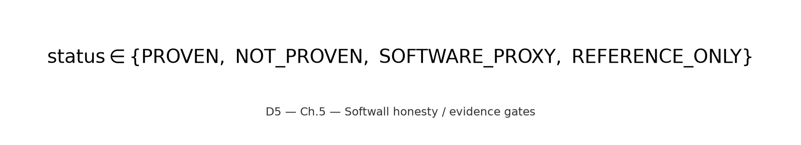

# Ceraph Corporation — Combined Technical Specification (Architecture & IC First)

**Stable Realization Interface (SRI)** — formerly Singularity-Based Realization Interface  
**All Intellectual Property Rights Reserved — Ceraph Corporation**  
**Provisional drafting edition — architecture / IC primary · AI features secondary · Braket-affirmed 2026-11-12**

**Companion whitepaper:** [09-combined-whitepaper-braket-affirmed.md](09-combined-whitepaper-braket-affirmed.md)  
**Attorney plain language:** [11-attorney-architecture-ic-plain-language.md](11-attorney-architecture-ic-plain-language.md)  
**Equation images (keep intact):** [`equations/E01.png`](equations/E01.png)–[`E30.png`](equations/E30.png), [`D1`](equations/D1.png)–[`D6`](equations/D6.png)  
**VC histograms:** [`equations/vc-histograms/`](equations/vc-histograms/) · **FIG. 1–8:** [`figures/`](figures/)

**Status legend:** **ENABLED** · **SUPPORTED_SILICON** · **SOFTWALL** · **REFERENCE_ONLY** · **ASPIRATIONAL** · **FUTURE**

**Math convention:** Each equation is given as (i) a rendered PNG, (ii) a display LaTeX block for Markdown/PDF engines that render math, and (iii) a Unicode one-liner for Word paste when needed.

---

## Table of contents

1. Abstract  
2. Field & summary of the invention (architecture → IC → AI)  
3. Background & theoretical framing (physics + CS)  
4. Architectural layers L0–L6 with equations 4.1–4.18 + Z1 extensions  
5. Integrated-circuit embodiments  
6. Secondary AI embodiments (Witness, hallucination, safety tax)  
7. Dissertation chapters 1–6  
8. Tested results catalog (complete)  
9. Softwall board  
10. Products, market, funds (VC retained)  
11. Preferred claims (architecture-first)  
12. VC patentable claims 1–5 (retained)  
13. Git / S3 anchors  
14. Conclusion & inventor checklist  

---

## 1. Abstract

SRI is a **continuous-variable symplectic cancellation architecture** and related **integrated-circuit design path**. Information is held as a CV dit; the working space is bipartitioned into signal and noise; a conjugation unit forms an antithesis of noise; a projector recovers structure by destructive interference. Silicon embodiments map conjugation to IEEE-754 sign-bit operations and cancellation to on-chip FMA / Tensor-Core arithmetic. **Secondary** software embodiments attach a dual-circuit Witness before Softmax to reduce hallucination and cut the post-inference safety tax.

Braket / SageMaker validity (2026-11-12): chapters 1–6 pass; Lemma Z1 confirmed; in-process median \(\approx 0.495\,\mathrm{ms}\) vs modeled \(300\,\mathrm{ms}\) filter midpoint (\(\approx 606\times\) architectural); softwalls honest.

---

## 2. Field & summary of the invention

### 2.1 Field

Continuous-variable computing architectures; on-chip noise-conjugation and cancellation circuits; hybrid classical–quantum fabric control; optionally generative-model middleware for pre-Softmax stability control.

### 2.2 Summary (claim narrative order)

1. **Architecture** — Layers L0–L4 (CV dit → bipartition → conjugation → projector → observable MMSE form).  
2. **IC** — Apparatus/method for sign-bit conjugation + FMA cancellation in SRAM/TMEM while remaining programmable.  
3. **AI features** — Witness damping, present/refuse confidence gate, dual-mode sensing cleanup as application layers.

**Figures:** FIG. 2 (cancel), FIG. 3 (Z1), FIG. 6 (IC / softwall boundary), FIG. 5/8 (AI intercept — secondary).

---

## 3. Background & theoretical framing

### 3.1 Information thermodynamics

$$
\Delta Q \geq k_B T \ln 2
$$

Unicode: `ΔQ ≥ k_B T ln 2`

Irreversible erasure has a minimum heat cost. Iterative AI stacks perform erasure-like operations at scale; post-filters add 100–500 ms and further erasures. SRI relocates cancellation **before** wrong tokens are committed. **Physical circumvention of Landauer on die remains SOFTWALL.**

### 3.2 Symplectic structure & destructive interference

In Hamiltonian / symplectic mechanics, structure-preserving transforms act on conjugate pairs. SRI’s conjugation operator flips the sign of the noise component in a bipartite chart so that linear recombination annihilates noise — the same physical idea as active noise control, formalized as a projector on a Hilbert space.

### 3.3 Continuous-variable quantum information & estimation theory

CVQI treats quadratures as continuous observables. Dual-mode (two-mode squeezing style) measurements yield a classical **MMSE / Wiener** estimator. Lemma Z1 proves that estimator **is** the observable cancellation projector — bridging quantum-optics intuition and deployable classical signal processing (no oracle \(\xi\)).

### 3.4 Computer-systems framing

The architecture is an **in-path fabric** (like a noise-cancelling stage inside a DSP pipeline), not an out-of-band judge. Compilation across NumPy/JAX/(Julia) “crystallizes” portable tiles toward future cuTile / TMEM ports (**SUPPORTED scaffold**).

---

## 4. Architectural layers & equation-by-equation analysis

### 4.1 Landauer bound (VC 4.1)

$$
\Delta Q \geq k_B T \ln 2
$$

**How it works.** Erasing a wrong answer costs energy. Cancel before write to avoid that loop.  
**Status.** Bound ENABLED as theory; bypass SOFTWALL.  
**Histogram.** `vc-histograms/p12_img00.png`

---

### 4.2 CV Omega-dit / CV-dit (VC 4.2 · Diss Ch.2)

$$
|\Omega\rangle=\int_{-\infty}^{+\infty}\sigma(t)\,e^{i\beta(t)}\,[v(t)+\xi(t)]\,d\omega
$$

Unicode: `|Ω⟩ = ∫ σ(t)·e^{iβ(t)}·[v(t)+ξ(t)] dω`

**How it works.** Keep the radio waveform intact until cancellation.  
**Status.** ENABLED math / finite-grid.

---

### 4.3 Bipartite Hilbert partition (VC 4.3)

$$
\mathcal{H}=\mathcal{H}_V\oplus\mathcal{H}_H
$$

Unicode: `H = H_V ⊕ H_H`

**How it works.** Two piles: keep vs cancel. Foundation for selective interference.

---

### 4.4 Forward / Thesis state (VC 4.4)

$$
|\Psi\rangle=|v\rangle+|\xi\rangle
$$

Unicode: `|Ψ⟩ = |v⟩ + |ξ⟩`

---

### 4.5 Symplectic conjugation operator (VC 4.5)

$$
\widehat{\mathcal{C}}_S=\widehat{\Pi}_V-\widehat{\Pi}_H
$$

Unicode: `Ĉ_S = Π̂_V − Π̂_H`

**IC note.** Sign inversion of noise; XOR embodiment path (E27).

---

### 4.6 Antithesis generation (VC 4.6)

$$
\widehat{\mathcal{C}}_S(v+\xi)=v-\xi
$$

$$
\widehat{\mathcal{C}}_S^{2}=I \quad\text{on the latent }(v,\xi)\text{ chart only}
$$

---

### 4.7 Cancellation projector (VC 4.7)

$$
\widehat{\Upsilon}=\frac{1}{2}\left(I+\widehat{\mathcal{C}}_S\right)
$$

$$
\widehat{\Upsilon}^{2}=\widehat{\Upsilon}
$$

Unicode: `Υ̂ = ½(I + Ĉ_S)`, `Υ̂² = Υ̂`

---

### 4.8 Recovered signal after destructive interference (VC 4.8)

$$
\widehat{\Upsilon}(v+\xi)=v
$$

**SUPPORTED_SILICON (H100):** residual variance ÷ 35,037; cosine 1.0000; median 95.23 µs.

---

### 4.9 Entropy collapse (VC 4.9)

$$
S\to 0 \quad\text{as noise variance}\to 0
$$

---

### 4.10 Free-energy ground-state identity (VC 4.10 · Diss Ch.5)

$$
F=U-TS\to U_{\min}\quad\text{when }S\to 0
$$

**Status.** Math ENABLED; physical silicon \(F=U_{\min}\) SOFTWALL.

---

### 4.11 Stability coefficient (VC 4.11)

$$
\Xi_{\mathrm{SNR}}\in(0,1]
$$

**R6 smoke:** \(\Xi_{\mathrm{SNR}}\) stable ≈ 0.990; unstable ≈ \(2\times10^{-5}\).

---

### 4.12 Autopoietic / V3 dual-circuit damping (VC 4.12)

$$
\chi_{v3}=\lambda_0 e^{-\kappa(1-\Xi)}+\Lambda_{\max}\,\sigma\bigl(\alpha(\widehat{\mathrm{Var}}-\theta_{\mathrm{crit}})\bigr)
$$

**R6:** variance before damp ≈ 24.41 → after ≈ 0.447.

---

### 4.13 Logit rescaling (VC 4.13) — secondary AI feature

$$
\ell\leftarrow \ell\cdot e^{-\chi}
$$

---

### 4.14 Weber–Fechner witness entropy (VC 4.14)

$$
H_W \propto \log(1+\mathrm{Var}/\varepsilon)
$$

---

### 4.15 Two-mode squeezing / dual observables (VC 4.15)

Feeds Lemma Z1 sensing model \(\mathcal{M}_{\mathrm{CV}}\).

---

### 4.16 Inherence / concomitance (VC 4.16 · A5)

$$
A\Rightarrow B \text{ on substrate } X \quad\text{(concomitance)}
$$

**ASPIRATIONAL.**

---

### 4.17 Mirror validation (VC 4.17)

$$
\mathcal{M}(C)=C\cdot\overline{C}=|C|^{2}
$$

---

### 4.18 Fabric Hamiltonian proxy (VC 4.18)

$$
H_{\mathrm{fab}}=\sum_i h_i+\sum_{\langle ij\rangle} J_{ij}
$$

**SUPPORTED** via CUDA-Q provisional fabric + conjugate shadow.

---

### 4.19 Lemma Z1 — observable projector ≡ MMSE (project advance · ENABLED)

$$
w=\mathrm{Cov}(s,Y)\,\mathrm{Cov}(Y)^{-1},\qquad \hat{s}=w_A y_A+w_B y_B
$$

$$
\widehat{\mathcal{C}}_S(Y)=(2w_A-1)y_A+2w_B y_B
$$

$$
\widehat{\Upsilon}_{\mathrm{obs}}(Y)=\frac{1}{2}\bigl(y_A+\widehat{\mathcal{C}}_S(Y)\bigr)=w_A y_A+w_B y_B=\hat{s}_{\mathrm{MMSE}}
$$

$$
\mathrm{MSE}_{\mathrm{MMSE}}=\mathbb{E}[(\hat{s}-s)^{2}]=V_s-\mathrm{Cov}(s,Y)\mathrm{Cov}(Y)^{-1}\mathrm{Cov}(Y,s)
$$

**Pass (C5):** algebra \(\widehat{\Upsilon}\equiv\hat{s}\) (rtol \(10^{-10}\)); sample MSE within 5σ of analytic; never receives \(s\) or \(n\). **Confirmed** on elaborate g4dn suite.

---

### 4.20 Lemma Z1b — raw-Y non-involution (instrument)

$$
W_{\mathrm{raw}}=\mathbb{E}\bigl[\lVert\widehat{\mathcal{C}}_S(Y)+y_A\rVert_2^{2}\bigr]>0
$$

Elaborate mean \(W_{\mathrm{raw}}\approx 1.282\).

---

### 4.21 IEEE-754 sign-bit conjugation proxy (IC path)

$$
x\mapsto -x \equiv \mathrm{XOR}(x,0\mathrm{x}80000000)\quad\text{(float32 MSB)}
$$

**SOFTWALL** for hardware O(0) TMEM; software proxy demonstrated.

---

### 4.22 Architectural latency ratio

$$
R=\frac{t_{\mathrm{post}}}{t_{\mathrm{in}}},\qquad R(300\,\mathrm{ms}/0.495\,\mathrm{ms})\approx 606
$$

---

### 4.23 Observable advantage & residual ratio

$$
\rho=\frac{\mathrm{MSE}_{\mathrm{raw}}}{\mathrm{MSE}_{\mathrm{projected}}}\approx\frac{1.814}{0.624}\approx 2.91
$$

---

## 5. Integrated-circuit embodiments (PRIMARY)

### 5.1 Preferred IC embodiment

A programmable integrated circuit comprising:

1. Memory-resident float registers representing bipartite forward state components;  
2. A **conjugation unit** configured to invert the sign of noise-associated registers (MSB XOR or arithmetic negate);  
3. A **cancellation unit** configured to compute \(\widehat{\Upsilon}\) via FMA / Tensor-Core arithmetic;  
4. Optional **Witness microcode** computing \(\Xi\), \(\chi_{v3}\), and logit rescale before Softmax emission;  
5. Retention of general-purpose programmability (VC Claim 4).

### 5.2 Mapping table

| Architectural block | Silicon mapping | Status |
|---|---|---|
| \(\widehat{\mathcal{C}}_S\) | IEEE-754 MSB XOR / negate | Proxy ENABLED; TMEM O(0) SOFTWALL |
| \(\widehat{\Upsilon}\) | On-chip FMA | SUPPORTED_SILICON (H100/A100) |
| Dual-mode \(Y\) | Dual sensor / dual tile inputs | ENABLED (Lemma Z1) |
| Witness | Pre-Softmax microcode / host intercept | ENABLED software |
| Fabric \(H_{\mathrm{fab}}\) | CUDA-Q / coupling graph | SUPPORTED smoke |

### 5.3 Silicon numbers (do not omit)

See whitepaper §5.2: H100 95.23 µs / 35,037×; A100 ~97.28 µs; L4 noise-estimation MSE cuts; Blackwell tables; bandwidth ~1755–1771 GB/s; VC efficiency multipliers. Blackwell 0.0062 ms = REFERENCE_ONLY on validity campaign.

---

## 6. Secondary AI embodiments

### 6.1 Hallucination / instability control

Apply E11–E13 before Softmax. Present/refuse confidence gate (**FIG. 8**). Validity user path: `present_answer`, ~0.32–0.40 ms.

### 6.2 Error correction via dual-mode MMSE

Lemma Z1 path; A100: MMSE beats MA / median / single-mode (E29).

### 6.3 Safety-tax reduction

In-process ~0.495 ms vs 100–500 ms band (E22/E28). Phase‑2 ~0.473 ms. R5 wall mean ~0.089 ms on Υ timing smoke.

**Counsel language:** Secondary method claims depending from architecture/IC independents.

---

## 7. Dissertation chapters 1–6

| Ch | Cell | Pass | Takeaway |
|---|---|---|---|
| 1 | C1 | yes | Safety-tax architecture latency |
| 2 | C2 | yes | CV-dit + bipartition |
| 3 | C3 | yes | Projector + Z1; MBL instrument |
| 4 | C4 | yes | Witness + mirror + user path |
| 5 | C5 | yes | FE math; softwall board |
| 6 | C6 | yes | Optical correctly future-only |

 

---

## 8. Tested results catalog (complete checklist)

| ID | Result | Source |
|---|---|---|
| V1 | Validity pass; digest `a8338bf9cbf7033d` | dissertation-validity pasteback |
| V2 | In-process median **0.49535 ms**; model 300 ms | same |
| V3 | Chapters 1–6 all true; softwall honest | pasteback-chapters |
| V4 | Ch.1 in-process **0.4897 ms** | chapter_1 |
| V5 | Lemma Z1 + Z1b advantage true | chapter_3 |
| V6 | User path ~0.32–0.40 ms; present_answer | chapter_4 / verdict |
| P1 | Phase‑2 pass; **0.4733 ms** | phase2 pasteback |
| P2 | MSE raw **1.814** → projected **0.624** | phase2 / foundation |
| C5 | Lemma Z1 `confirmed` on elaborate g4dn | sphota elaborate |
| F1 | Foundation atlas **23/23** | foundation-atlas |
| R1–R7 | All provisional rounds pass | grand-theory provisional |
| R4 | Oracle MSE ~0; obs MSE **0.624**; analytic **0.613** | R4 |
| R5 | Wall mean **0.089 ms** | R5 |
| R6 | Ξ stable/unstable; var 24.4→0.45 | R6 |
| A100 | MMSE 0.614 < single 0.694 < MA 1.088 < med 1.235 | cv-observable-a100 |
| H100 | 35,037×; cosine 1.0; 95.23 µs | VC Spec |
| A100-VC | ~97.28 µs; ~2× vs three-pass | VC Spec |
| L4 | up to ~94% MSE reduction (estimate-dependent) | VC Spec |
| Softwalls | Landauer NOT_PROVEN; TMEM proxy; Blackwell REFERENCE_ONLY; MBL instrument; PPLN future; software O(1) REFUTED | annex |

---

## 9. Softwall board

| Item | Verdict |
|---|---|
| Landauer circumvention / measured \(F=U_{\min}\) | `NOT_PROVEN` |
| TMEM MSB-XOR \(\mathcal{O}(0)\) | `SOFTWARE_PROXY_NOT_TMEM` |
| Blackwell 0.0062 ms this campaign | `REFERENCE_ONLY_NOT_REMEASURED` |
| MBL quasicrystal | `INSTRUMENT_ONLY_NOT_PROVEN` |
| Optical PPLN | `FUTURE_EMBODIMENT_NOT_PROVEN` |
| Software \(\mathcal{O}(1)/\mathcal{O}(0)\) in \(N\) | **REFUTED** (slope ≈ 0.95) |
| DeepSeek TE TFLOPS as Ceraph | `REFERENCE_ONLY_NOT_OURS` |
| Any softwall falsely greened | **false** |

---

## 10. Products, market, funds (VC §§6–8 retained)

**Products:** SHREE AI MENTOR; Cyberdemon.  
**Market:** Hallucination-sensitive verticals; AI infrastructure context.  
**Funds:** Bootstrap ~$5k; raise $7.5–10M (18–24 mo); Y1–Y3 revenue as in VC Spec. Pre-seed alternate in `05-investor-preseed-evaluation.md`.

---

## 11. Preferred claims (architecture-first)

1. **Independent — Architecture:** Method/system partitioning a CV forward state into signal/noise subspaces, generating a symplectic antithesis, and applying a cancellation projector recovering the structural component.  
2. **Independent — IC:** Programmable IC or on-chip kernel apparatus performing sign-bit conjugation and FMA cancellation in on-chip memory.  
3. **Independent — Observable estimator:** Dual-mode \(Y\to\widehat{\Upsilon}_{\mathrm{obs}}\equiv\hat{s}_{\mathrm{MMSE}}\) without latent noise (Lemma Z1).  
4. **Dependent — AI Witness:** Pre-Softmax \(\Xi+\chi_{v3}\) rescale for instability / hallucination control.  
5. **Dependent — System:** Combining 1+3+4 in a serving or sensing middleware.  
6. **Dependent / future:** TMEM MSB XOR; optical PPLN; quasicrystal fabric; Lemma Z2 / Theorem Zero.

---

## 12. VC patentable claims 1–5 (retained verbatim)

> **Claim 1:** A method of cancelling noise in a continuous-variable computing system comprising partitioning a raw output into a structural component and a noise component, generating an anti-noise state by sign inversion of the noise component, and performing a single fused multiply-add (FMA) operation that recovers the structural component with residual variance reduced by at least an order of magnitude.

> **Claim 2:** The method of Claim 1 wherein the cancellation is performed inside on-chip SRAM or Tensor Memory and completes with median latency under 100 microseconds on production GPU hardware.

> **Claim 3:** A system implementing the method of Claim 1 further comprising a stability coefficient and dual-circuit damping controller.

> **Claim 4:** A generic (non-ASIC) integrated circuit designed to natively support the sign-bit conjugation and single-cycle cancellation steps of Claim 1 while remaining general-purpose programmable.

> **Claim 5:** The method of Claim 1 wherein the architecture delivers at least a 20 percent throughput advantage over conventional post-inference filtering on current NVIDIA Blackwell-class hardware and achieves up to a 78-million-fold reduction in CMOS switching-energy transitions.

**Counsel:** Elevate Claims 1/4 as architecture/IC independents; treat Claim 3 as secondary AI dependent; softwall-aware on Claims 2/5 absolute hardware/energy language unless exhibits attached.

---

## 13. Git / S3 anchors

| Anchor | Path / URI |
|---|---|
| Validity | `docs/benchmark-results/braket-live/dissertation-validity/sagemaker-g4dn/` |
| Phase‑2 | `.../phase2-dissertation/sagemaker-g4dn/` + S3 `.../phase2-dissertation/results/20261112T072158Z/` |
| C5 elaborate | `.../sphota-yoga-buddhi-elaborate/sagemaker-g4dn/` |
| Foundation | `.../foundation-atlas/` + S3 `.../foundation-atlas/results/20261112T065601Z/` |
| CUDA-Q | S3 `.../cudaq-provisional-dissertation/results/20261112T064213Z/` |
| Softwall annex | `.../grand-theory-audit/PATENT_ANNEX_enablement_and_softwalls.md` |
| Axioms | `docs/architecture-axioms.md` |
| Campaign | `experiments/braket_dissertation_validity_campaign.py` |

---

## 14. Conclusion & inventor checklist

Architecture and IC first; AI features second; equation images intact; all listed test numerics attached; softwalls labeled.

- [ ] Send [09](09-combined-whitepaper-braket-affirmed.md) + this file + [11](11-attorney-architecture-ic-plain-language.md)  
- [ ] Attach `equations/` (E01–E30, D1–D6) and `vc-histograms/`  
- [ ] Attach FIG zip + validity pastebacks + softwall annex  
- [ ] Draft independents from §11.1–11.3 before AI dependents  
- [ ] Do not green softwalls in enabled claims  
