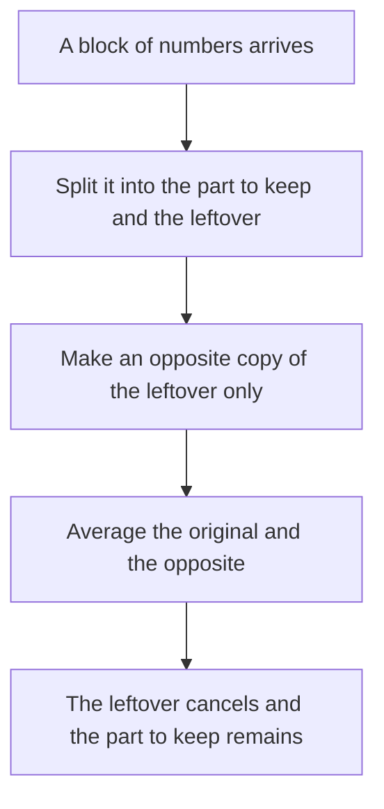
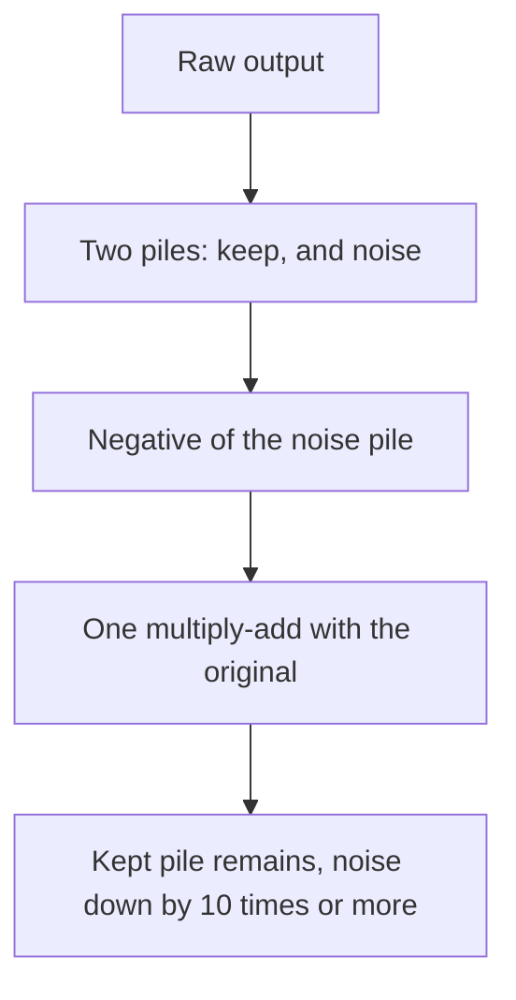
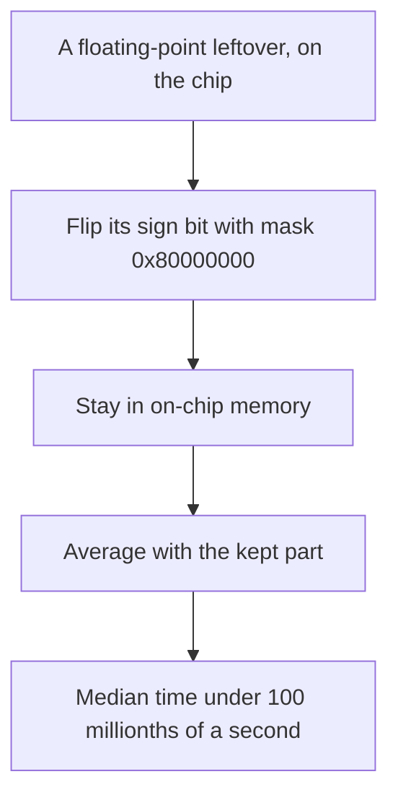
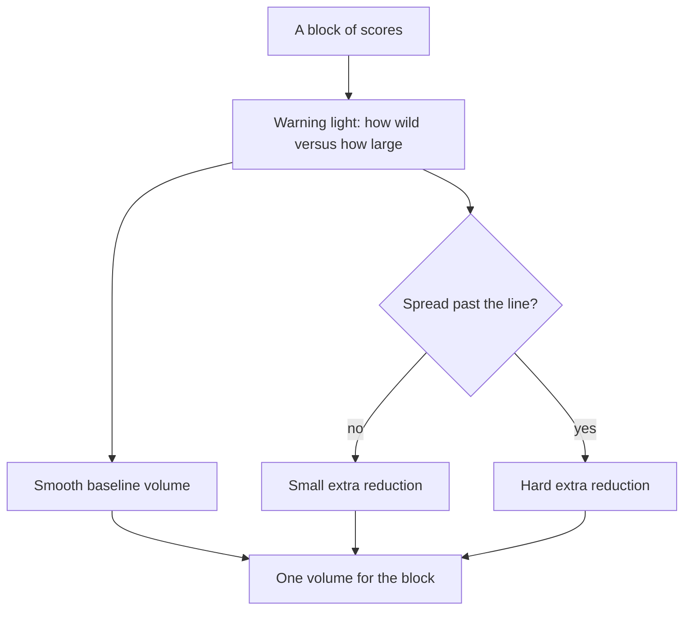
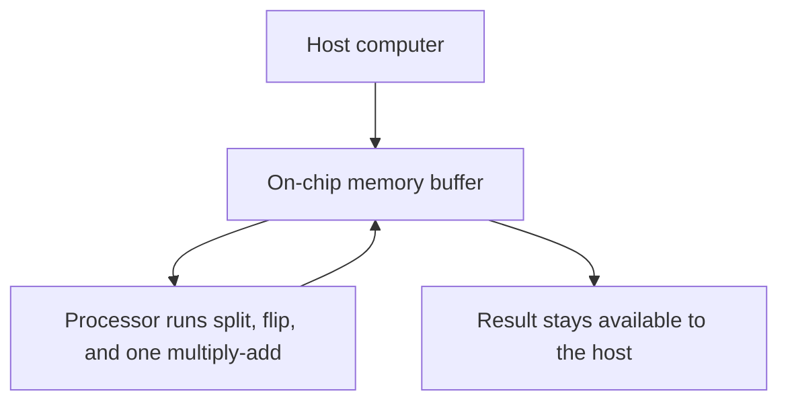
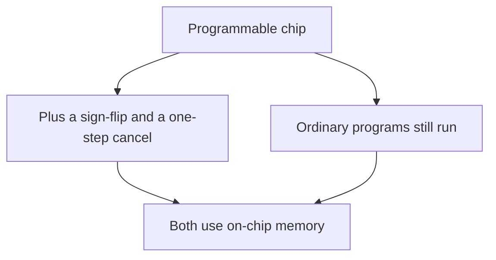
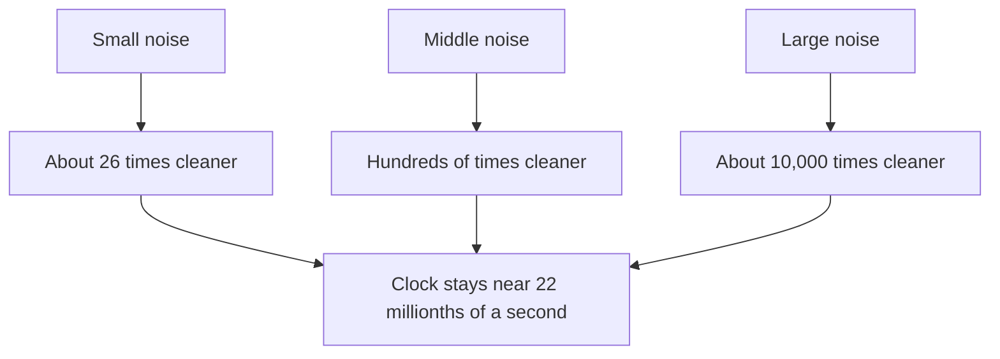
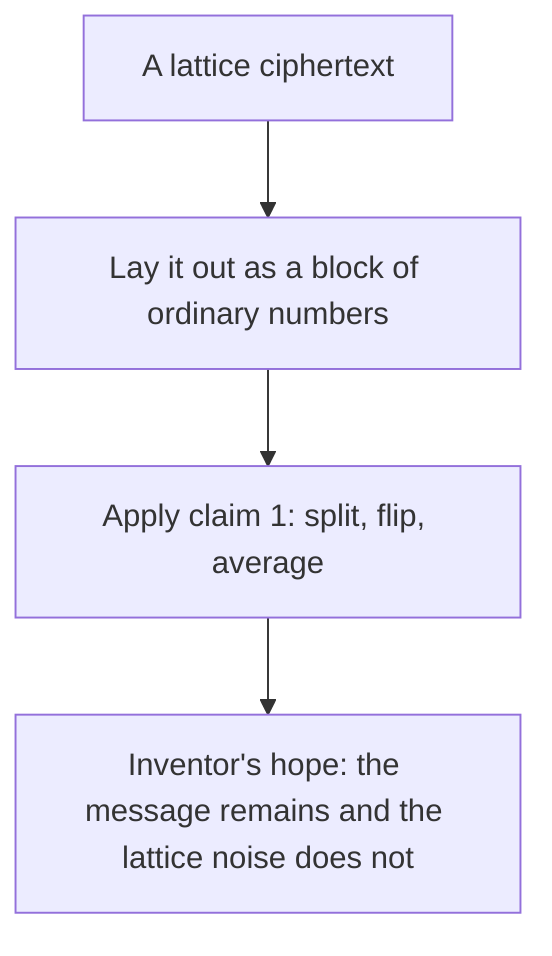
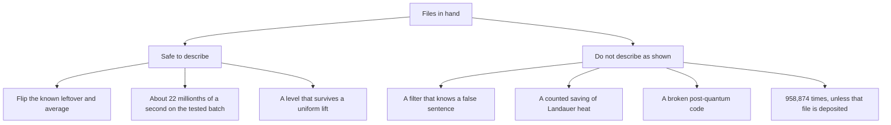

# A plain-language brief for the provisional

Ceraph Corporation, Kerala, India. 15 November 2026. For patent counsel. Not a filed application. Not legal advice. chief@ceraphco.com. www.ceraphco.com.

Inventor, as the company names him for this draft: Hari Krishna. Please confirm the legal name, address, and the assignment into Ceraph Corporation before filing.

Title, in ordinary words: A way to split a block of numbers into the part you want to keep and the leftover, to flip only the leftover, and to average the two so the leftover cancels. The same idea is written up, in the inventor’s papers, under the name Singularity-based Realization Interface, or omega-dit.

## How to use this brief

Each claim below is written twice. First in the words a reader who does not write kernels can follow. Then as a picture of the steps. Under each picture is what a product might look like, what was actually measured, and what should stay out of the claim.

Two experiments are easy to confuse, and the claims depend on the difference.

The first experiment hands the machine both the clean part and the leftover. Flipping the leftover and averaging is then an arithmetic identity. On a graphics board in November 2026 that identity was timed. As the leftover was made larger, the ratio of “before” spread to “after” spread grew from 26 times to 10,026 times, and the time stayed near 22 millionths of a second. The clean part used for the score was the true clean part.

The second experiment does not hand over the leftover. The machine sees only the mixture. Cancelling then requires a guess of the leftover. A separate internal note, on a different board, speaks of a guess that removed up to about 94 percent of the squared error. The November write-up of the first experiment says that 94 percent result was not repeated there. A claim that needs “we guessed the leftover from the mixture alone” needs the second experiment’s file, not the first experiment’s table.

A third experiment, on 14 November, keeps a local average and shrinks only the wiggle around it. Shifting the whole record by five degrees did not change the error of that rule. A goal that the wiggle fall by half or more was missed on a real temperature record. That rule is a useful embodiment of “do not throw away the level.” It is not the same knob as the exact flip.

## The idea in one picture

If the opposite copy flips the whole block, the average is zero and the part you wanted is gone. Every claim below assumes the flip hits the leftover, not the level.

## Claim 1. Split, flip the leftover, average once

The words in the November specification: partition a raw output into a structural component and a noise component; make an anti-noise state by flipping the sign of the noise; do one combined multiply-and-add that recovers the structural component, with the spread of the leftover reduced by at least ten times.

In ordinary words: take the mixture apart, build a negative of the noise only, and add that negative back in one arithmetic step so the noise drops by at least a factor of ten.

What a product would do. A graphics program that already holds a clean signal and a noise buffer in the same pass can cancel the noise buffer before anything is stored as the answer. A later product that does not hold the noise buffer has to estimate it first. Claim 1, as measured, is the first of those.

What was measured. On an RTX PRO 6000, with the clean part known, the spread ratio was 26 times at a modest noise and 10,026 times at a large noise. The “at least ten times” wording is met by that table. The time of that table is about 22 millionths of a second, discussed under claim 2.

What to leave out. Do not write that the method has been shown to catch a false sentence in a language model. Do not write the 10,026-times figure as a result on data where the noise was never supplied. Do not import a peak of 958,874 times from a four-page specification unless the file that produced it is deposited. That peak is not a row of the 26-to-10,026 table.

## Claim 2. The flip is a bit, it happens on the chip, and it finishes quickly

The words in the specification: the sign flip is a bit operation on the sign of an IEEE-754 floating-point number sitting in on-chip memory, and the cancellation finishes with a median time under 100 millionths of a second on a production graphics processor.

In ordinary words: negative-of-a-number, for the kind of decimal a graphics chip uses, is “flip the sign bit.” The bit is the highest bit. The mask is the constant 0x80000000, and it has to be treated as an unsigned number or the programming language overflows. The flip and the average happen in the chip’s own memory, not by shipping the whole block out to the host and back. The middle-of-the-road time is under a ten-thousandth of a second.

What a product would do. A kernel on a current NVIDIA board, or on a later programmable chip with the same floating-point format, flips the sign of the noise buffer and adds.

What was measured. The November table’s median times are 0.0216 to 0.0223 milliseconds, which is about 22 millionths of a second, under the 100-millionths ceiling. A prior internal note on an H100 reports 95.23 millionths of a second, also under that ceiling, at a variance ratio of 35,037. The November write-up says the H100 figure was not the run being repeated. An A100 note reports 97.28 millionths of a second. On 14 November a different, forty-pass kernel took 7.38 milliseconds. That longer time is a different program and should not be offered as claim 2’s example. A sign-bit check on 14 November matched ordinary negation with nothing left over.

What to leave out. Do not say the chip was shown to save a particular number of joules of heat. The Landauer figure, a few billionths of a billionth of a joule per erased bit, is a textbook bound. It was not metered. Do not say “constant time” without the length of the buffer. Short jobs are dominated by the time to start the program. A fifty-million-number pass in the 14 November exam took 0.548 milliseconds.

## Claim 3. A warning light and a two-stage volume knob

The words in the specification: also compute a stability coefficient, and apply a controller that mixes a smooth baseline with a switch that turns on hard when the spread crosses a line.

In ordinary words: look at how wild the block is. If it is calm, turn the volume down a little. If it is wild, turn it down a lot. The warning light is a ratio of spread to size. The volume knob is an exponential plus an S-shaped curve.

What a product would do. A monitor on a stream of scores that spends its effort when the stream gets wild, and stays quiet when it does not.

What was measured. On the November series the warning light read −6.57 on a structured synthetic block and −9.04 on pure noise. Both are “on,” and the structured block is calmer, which is the direction the author wanted. The light did not sit in a comfortable 0-to-1 range on that formula. A different note on an H100, using a different formula, reports an average of 0.3744 on realistic scores and zero on pure noise. A mild setting of the knob on that H100 note moved the spread by a factor of 1.01, which is almost nothing. A strong setting used in other notebooks saturates and multiplies every score by the same factor. Multiplying every score by the same factor does not change which score wins.

What to leave out. Do not claim the warning light tells a true sentence from a false one. On later sheets a harsh setting of a related light refused every answer, including the right ones, and a milder setting never fired. Claim 3 is a gain control. It is not a fact checker.

## Claim 4. A machine that holds the memory and does the three steps

The words in the specification: a system with a memory buffer and a processor configured to do the split, the sign flip, and the single multiply-add inside on-chip memory.

In ordinary words: not just a formula on paper. A device with memory and a processor, wired so the three steps of claim 1 happen in the memory that sits next to the processor.

What a product would do. A graphics card, or a later chip, with the kernel of claim 1 loaded. The November examples are NVIDIA boards: RTX PRO 6000, and, in the prior-internal column, H100, A100, and L4. The claim as drafted is not limited to one brand, but the examples are that brand. Enablement should stay with the boards that were timed until a second vendor is actually run.

What was measured. Campaign times in claim 2. On 14 November four RTX PRO 6000 boards ran independent heavy jobs at 549 per second against 137 on one board, at temperatures of 47 to 48 °C and at roughly half of a 600 watt nameplate. That four-board run is a system fact about throughput of independent jobs. It is not, by itself, the sign-flip identity.

What to leave out. Do not describe a custom chip as if it had been fabricated. Claim 5 is where a future chip is discussed, and it should be drafted as a capability, not as a photograph of silicon.

## Claim 5. A programmable chip, not a single-purpose chip

The words in the specification: a general-purpose programmable integrated circuit that knows how to do the sign-bit flip and the one-step cancellation, and is not a fixed-function chip.

In ordinary words: the inventor does not want the claim limited to a graphics card, and also does not want it limited to a chip that can do only this trick. The picture is a programmable chip that includes this trick among its instructions, the way a graphics chip includes many other instructions.

What a product would do. A future processor, or a graphics processor used as the programmable chip it already is. Today’s enabling examples are the graphics processors in claim 4. A foundry part has not been taped out in these files.

What was measured. The bit operation and the one-step average, on the boards already named. Nothing in the files is a layout, a process node, or a tape-out.

What to leave out. A longer draft asks for “at least 20 percent more throughput than ordinary after-the-fact filtering” and for “up to a 78-million-fold reduction in switching energy.” Those sentences are not rows in the November timing table. Please do not put them in an independent claim unless the inventor deposits the count of switch events and the baseline filter, side by side. The numbers we can point to today are times, variance ratios, watts, and temperatures.

## Claim 6. The cleanup grows with the noise, and the time does not

The words in the specification: the variance reduction scales with how large the noise is, while the median time stays essentially constant across a range of noise levels, on NVIDIA Blackwell-class hardware.

In ordinary words: dirtier input, more dramatic cleanup, and the clock barely moves.

What a product would do. A cleanup pass whose duration the caller can budget, because making the noise worse does not make the pass slower, inside the range that was tested.

What was measured. The five-row table: noise settings 5, 10, 25, 50, and 100; ratios 26, 101, 627, 2,500, and 10,026; times 0.0223, 0.0218, 0.0218, 0.0216, and 0.0217 milliseconds. The batch is 16 by 65,536 float16 numbers, sixty iterations after the program has already been warmed up. Cosine agreement with the true clean part stays at or above 0.99979. This is the oracle experiment. The clean part is known.

What to leave out. Do not extend the flat clock to a buffer of a different size. Do not extend the 10,026-times ratio past noise setting 100. The four-page specification’s 958,874-times sentence is a different statement and is not this table. Do not call the cosine a proof that an unknown noise was discovered. The cosine is against the true clean part.

## Claim 7. A possible use on lattice codes

The words in the specification: a method for post-quantum lattice decryption that maps a lattice ciphertext into a continuous-variable block and then applies claim 1, so the lattice noise is wiped out in one shot.

In ordinary words: some modern codes hide a message by adding structured noise. The hope is to treat that noise as the leftover in claim 1 and cancel it. This is a proposed use. It is not a demonstration that a standardized code was broken.

What a product would do, if the embodiment is ever enabled. A decoder that reshapes a ciphertext into the tensor claim 1 already knows how to clean, then runs that clean-up. Enabling it requires showing that the lattice noise is the leftover the flip is aimed at, and that the message is the part that is kept. A flip aimed at the wrong pile destroys the message.

What was measured. The long technical specification states that an 8192 by 8192 grid finished in 0.38 milliseconds on a Blackwell board. That is a timing of a grid of that size. It is not a recovery of a secret from a named post-quantum scheme, and it is not a security reduction. Please keep claim 7, if it is filed at all, as a use claim that incorporates claim 1, and please do not recite a successful decryption of a standard.

What to leave out. Any sentence of the form “breaks post-quantum cryptography.” The files do not show that.

## Embodiments that are real, and embodiments that are only plans

Embodiment A, measured. Oracle cancellation on an RTX PRO 6000, float16, noise settings 5 through 100, ratios 26 through 10,026, time near 22 millionths of a second, agreement with the true clean part at or above 0.99979. Free-energy stand-in falling from about 140 to about 1. Mirror check on 1,000 complex numbers, average squared size 1.93.

Embodiment B, prior internal, disclosed so it is not hidden, and labelled as not repeated by embodiment A. H100: ratio 35,037, median 95.23 millionths of a second, agreement 1.0000. A100: median 97.28 millionths of a second. L4: a small learned estimator, up to about 94 percent of the squared error removed when the estimate comes from the observed numbers, at a noise setting of 4. About 91 percent when a good estimate is handed in. A mild volume knob at a factor of 1.01.

Embodiment C, measured, different rule. Keep the local level, shrink only the wiggle. Synthetic error stays at 1.472 when the series is lifted by 5. Temperature error stays at 5.819 when the days are lifted by 5 °C. A goal of cutting the wiggle in half was missed: about 51 to 52 percent remained. Four boards, five minutes, 549 jobs a second against 137, temperatures under 50 °C. This embodiment belongs in the specification because it is the rule that does not destroy a level. It should be its own dependent claim if counsel wants it, not a silent redefinition of claim 1.

Embodiment D, measured on a different chip, not a language proof. An L4 notebook watches a row of next-word scores, and if a host rule rejects the step it rewinds a memory cache. In one logged trial the host had already typed a reference sentence, and the printed line then contained that sentence. This is a rewind-and-insert. It is not claim 1, and it did not measure a physical constant.

Embodiment E, a plan. The education product and the device-safety product named in the venture report. They are commercial embodiments the company hopes to build with the raise. They are not timed products. Please do not put their names in a claim.

Embodiment F, a plan. A programmable chip under claim 5. No tape-out is in the files.

## Dependent claims worth considering

Counsel will rewrite these. They are here so the dependencies are visible.

Claim 1 is the method. Claim 2 narrows the flip to the sign bit and the time to under 100 millionths of a second, and should cite embodiment A, with embodiment B available as a prior internal example if the inventor deposits it. Claim 6 narrows claim 1 to the scaling table and should recite the five noise settings, the batch, and the fact that the clean part was known. Claim 3 should be drafted as a gain, with the two reported formulas of the warning light named so they are not treated as one number. Claim 4 is the system. Claim 5 should wait on claim 4’s programmable processor and should not recite the 78-million-fold energy sentence. Claim 7 should depend on claim 1 and should be framed as a mapping, not as a successful attack.

A useful extra dependent claim, from embodiment C: the number that is kept is a local level, the number that is shrunk is the departure from that level, and a uniform lift of the record lifts the result by the same amount. The recorded synthetic errors 1.4723521 and 1.4723523, and the recorded temperature error 5.8189759 at both offsets, can sit in the specification as examples. The missed half-variance bar should sit in the specification too, so the file is complete.

Another useful dependent claim: several processors each clean their own block, and a message between them carries a short state of 16 bytes rather than the whole block. The 14 November files show 16 bytes moved in one cell and a much larger byte count not moved. Please do not add that cell’s 54.58 gigabytes per second to the 1,459 gigabytes per second of the long traversal. They are different measurements.

## A picture of what not to claim

## Money, only so it is not copied into a claim

The venture report states a company with about 5,000 dollars on hand, a hoped-for seed of 7.5 to 10 million dollars, and planning revenue of 1.2 to 1.8 million in year 1, 4.5 to 6.5 million in year 2, and 9 to 12 million in year 3. An earlier memorandum used 1.25 million dollars. None of this is a technical limitation. Please keep it out of the claims and out of the abstract of the application.

## Abstract, in ordinary words

A method splits a block of numbers into a part to keep and a leftover, flips the sign of the leftover, and averages the two in one step so the leftover cancels. On a current graphics processor, with the part to keep known in advance, the spread of the result fell by 26 times to about 10,000 times as the leftover was made larger, while a typical run stayed near 22 millionths of a second. A related rule shrinks only the wiggle around a local level, so lifting the whole record does not inflate the error. The method does not, on the records in hand, decide whether a sentence is true.

## What the inventor should confirm before filing

The legal name and the assignment. Which notebooks are already public. Whether embodiment B’s H100 and L4 files will be deposited. Whether the 958,874-times sentence will be deposited or dropped. Whether claim 7 is wanted, given that no standard code was shown broken. Whether claim 3 is wanted, given that the warning light did not separate true sentences from false ones. The inventor’s present instruction, reflected in this brief, is that the sentence filter is not the invention being offered, and that the invention being offered is the split, the flip of the leftover, the average, the conditions under which that average is an identity, and the separate rule that preserves a level.
