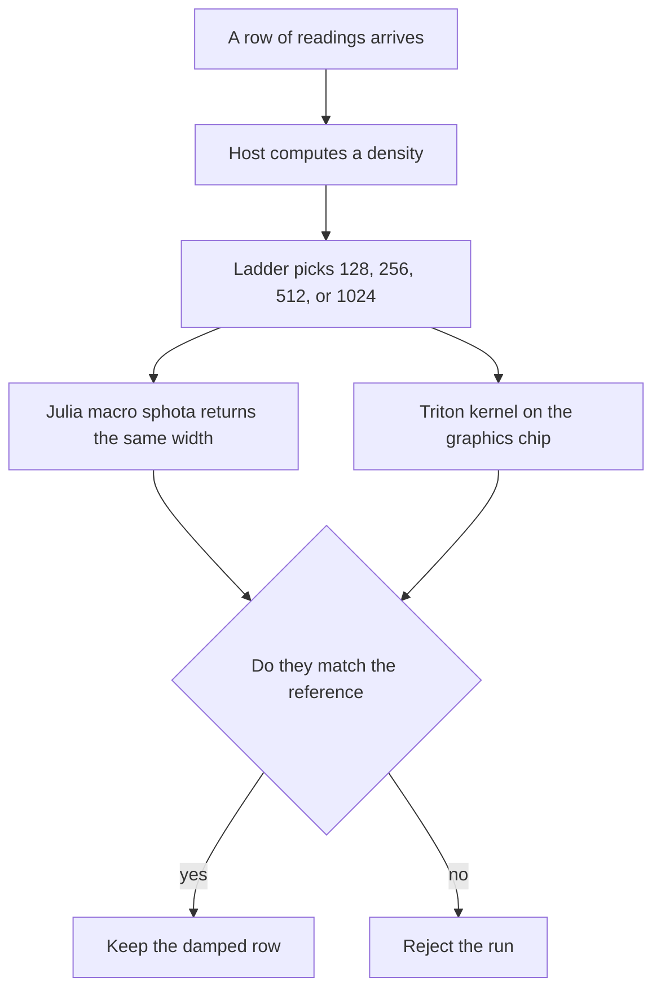
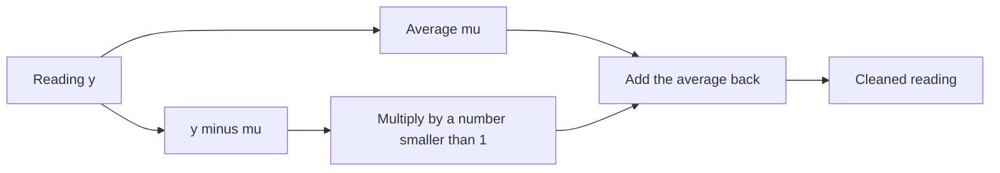
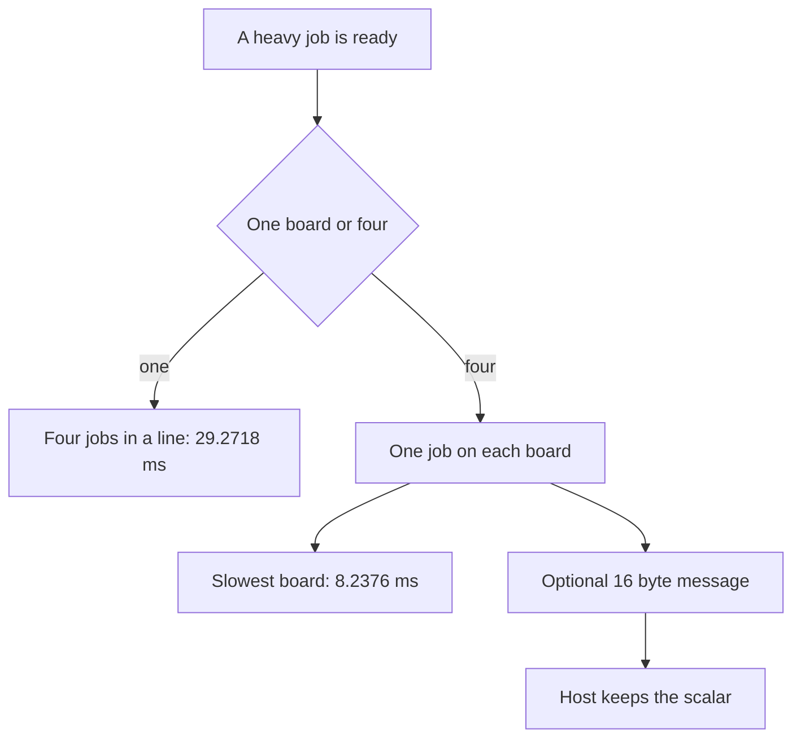
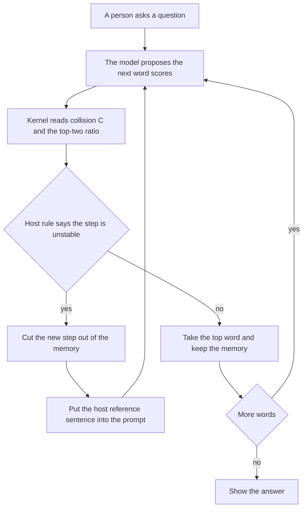

# Patent specification with worked flowcharts

Ceraph Corporation, Kerala, India. Draft for counsel, 15 November 2026. Not a filed application. chief@ceraphco.com. www.ceraphco.com.

This note explains the measured system in short sentences and in charts. Where a person asks a question, the chart starts there. Where the input is a row of readings, the chart starts at the reading. Numbers are from `benchmarks/rtx_pro_6000_blackwell/hardware_tensor_telemetry.json`, the 14 November exam files, the 15 November fair four-board file, and the L4 notebook log.

## What the system is

A computer keeps a local average of a series and multiplies only the departure from that average by a shrinking factor. A schedule picks how wide a tile the graphics chip should use. A second program must agree before the result is kept. Four chips each do their own heavy job. A short message of 16 bytes can move between them instead of the whole series.

A separate program, logged on one NVIDIA L4, reads the next-word scores of a text model. It computes a collision number and a peak-to-mean ratio. If the host rule says the step is bad, it cuts those new scores out of the sentence memory and continues from a reference sentence the host already holds.

## Chart 1. A row of readings

The damped value is the local average plus the departure times e to the power of minus lambda times a local instability. On synthetic seed 11 that error is 1.4723521 and 1.4723523 across a shift of 5. The map that multiplies the whole row is 0.7735443 before the shift and 18.1708527 after it.

## Chart 2. The center stays, the wiggle shrinks

## Chart 3. Four boards

One board in the five-minute exam: 137.2839 jobs a second. Four boards: 549.1516. Peak temperatures 48, 47, 48, and 47 degrees Celsius. Mean draw about 279 to 283 watts on a 600 watt limit. At 50 million numbers, 1,459.0872 gigabytes a second, 91.3643 percent of the stated peak.

## Chart 4. A person asks a question

This chart is the L4 notebook. It starts at the question. The reference sentence is already in the host. The graphics chip in that log is an L4, not one of the four Blackwell boards.

The last logged suite on that L4 says:

- Test 1. 17.64 words a second. Four noise steps blocked. At word 08 the log names ` lower` against ` higher`, collision 0.226, ratio 1.13. The printed sentence contains 2,200 W/(m·K) and about 400 W/(m·K). Those numbers are in the reference the cell supplies.
- Test 2. 19.08 words a second. Four noise steps blocked. Collision 0.405, ratio 1.45.
- Test 3. 11.95 words a second. Eight noise steps blocked. Collision 0.423, ratio 1.45. The printed text gives Mercury 88 days and Venus 225 days, then calls 137 days Mercury’s period.
- The same notebook without the memory cut repeats words on two answers.
- An ungated perturbed run prints 16.84 words a second and still says diamond’s conductivity is lower than copper’s.

A fused-kernel cell on that L4 prints 0.1158 milliseconds, with Shannon index 0.4872, collision 0.0302, and signal ratio 4.61. An earlier batch of 32 prints 0.0884 milliseconds, 2.76 microseconds per row, and 819.94 gigabytes a second on that cell’s own byte count.

## Chart 5. What we do not draw as finished

Question-and-answer sheets on the Blackwell boards did not give this governor a passing score as a judge of true and false sentences. Hidden-state scores never crossed 0.20. A phase-velocity cutoff at 0.05 erased right answers. An entropy cutoff at 0.50 followed the way the question was phrased. A twelve-item audit removed three wrong answers and also removed a correct “Pacific Ocean.” Public quizzes did not improve. Those sheets are not drawn here as a working filter. They are the reason claim language about false sentences is withheld.

## Claims counsel can start from

1. Select a tile width from a density. Compute the center-keeping map on the host and in a graphics kernel. Keep the result when they agree.

2. The map is the average plus the departure times a shrinking exponential. A uniform shift leaves the recorded flux error at 1.4723521 and 1.4723523.

3. Flip a float32 sign bit with exclusive-or 0x80000000 and average the pair. The telemetry file records variance 2.4656 to 0.0 in 10.1 milliseconds on 5,000,000 states, residual 0.0.

4. Give each of several graphics processors its own job. Pass 16 bytes, not the series. The file records 319,999,984 bytes not sent.

5. Optionally, reduce one row of next-word scores to a collision and a peak ratio, cut a rejected step out of sentence memory, and continue from a reference the host already holds. This is the L4 notebook. It is an embodiment of a control step. It is not a claim that the chip discovered a physical constant.
