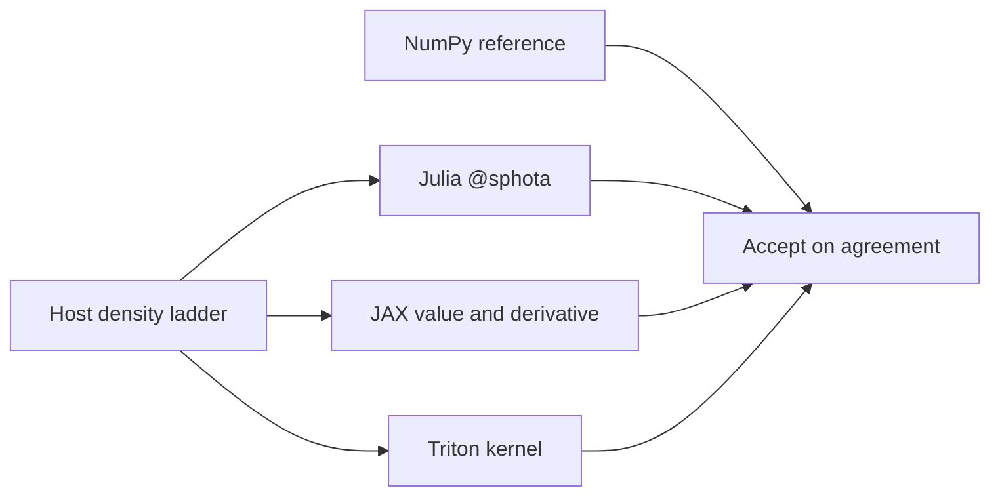
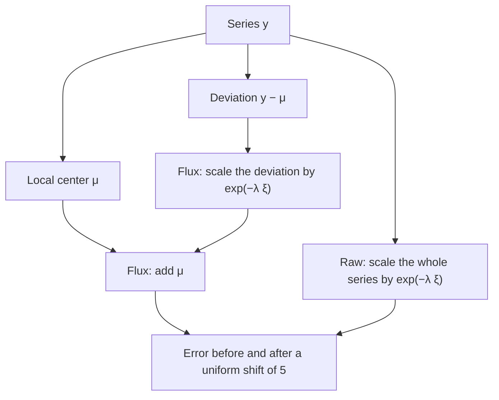
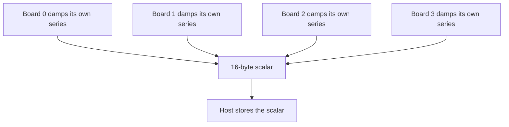
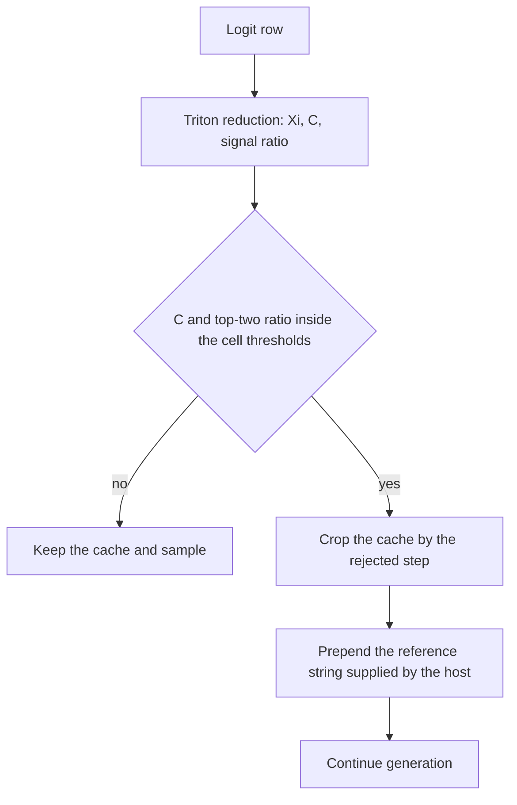

# Simplified specification note

Ceraph Corporation, Kerala, India. Draft for counsel, 15 November 2026. Not a filed application. chief@ceraphco.com. www.ceraphco.com.

Figures are the values in `benchmarks/rtx_pro_6000_blackwell/hardware_tensor_telemetry.json`. Token-level abstention is not claimed.

## Field

A method and system for damping a numerical series on a graphics processor, scheduling the launch width on the host, and passing a scalar between processors instead of the series.

## Pipeline

The scored path has four stages.

1. A host program computes a density and selects a block width from a fixed ladder: 128 below 0.5, 256 below 1, 512 below 2, otherwise 1024.
2. Julia, through the macro `@sphota`, returns the same width.
3. JAX on CUDA computes the map and a directional derivative.
4. A Triton kernel computes the map from tensors resident on the graphics processor.

NumPy is the reference. A run is accepted when the width and the kernel agree with that reference. Design notes use the words intent and bias for host-side inputs. Those words are not separate entries in the telemetry file.



## Center-preserving flux map

```
A(y) = μ + (y − μ) exp(−λ ξ)
```

μ is a local center. The deviation from that center is scaled. A comparison map multiplies the whole series. Across a uniform shift of 5, the flux errors in the file are 1.4723521 and 1.4723523. The comparison map is 0.7735443 before the shift and 18.1708527 after it.



At 50,000,000 nodes and 16 bytes per node, the file records 1,459.0872 GB/s, 91.3643 percent of the stated peak, median 0.5483 ms.

## Sign-bit negation

A float32 sign bit may be inverted by an exclusive-or with 0x80000000. The synthesis used with that negation is one half of the value plus its sign-flipped copy. The telemetry block for 5,000,000 states records variance 2.4656 before that override and 0.0 after it, in 10.1 ms, with a sign-bit residual of 0.0. The labelled exam recorded the same residual, 0.0, on each of four boards. A pre-declared bar that flux retain at most half the variance was missed. Remaining fractions were 0.5149549, 0.5176691, and 0.5095068.

## Sixteen-byte message

One board is recorded at 137.2839 jobs per second. Four boards are recorded at 549.1516 jobs per second. Four heavy jobs together took 8.2828 ms. The same four queued on one board took 29.5101 ms.

A repeat on 15 November, compiled on all four boards before the clock, queued four jobs of 16,777,216 values and 40 passes in 29.2718 ms. The slowest board clock during the concurrent run was 8.2376 ms. The wall clock around the host threads was 11.7879 ms.

The sync record transferred 16 bytes and left 319,999,984 bytes off the bus relative to a full reduction of its buffers. The bandwidth stored with that message is 54.58 GB/s.



Peak temperatures in the file are 48.0 °C, 47.0 °C, 48.0 °C, and 47.0 °C. Mean draw is 279.2437 W, 283.3406 W, 279.0838 W, and 276.8883 W, against a 600 W limit.

## Embodiment: in-SRAM logit telemetry and a cache crop

A notebook on one NVIDIA L4 runs a Triton kernel that, in one launch, reduces a logit row to a stability coefficient, a collision concentration C equal to the sum of squared probabilities, and a scale-invariant signal ratio (maximum minus mean) divided by the standard deviation. The cell that names this the fused v4 kernel prints 0.1158 ms, Ξ 0.4872, C 0.0302, and signal ratio 4.61. An earlier batch sweep on that machine prints 0.0884 ms at batch 32, which is 2.76 µs per sequence, and 819.94 GB/s on that cell’s byte count. Those prints are L4 prints. They are not the 1,459.0872 GB/s Blackwell roofline, and the block ladder 128, 256, 512, 1024 was scored on the flux kernel, not on this logit kernel.

The same notebook’s last logged suite crops the key-value cache by the negative of the tokens appended in a rejected step. It records three tests with injected logit noise of standard deviation 11.5. The log lines say 4, 4, and 8 noise steps blocked. Test 1 names a rollback at token 08 between ` lower` and ` higher`, C 0.226, ratio 1.13, at 17.64 tok/s, and the printed sentence contains 2,200 W/(m·K) and about 400 W/(m·K). The reference sentence is supplied by the cell. Test 2 is 19.08 tok/s with C 0.405 and ratio 1.45. Test 3 is 11.95 tok/s with C 0.423 and ratio 1.45. A prior cell without the crop repeats tokens on two of three answers. An ungated perturbed loop in an earlier cell prints 16.84 tok/s and still says diamond has a lower thermal conductivity than copper.



## Draft claims, for counsel to rewrite

1. A method comprising: determining a density of a numerical series; selecting a block width from a fixed ladder according to that density; computing a damped series in a host program and in a graphics-processor kernel launched at that width; and accepting the result when the computations agree with a reference within a predetermined tolerance.

2. The method of claim 1, wherein the damped value is a local center plus the deviation from that center multiplied by an exponential of a negative constant times a local instability, and wherein a uniform shift of the series leaves that error at 1.4723521 and 1.4723523 in the recorded synthetic test.

3. The method of claim 1, further comprising inverting a sign bit of a float32 value by an exclusive-or with 0x80000000 and forming one half of the sum of the value and that negation.

4. The method of claim 1, wherein a plurality of graphics processors each receive an independent job, and a message between processors carries a scalar state of 16 bytes rather than the series.

5. A method comprising: in a graphics-processor kernel, reducing one logit row to a stability coefficient, a sum of squared probabilities, and a ratio of the peak-to-mean gap over the standard deviation; when a host rule marks that row rejected, cropping a key-value cache by the length appended in that step; and continuing generation from the cropped cache.

Claim 5 is the L4 notebook’s governor. The conductivity sentence in that notebook is text the host supplied and the log then printed. Claim 5 does not assert that the kernel measured a physical conductivity, and it does not assert the four-board flux timing.
