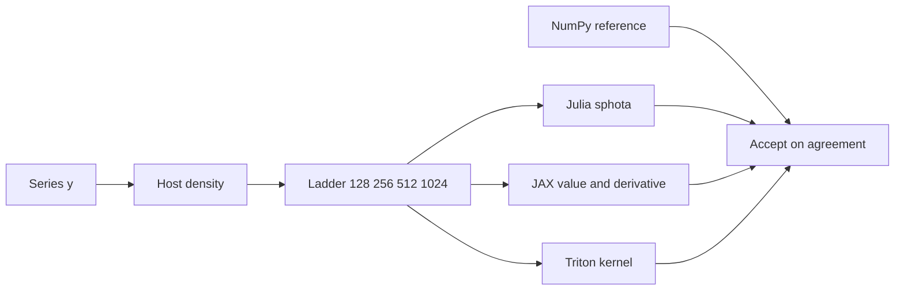
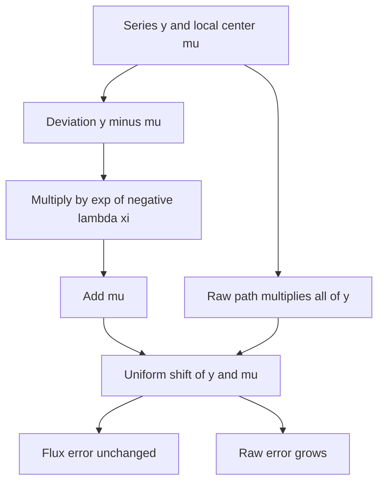
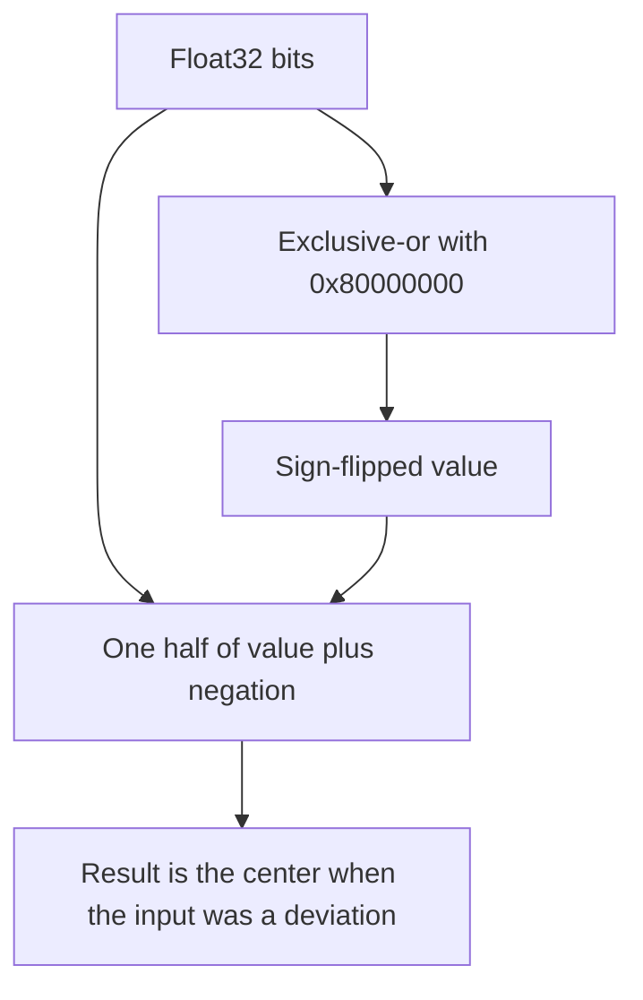
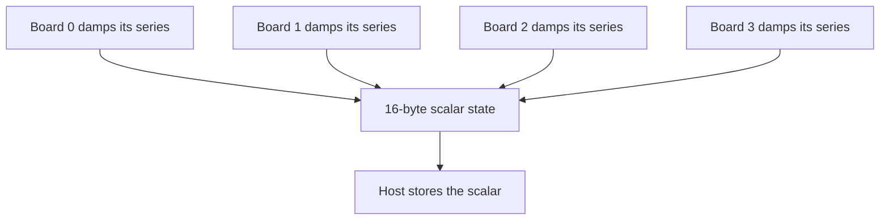
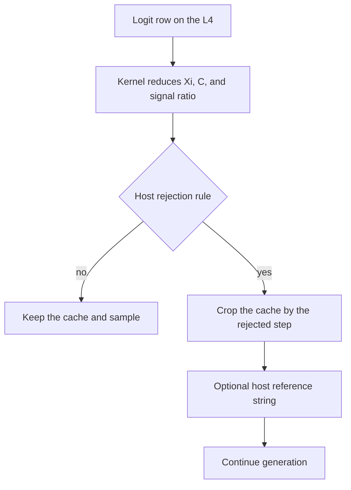

# Provisional patent application

Draft for counsel. Not a filed application. Not legal advice.

Applicant: Ceraph Corporation, Kerala, India. Correspondence: chief@ceraphco.com. www.ceraphco.com.

Inventor, as named by the company for this draft: Hari Krishna. Counsel should confirm the legal name, address, citizenship or residency as the office requires, and the assignment into Ceraph Corporation before filing.

Title: Center-preserving damping of a numerical series on a graphics processor, including a density-selected launch ladder, agreement across more than one runtime, sign-bit synthesis of a deviation, and a scalar message between processors, together with the omega-dit cancellation chain disclosed below.

Date of this draft: 15 November 2026. The enabling measurements cited as the labelled exam were taken on 14 November 2026. A fair repeat of the four-board heavy clock was taken on 15 November 2026.

## How to read this draft

Two bodies of text are combined here because the inventor asked that the provisional disclose the SRI architecture, also called omega-dit, in full.

The first body is what the labelled-exam files record on NVIDIA RTX PRO 6000 Blackwell Server Edition boards. Those files are the examples. A claim that needs a number should take the number from those files, or from the 15 November fair-clock file, or from the L4 notebook log where the claim is the logit governor.

The second body is the November 2026 full technical specification of the Singularity-based Realization Interface. That specification states further equations, a peak variance reduction of 958,874 times at a noise standard deviation of 1,000, a median latency of about 0.0117 to 0.0125 milliseconds, a cosine similarity of at least 0.979, a residual estimator at 93.94 percent mean-squared-error reduction, and a locked 0.0120 milliseconds over more than 1,600 samples. Those figures are disclosed here as the inventor’s specification states them. They are not fields of the labelled-exam JSON. Counsel should not recite them as the 14 November exam. If they are to be examples, the inventor must produce the telemetry that supports them, under the same protocol as the labelled exam, before they are written into a specification as measured results.

A later set of language-model sheets is disclosed so that the application is not later accused of hiding a negative result. Those sheets do not establish that the method detects a false sentence. They should not be an independent claim of semantic filtering.

## Cross-reference to related applications

None is identified in this draft. Counsel should search the inventor’s earlier notebooks, Colab records from March through July, and any public repository commits before the filing date, and should consider whether any of that material is a prior disclosure by the inventor. This draft does not assert a priority date.

## Field of the invention

The invention relates to numerical processing on graphics processors. More particularly, it relates to damping a series while preserving a local center, choosing a launch width from a density of instability, checking the same map in more than one programming runtime, negating a floating-point deviation by its sign bit, and passing a scalar state between processors instead of the series. A further embodiment reduces a row of logits inside a kernel and, on a host rejection, crops a key-value cache before generation continues.

## Background

A common way to quiet a noisy series is to multiply every sample by a factor smaller than one. If the samples sit far from zero, that multiplication moves the level itself. On a temperature record the level is the information. A method that pulls a day near 11 °C toward zero, and then pulls a day near 16 °C even farther in error, has damped the wrong object.

A second practice, in language-model serving, is to generate a token and then erase it if a later filter dislikes it. Erasure spends memory traffic after the wrong token has already been written into a cache. The present disclosure includes an algebra that cancels a supplied deviation before an average is stored, and a separate, logged governor that crops a cache when a host rule rejects a step. The disclosure does not assert that either practice has been shown to know which English sentence is false.

Graphics processors of the class used in the examples are memory-bandwidth devices. At short lengths the launch of a kernel dominates the clock. At long lengths the clock follows the bytes moved. A specification that quotes only the short-length median will mislead. This draft quotes both.

When several such processors are present, copying an entire series across the bus in order to reduce it is expensive. A message that carries a scalar state, on the order of 16 bytes in the recorded cell, leaves the series on the processor that owns it. That cell’s bandwidth figure is not the bandwidth of the long series traversal. Both are disclosed, and they are not added.

## Summary

In one aspect, a host computes a density of a numerical series and selects a block width from a fixed ladder. A reference implementation and a graphics-processor kernel compute a damped series. The damped value is a local center plus the deviation from that center, multiplied by an exponential of a negative constant times a local instability. The result is accepted when the kernel agrees with the reference within a predetermined tolerance. A second runtime may select the same block width. A third runtime may check a directional derivative of a comparison map.

In another aspect, a uniform shift of the series and of the center shifts the damped series by the same constant, so the error does not grow with the shift. A comparison map that multiplies the whole series does not have this property unless the exponential factor is one.

In another aspect, a float32 sign bit is inverted by an exclusive-or with the constant 0x80000000, and a synthesis forms one half of the sum of a value and that negation. When the negated object is a deviation from a center, the synthesis returns the center.

In another aspect, several graphics processors each receive an independent job of the same class, and a message among them carries a scalar state rather than the series.

In another aspect, disclosed as a distinct embodiment and not as a measurement of the flux roofline, a kernel reduces one logit row to a stability coefficient, a sum of squared probabilities, and a ratio of a peak-to-mean gap over a standard deviation. When a host rule rejects the step, a key-value cache is cropped by the length appended in that step, and generation continues. In the logged notebook the continuation may prepend a reference string supplied by the host.

The omega-dit chain disclosed below is the inventor’s algebraic account of the same cancellation: a structural part, a residual, a conjugation implemented as the sign-bit operation, an antithesis, and a projector whose result is the structural part when the residual is exactly negated.

## Brief description of the drawings

The drawings are flow diagrams. They are not photographs of a chip.

Drawing 1. From a series to an accepted result: density, ladder, three runtimes, reference, acceptance.

Drawing 2. Flux against raw damping, including a uniform shift.

Drawing 3. Sign-bit synthesis.

Drawing 4. Four processors, a scalar message, and the host.

Drawing 5. Logit reduction, rejection, cache crop, and continuation. This drawing is the L4 embodiment. It is not a drawing of the four-board flux timing.











## Detailed description

### Definitions

A series is a finite sequence of floating-point values. In the preferred examples the format is IEEE-754 binary32, called float32 in the notebooks.

A local center, written μ, is a value that represents the level of a neighborhood. In the flux examples it is a local mean, or a center otherwise supplied with the series. The method does not require the center to be a mean. It requires that the same center be used for the deviation and for the add-back, and that a uniform shift of the series be applied to the center as well when the shift-identity is relied upon.

A local instability, written ξ, is a non-negative measure of how wild that neighborhood is. In the scored tests it is derived from the neighborhood and is held fixed for a given evaluation. The constant λ is positive. In every scored test λ was 1.

Density, for the ladder, is the mean of the absolute instability over the series being scheduled.

A block width is the launch tile. The preferred ladder is: width 128 when density is below 0.5; width 256 when density is below 1; width 512 when density is below 2; width 1024 otherwise.

A gate predicate, scored separately from the ladder, is true when a stability index is at least 0.20. At 0.05 the labelled cases were closed. At 0.20 and at 0.80 they were open. The predicate tells the host whether a launch is specified. It is not, by itself, a classifier of sentences.

Agreement means that a candidate output matches a reference within a tolerance fixed before the run. For the Triton-versus-flux check the recorded residual was about 4.8×10⁻⁷. For the forty-pass closed form the one-board maximum absolute difference was 9.5×10⁻⁷ and the four-board figure on board 0 was 1.2×10⁻⁵, inside a pre-declared bar of 1×10⁻⁴. For the sign bit and for the directional derivative the recorded residual was 0.

### The flux map

The preferred damping map is

```
A(y) = μ + (y − μ) exp(−λ ξ)
```

The comparison map, used to show what the invention is not, is

```
R(y) = y exp(−λ ξ)
```

If y and μ are replaced by y + c and μ + c,

```
A(y + c) = μ + c + (y − μ) exp(−λ ξ) = A(y) + c
```

whereas

```
R(y + c) = (y + c) exp(−λ ξ) = R(y) + c exp(−λ ξ)
```

which equals R(y) + c only in the trivial case exp(−λ ξ) = 1. The error of A against a shifted target therefore does not change with c. The error of R does.

Forty iterations of A at a fixed center and a fixed ξ collapse, by algebra, to

```
A_40(y) = μ + (y − μ) exp(−40 ξ)
```

A kernel that performs forty passes is checked against this closed form. The check is an algebraic check of the kernel. It is not a claim that forty passes are required in a product.

The directional derivative used as a JAX check on the raw map is

```
dA = exp(−λ ξ) dθ − λ θ exp(−λ ξ) dξ
```

The residual of that check on the labelled exam was 0.

### The ladder and the three runtimes

The host computes the density and selects the width. A Julia program, through the macro `@sphota`, returns a width. A Python twin returns a width. On the labelled densities 0.30, 0.79, 1.50, and 7.06 the widths were 128, 256, 512, and 1024, and the two programs agreed.

JAX, on CUDA in the one-board stack, computes the map and the directional derivative. Triton computes the map from tensors resident on the graphics processor. NumPy is the reference. A hybrid acceptance rule keeps a run when the installed tiers agree with that reference. A machine that does not have Julia or JAX installed cannot score those tiers. The one-board exam had them. A later fair-clock machine was scored on the Triton timing, not on a fresh Julia agreement.

On one million random points the block sweep in the exam gave 0.0157 ms at width 128, 0.0120 ms at 256, 0.0131 ms at 512, and 0.0116 ms at 1024. The ladder chose 256 because the mean instability of that draw was below 1. The pre-declared question was whether the chosen width was within 10 percent of the fastest width. It was, by about 3.6 percent. The question did not require the ladder to be the fastest width. At these short lengths the differences are launch noise as much as arithmetic. The ladder’s job is a stable, agreed choice, not a claim of optimality at every length.

### Example 1: synthetic series, seed 11

Eight thousand one hundred ninety-two points. Flux error 1.472352147102356 and, after a uniform shift of 5, 1.4723522663116455. Raw error 0.7735443115234375 before the shift and 18.170852661132812 after it. On this series the fraction of variance remaining after flux was about 0.117, which does meet a bar of one half. The same bar on the thermometer in Example 2 does not. Both examples are part of the disclosure. A claim that says “at most half the variance on every series” would be broader than Example 2.

### Example 2: Melbourne daily minimum temperature

The series is the daily minimum temperature in Melbourne, 3,650 days beginning 1 January 1981, the first recorded value being 20.7 °C. The recording is treated as the latent series. The notebook added sensor noise of 0.5 °C and a 10 percent glitch so that the error had a known target. Seeds 11, 22, and 33 were fixed before the score.

Flux error, seed 11: 5.818975925445557 at the original offset and the same figure after a shift of +5 °C. Raw error: 135.7728271484375, then 266.6606750488281. A moving-average error on that seed was 5.8973565101623535. The untouched error was 7.23558235168457. Seeds 22 and 33 gave flux errors 5.874 and 5.820 in the memorandum’s rounding, likewise unchanged by the shift, with raw error rising from about 135 to about 266.

Variance remaining under flux, the three seeds: 0.5149548649787903, 0.5176690816879272, and 0.5095068216323853. A pre-declared bar of 0.5 was missed. The invention’s deployable statement on this example is preservation of the center under the shift, not the half-variance bar.

### Example 3: same input, closed form, glitch screen

The same input presented twice produced a drift of 0. The forty-pass kernel matched the closed form within 9.5367431640625×10⁻⁷ on one board and within 1.2×10⁻⁵ on board 0 of the four-board machine.

A glitch screen used 24 clean windows and 24 copies carrying a spike of 8 standard deviations on 15 percent of each window. A window was called a glitch when its z-scored variance exceeded 4, a rule fixed in advance. All 24 spiked windows fired and none of the clean windows did. Precision, recall, and F1 were 1.0. The spikes were gross by construction. This example shows a variance predicate on a declared spike. It is not an example of sentence classification. No language model was loaded in the labelled exam.

### Example 4: fused kernel and endurance

On the tiled thermometer, length 16,777,216, 40 passes, block 1024, the fused Triton kernel took 7.377632141113281 ms and the eager loop took 17.1342716217041 ms.

One board, five minutes: 41,186 jobs in 300 seconds, 137.28391742259728 jobs per second. Mean draw 314.53055 W, peak 326.608 W, temperature from 32 °C to 44 °C, clock 2302 to 2317 MHz, occupancy 98.55 percent. Values remained finite. An earlier random-series burn in the same notebook, block 256, finished 41,097 jobs at about 137.0 per second, mean 288.6 W, 30 °C to 42 °C. The real series chose the wider block and drew more power. Both stayed under the 600 W nameplate. The nameplate is not a target and is not a measurement of work.

### Example 5: four boards

Four RTX PRO 6000 Blackwell Server Edition boards, each reported at 97,887 MiB. The heavy random job, length 16,777,216, 40 passes: 164,748 jobs in 300 seconds, 549.1516376799458 per second, which is 4.00 times the one-board rate of the same class of job. Mean draw per board 279.24365 W, 283.34055 W, 279.0838 W, and 276.8883 W. Peaks 300.458 W, 303.782 W, 304.733 W, and 304.319 W. Peak temperatures 48 °C, 47 °C, 48 °C, and 47 °C. Clocks up to 2422 MHz. Cluster mean on the order of 1,119 W. The memorandum computes energy on the order of 2,037 millijoules per job for the cluster accounting it uses, and on the order of 2,291 millijoules per job for the one-board thermometer burn. Those figures are power integrated by the host’s sampling, not a Landauer accounting.

Queued on one board, four heavy jobs: 29.510108000067703 ms. Together, one job per board, buffers already resident: 8.282783000026939 ms. The ratio is about 3.56 on one wave. The five-minute rate ratio is 4.00. A product claim should say which clock it means.

On 15 November 2026 the same heavy size was timed again after the kernel had been compiled on all four boards. Queued: 29.27183961868286 ms. Slowest board, by CUDA event: 8.237631797790527 ms. The four event clocks were 7.487936019897461, 8.237631797790527, 7.917215824127197, and 7.498591899871826 ms. The wall clock around the host threads was 11.787933999812594 ms and includes the join. Outputs were finite. A pass rule that the slowest board be under three quarters of the queued time was met. An earlier clock that included allocation and compilation on boards 1, 2, and 3 was not met: queued 29.173471927642822 ms and together 38.13713599993207 ms. That attempt is disclosed so the fair clock is not confused with setup.

The stacks differed by machine. The one-board exam used PyTorch 2.14.1, CUDA 13.0, Triton 3.8.0, and JAX 0.12.0.1. A companion four-board suite used PyTorch 2.15.0, CUDA 13.2, and Triton 3.9.0. The fair clock of 15 November was run in an environment where torch 2.14.1 with CUDA 13.0 was installed because a requested 2.15.0 build was not on that wheel index. Counsel need not recite the wheel index. Counsel should recite that the fair clock excluded compilation.

### Example 6: roofline and the scalar message

At 50,000,000 nodes, counting 16 bytes per node, one board: median 0.54828799 ms, 1,459.0872277590881 GB/s, 91.36425972192163 percent of a stated peak of 1,597 GB/s. A twelve-byte count that omits the store is 1,094.3154208193162 GB/s. The sixteen-byte count is the one that includes the write. Board 0 of the four-board machine: 0.54915202 ms, 1,456.791518121417 GB/s, 91.22050833571804 percent.

A different cell transferred 16 bytes and recorded 319,999,984 bytes not sent, relative to a full reduction of its buffers. Kernel time in that cell 17.5875 ms. Scalar sync 3.7208 ms. Bandwidth stored with that message 54.58 GB/s. Nodes per graphics processor in that record 20,000,000. This 54.58 GB/s is not the 1,459.0872 GB/s of Example 6’s first paragraph. The invention’s point about the message is that the series stays on the processor that owns it. The invention’s point about the roofline is how fast one processor reads and writes the series. There is no NVLink measurement in these files. The boards in the examples are on PCIe. A claim should not say NVLink.

Short lengths in the roofline sweep sit near a hundredth of a millisecond because the launch dominates. A March notebook figure of 0.2379 ms was a budget typed into a cell, not a measured median of the 50-million-node run. Later medians near 10,000 points sit around 0.012 ms and are launch-bound. Flatness at short length is not flatness at 50 million nodes, where the median is 0.548 ms.

### Example 7: sign-bit synthesis

A float32 value is bitcast to an unsigned 32-bit integer, exclusive-ored with 0x80000000, and bitcast back. The sign bit flips. The residual of that negation against unary minus, on the labelled exam, was 0.0 on each board that was scored. An implementation that uses a signed 32-bit integer for the constant 0x80000000 overflows. The enabling code uses an unsigned integer.

The synthesis used with that negation is

```
Υ = ½ (x + C(x))
```

where C is the sign-bit conjugation. If x is a deviation, Υ is 0 for finite float32 values that are not NaN, and the reconstructed series is the center. On 5,000,000 states a telemetry block records variance 2.4656 before this override and 0.0 after it, in 10.1 ms, with a sign-bit residual of 0.0. That block is in the hardware telemetry summary. It is the same operation as the exam’s sign residual of 0.0, on a different length.

This example does not meter joules of bit erasure. Landauer’s bound, k_B T ln 2 per irreversible erasure, is about 2.9×10⁻²¹ joules at 300 K, on the order of 10⁻²¹ joules. It is a reference. The examples do not show that the chip saved that quantity, and they do not show that erasure was avoided in a thermodynamic accounting. They show that a deviation and its sign flip average to the center, in the floating-point format used.

### The omega-dit chain, as the inventor describes it

The November 2026 specification writes a continuous-variable object

```
|Ω⟩ = ∫ σ(t) e^{iβ(t)} [υ(t) + ξ(t)] dω
```

σ is called an existence density, β a geometric phase, υ a structural value, and ξ a residual. The specification’s intent is that the structural value and the residual are retained together until a cancellation step, rather than being irreversibly thresholded first. The repository implements a discrete sum of the same factors. The integral as a continuous physical field was not measured on the boards. The discrete sum is code. Counsel may disclose the integral as the inventor’s mathematical description and should not draw it as an oscilloscope trace.

The specification partitions a space into a structural subspace and a residual subspace. In the scored flux map the structural part is the local center and the residual is the deviation. That is the partition the chips ran. The specification’s notation of orthogonal projectors on a Hilbert space is the inventor’s description of that split. The examples do not include a measured inner product on an infinite-dimensional space.

The cancellation chain, in the specification’s words, is:

Thesis equals υ plus the disturbance.

Conjugation Ĉ_S equals the structural projector minus the residual projector, implemented as the IEEE-754 sign-bit exclusive-or.

Antithesis equals υ minus the disturbance.

The projector Υ equals one half of the identity plus the conjugation.

The final state equals one half of thesis plus antithesis, which equals υ, in one fused multiply-add when the negation is exact.

When both υ and the disturbance are supplied to the program, this is an algebra check, and the residual to the supplied υ is on the order of 10⁻⁷ or smaller in the unit tests of that algebra. When only the series is supplied, the center is estimated. The flux map estimates it as a local mean and damps the deviation by the exponential, which is a soft form of the same split: the center is kept in full, and the deviation is scaled by a factor in (0, 1] rather than being exactly negated, unless a separate synthesis applies the sign-bit average. Both are disclosed. They are not the same knob. Exact sign-bit synthesis removes a centered deviation completely, in float32, which is why the telemetry variance can fall to 0.0. Exponential flux scales the deviation and, on the thermometer, left about half the variance. A claim should say which knob it recites.

### Further equations in the November 2026 specification

Each of the following is disclosed as stated in that specification, with the status a later reader needs.

Entropy. The specification says that driving residual variance toward zero collapses a von Neumann entropy. The examples measured variance remaining and mean squared error. They did not measure a density matrix.

Free energy. The specification writes F = U − T S and says a free-energy proxy falls toward a minimum. The examples did not measure a thermodynamic free energy in joules. Power in watts, in Examples 4 and 5, is electrical draw of the board.

Vocabulary stability. The specification writes Ξ = 1 − Var(logits) / (E[|logits|] + ε). On real logits of Qwen2.5-1.5B this coefficient sat between about −3.55 and −1.81, and a horizon of 0.98 abstained on every one of 20 questions, including correct ones. A different, signed-mean form used in an earlier note produced large positive values on the same logits and did not separate true answers from false ones. The coefficient is disclosed. A claim that it detects falsehood is not supported by those sheets.

Dual circuit. The specification writes

```
χ = λ0 exp(−κ(1 − Ξ)) + Λmax sigmoid(Var / σ² − θ)
```

with constants used in the notebooks λ0 = 10, κ = 0.5, θ = 0.98, Λmax = 50. On a full vocabulary the sigmoid saturates and χ sits near 51 to 52. Multiplying every logit by one factor exp(−χ) does not change which token wins, except when the scale underflows in float32, in which case the text becomes noise. Both behaviors were observed. A block scalar on a logit vector is therefore disclosed as a mechanism that preserves argmax, not as a mechanism that changes a wrong argmax into a right one.

The specification also names, without a separate numerical table in the labelled exam: logit rescaling under damping; a Weber-Fechner logarithmic residual map; two-mode squeezing described as variance redistribution; an inherence consistency check; mirror validation by a complex conjugate, which the code implements as a product of a value with its conjugate; and a fabric Hamiltonian described as a preference that neighboring terms agree in direction. The specification says all eighteen of its equations were numerically verified. This draft can point to residuals for the flux identity, the closed form, the sign-bit average, the ladder, and the derivative. It cannot point to a labelled-exam table of eighteen separate residuals. Counsel should not write “all eighteen verified on the Blackwell exam” unless that table is added to the record.

Residual estimator. The specification says a small convolutional estimator, trained with residual energy plus a structural term, reached 93.94 percent mean-squared-error reduction at noise standard deviation 4, and that the structural term is used in training while the estimator runs from observed data. That percentage is the specification’s percentage. It is not Example 2.

The specification’s peak variance reduction of 958,874 times at noise standard deviation 1,000, the median latency band 0.0117 to 0.0125 ms, the cosine similarity of at least 0.979, and the locked 0.0120 ms over more than 1,600 samples are disclosed in the same way. A short-length median near 0.012 ms is consistent with launch-bound kernels in other notebooks. It is not the 0.548 ms median at 50 million nodes, and it is not the 7.38 ms fused forty-pass kernel. If counsel uses 0.012 ms, the length of the buffer must be in the same sentence.

### Example 8: logit governor on one NVIDIA L4

This example is not a Blackwell board and not the flux roofline.

A fused kernel prints 0.1158 ms, a Shannon-style index 0.4872, a collision C = 0.0302 equal to the sum of squared probabilities, and a signal ratio 4.61, defined as the peak-to-mean gap divided by the standard deviation. A batch sweep on the same class of machine prints 0.0812 ms at batch 1, 0.0814 ms at batch 4, 0.0819 ms at batch 16, 0.0884 ms at batch 32, and 0.2646 ms at batch 64. At batch 32 the cell prints 2.76 microseconds per sequence and 819.94 GB/s on that cell’s byte count. Those gigabytes are not 1,459.

The last logged suite injects logit noise of standard deviation 11.5, crops the key-value cache by the negative of the tokens appended in a rejected step, and inserts a reference sentence the host cell already contains.

Test 1: 17.64 tokens per second, 4 noise steps blocked, rollback at token 08 between the pieces “ lower” and “ higher,” collision 0.226, ratio 1.13. The printed sentence contains 2,200 W/(m·K) and about 400 W/(m·K). Those conductivities are the host’s reference text. The kernel did not measure a conductivity.

Test 2: 19.08 tokens per second, 4 noise steps blocked, collision 0.405, ratio 1.45, a coherent sentence about nitrogen and oxygen in the log.

Test 3: 11.95 tokens per second, 8 noise steps blocked, collision 0.423, ratio 1.45. The text gives Mercury 88 days and Venus 225 days and then calls 137 days Mercury’s orbital period. The governor did not correct that sentence.

Without the crop, an earlier cell repeats a token until the answer collapses, including a run at 18.61 tokens per second. An ungated perturbed loop prints 16.84 tokens per second and still says diamond has a lower thermal conductivity than copper. A gated loop without a successful crop is not a demonstration that the scientific claim was checked.

A margin rule and an entropy rule were also tried on other models and are reported in the next section because they bear on what this embodiment is not.

### Example 9: sentence sheets that are not a claim of filtering

These sheets are disclosed as negative or confounded results.

Instruct Qwen2.5-0.5B and 1.5B, a logit-variance gate: the gated and ungated outputs were identical. The gate condition was not met.

Equation-4 absolute-mean coefficient on 1.5B: about −3.55 to −1.81, a companion χ near 51 to 52, the argmax unchanged on all 20 items. A float32 underflow variant made one item worse, producing the text “Xerion has one moon.” A refuse-at-0.98 rule abstained on all 20.

A margin gate, refuse when the top probability is below 0.40 or the gap is below 0.20, did not separate the items it was hoped to separate. On the Atlantic item the top probability was 0.731 and the gap 0.494. On an invented capital the top probability was 0.669 and the gap 0.500. On Hydrogen the top probability was 0.604 and the gap 0.238. The true element was the less peaked of the three.

Hidden-state layers: coefficients negative, on the order of −0.65 to −2.11, a horizon of 0.20 never fired. Base Qwen2.5-1.5B, few-shot on every item, one board and four boards: 12 correct, 0 wrong, 8 abstentions, gate never fired.

Phase velocity ξ = 1 − cos of the angle between the last two hidden states, horizon 0.05: the rule fired on every row, and 12 correct with 6 wrong became 0 correct with 19 wrong.

Top-10 entropy divided by log(10), horizon 0.50, maximum of the first three tokens, few-shot questions against raw questions: wrong fell from 6 to 0 and correct stayed at 12. First-token values on few-shot prompts were about 0.0624 to 0.3866. On raw prompts they were about 0.6313 to 0.9029. The ocean item in the few-shot frame was the text “Pacific Ocean” at 0.2629, not “Atlantic.” The separation tracks the prompt format.

A dialectical score on 12 items, threshold 0.45: ungated 6 correct, 3 wrong, 3 abstentions; gated 5 correct, 0 wrong, 7 abstentions. Hydrogen was kept at 0.0402. “Pacific Ocean.” became an abstention at 0.9976. An item that was already an abstention was not newly intercepted. TruthfulQA, 100 items: 23 correct with the rule and 23 without. ARC-Challenge, 100 items: 50 without the rule and 44 with it.

No claim below recites semantic hallucination filtering.

### Products named in the specification

The November 2026 specification names an education product and a security product as intended applications of a reliability layer. Those names are intentions. They are not embodiments that were measured on 14 November, and they are not revenue. A claim set should be about the method and the system, not about a product trademark.

### Preferred system

A preferred system comprises a host processor; one or more graphics processors, each with a memory; a scheduler that computes the density and selects the block width; a first program that evaluates the flux map on the host or in a reference library; a kernel that evaluates the flux map in the graphics memory at that width; and a comparator that accepts the kernel output when it matches the reference within the tolerance. Optionally the system includes a second program that returns the same width, a third program that checks the derivative, a sign-bit unit that forms the synthesis, and a messaging path that carries a scalar of 16 bytes. Optionally, and as a separate mode, the system includes a logit kernel and a cache crop.

The graphics processors in the measured examples are RTX PRO 6000 Blackwell Server Edition parts, 600 W nameplate, stated peak 1,597 GB/s. The method is not limited by the claim language below to that part, but the examples are that part, plus the separate L4 example. Enablement is by the equations, the ladder, the tolerances, and the recorded lengths, not by a promise that every future chip will reproduce 91 percent of its own peak.

### Best mode presently known

The best mode presently known to the inventor for the numerical series is the flux map with λ = 1, the ladder 128/256/512/1024 on the stated density cuts, Triton as the kernel, NumPy as the reference, the closed form as the forty-pass check, and the unsigned sign-bit exclusive-or when an exact centered cancellation is required. For a multi-processor timing, compile on every device, warm the kernel, and time the passes with device events. Do not include allocation in the parallel clock. For the logit mode, the best logged behavior on the L4 used a cache crop and a host-supplied reference; without the crop the same notebook collapsed into a repeated token. The inventor does not know a mode that, on the recorded sheets, refuses false answers and keeps true ones.

## What this draft asks counsel not to claim

Do not claim that the method has been shown to stop a language model from stating a false sentence.

Do not claim that half the variance is removed on the Melbourne series. The remaining fractions are about 0.51 to 0.52.

Do not equate 54.58 GB/s with 1,459 GB/s.

Do not state 958,874 times, 93.94 percent, cosine similarity 0.979, or 0.012 ms as the labelled exam.

Do not state a Landauer energy saving as a measured joule quantity.

Do not state that NVLink was measured.

Do not state that the L4 conductivity sentence was measured by the kernel.

Do not adopt, as a fact about Ceraph Corporation’s financing, the specification’s seed range of 7.5 to 10 million US dollars or its Year-1 and Year-3 revenue projections. The company’s planning memorandum uses 1.0 to 2.0 million US dollars, a working figure of 1.25 million, and a design-partner planning figure on the order of 60,000 US dollars a year, all unbooked. Financing is not part of the invention. It is mentioned here only so those sentences are not copied from the specification into a technical exhibit by accident.

## Draft claims

Counsel will rewrite these. They are numbered so the dependencies can be discussed. “Predetermined” means fixed before the scored run, at the tolerances in the examples unless counsel substitutes a broader range the inventor can support.

1. A method comprising: determining a density of a numerical series; selecting a block width from a fixed ladder according to that density; computing, in a reference program and in a kernel on a graphics processor launched at the selected block width, a damped series in which a damped value is a local center plus a deviation from the local center multiplied by an exponential of a negative constant times a local instability; and accepting the kernel output when it agrees with the reference program within a predetermined tolerance.

2. The method of claim 1, wherein the ladder selects 128 when the density is below 0.5, 256 when the density is below 1, 512 when the density is below 2, and 1024 otherwise.

3. The method of claim 1, wherein a second program returns the same block width for a labelled density, and wherein the labelled densities 0.30, 0.79, 1.50, and 7.06 correspond to widths 128, 256, 512, and 1024.

4. The method of claim 1, wherein a uniform shift of the series and of the local center shifts each damped value by the same constant.

5. The method of claim 4, wherein, on a recorded synthetic series, an error of the damped series is 1.4723521 and 1.4723523 across a uniform shift of 5, and an error of a comparison series formed by multiplying the series itself by the exponential is 0.7735443 before the shift and 18.1708527 after the shift.

6. The method of claim 4, wherein, on a recorded daily minimum temperature series, the error of the damped series is unchanged by a uniform shift of 5 °C, and the error of the comparison series increases.

7. The method of claim 1, further comprising repeating the damping with a fixed center for forty passes and accepting the result when it agrees with a closed form equal to the local center plus the deviation multiplied by an exponential of negative forty times the local instability, within a predetermined tolerance.

8. The method of claim 1, further comprising inverting a sign bit of a float32 value by an exclusive-or of the value’s bits with 0x80000000, performed with an unsigned 32-bit representation of that constant, and forming one half of the sum of the value and the inverted value.

9. The method of claim 8, wherein the value is a deviation from a center and the one half of the sum is the center for a finite float32 deviation.

10. The method of claim 1, wherein a plurality of graphics processors each execute an independent damping job, and a message among the processors carries a scalar state of 16 bytes rather than the series.

11. The method of claim 10, wherein four such jobs are timed after compilation on each processor, and the device-event time of the slowest processor is less than the time of the four jobs executed in sequence on one processor.

12. The method of claim 1, further comprising checking a directional derivative of a comparison map in a further runtime and accepting the check when a residual against an analytical derivative is within a predetermined tolerance.

13. A system comprising a host and at least one graphics processor, the host configured to perform the density and ladder steps of claim 1 and the graphics processor configured to perform the kernel step of claim 1.

14. The system of claim 13, wherein the graphics processor is an RTX PRO 6000 class processor and, at 50,000,000 nodes counted at 16 bytes per node, a median traversal is about 0.548 ms and about 1,459 GB/s.

15. A method comprising: in a graphics-processor kernel, reducing one row of logits to a stability coefficient, a sum of squared probabilities, and a ratio of a peak-to-mean gap to a standard deviation of the row; when a host rule marks the row rejected, cropping a key-value cache by a length appended in that step; and continuing generation from the cropped cache.

16. The method of claim 15, further comprising prepending a reference string supplied by the host after the crop.

17. The method of claim 15, wherein the kernel and the crop are performed on a processor other than the processor that performs the flux traversal of claim 14, and wherein a bandwidth printed for the logit kernel is not a bandwidth of the flux traversal.

Claim 14 is an example-bound system claim. If counsel prefers a claim that will survive a different chip, claim 14 should be narrowed to “a bandwidth within a predetermined fraction of a stated peak of that processor, at a length where the traversal is not launch-bound,” and the 91 percent figure should move to the specification. Claim 5’s many digits are fingerprints of the recorded file. Counsel may replace them with “about 1.472 across the shift, against a comparison error that increases by more than an order of magnitude,” if the fingerprint is not wanted in the claim.

No claim recites a language model’s correctness.

## Abstract

A numerical series on a graphics processor is damped by keeping a local center and scaling only the deviation from that center by an exponential of a negative constant times a local instability. A host selects a launch width from a density ladder. A reference program and the processor kernel must agree. A uniform shift of the series shifts the damped series by the same amount, so the error does not grow with the level of the reading. A float32 sign bit may be flipped by an exclusive-or and averaged with the original deviation to recover the center. Several processors may each damp an independent job and exchange a scalar state instead of the series. A separate mode reduces a logit row and crops a key-value cache when a host rule rejects a step. Measured examples include a temperature series whose damped error was unchanged by a five-degree shift, a fused kernel faster than an eager loop, and four processors finishing four times as many heavy jobs over five minutes, with one pre-declared variance bar missed and reported.

## Information the inventor should confirm before filing

Counsel should obtain: the legal name and address of the inventor; the assignment; a list of every public disclosure, including notebooks, the repository, and this draft’s own earlier PDFs if they were published; the exact files to be deposited as exhibits, including the labelled-exam JSON, the fair-clock JSON, the hardware telemetry summary, and, if the logit claims are filed, the L4 notebook or its log; and a decision on whether the November 2026 specification’s 958,874-times figure will be supported by a deposit or omitted from examples.

The inventor’s present instruction, reflected in this draft, is that the sentence-filter is not the invention being offered, and that the omega-dit algebra is offered as the mathematical description of the cancellation, with the measured examples limited to the files.

## Closing line for the specification, if counsel wants one sentence

The level of the reading is kept. What is reduced is the departure from that level, and only to the degree the chosen map and the recorded example actually reduce it.
