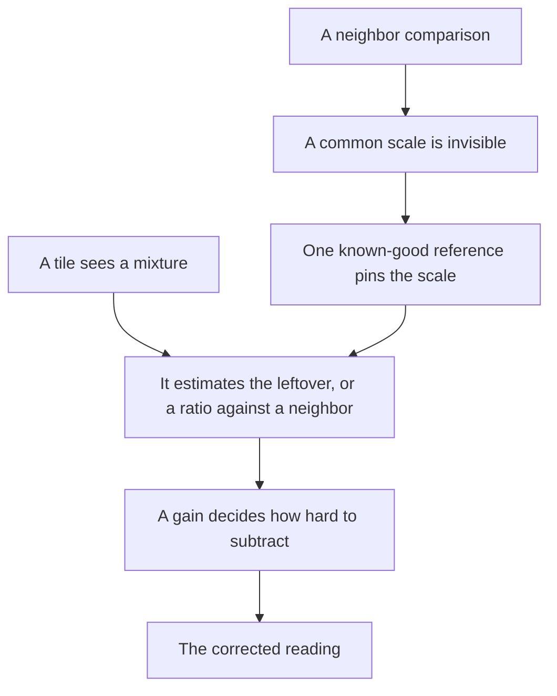
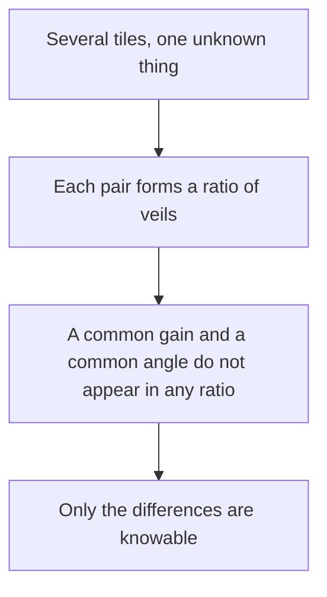
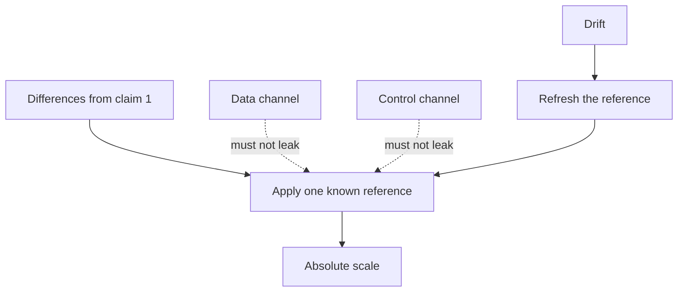
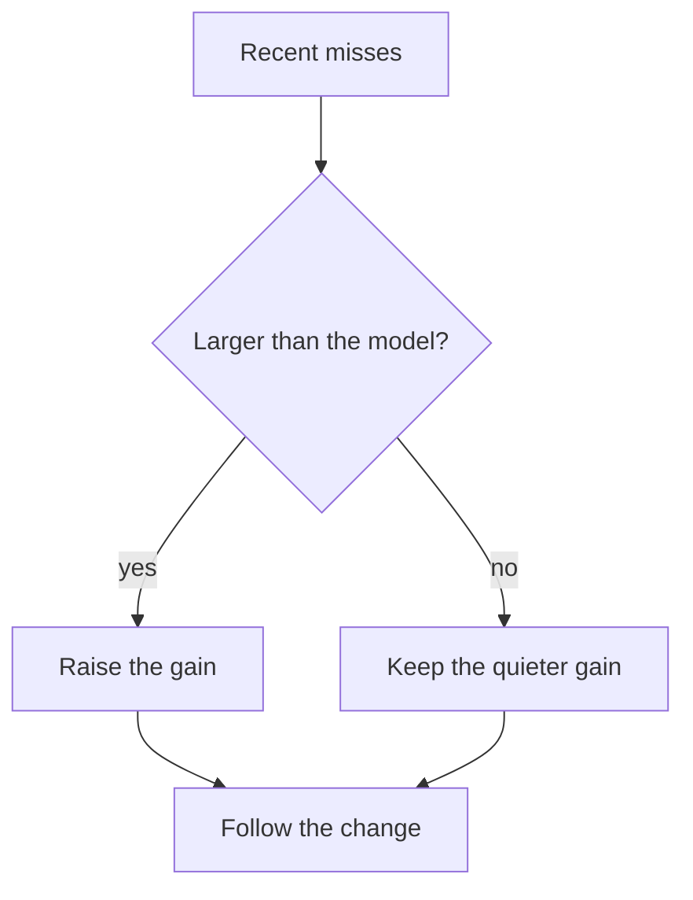
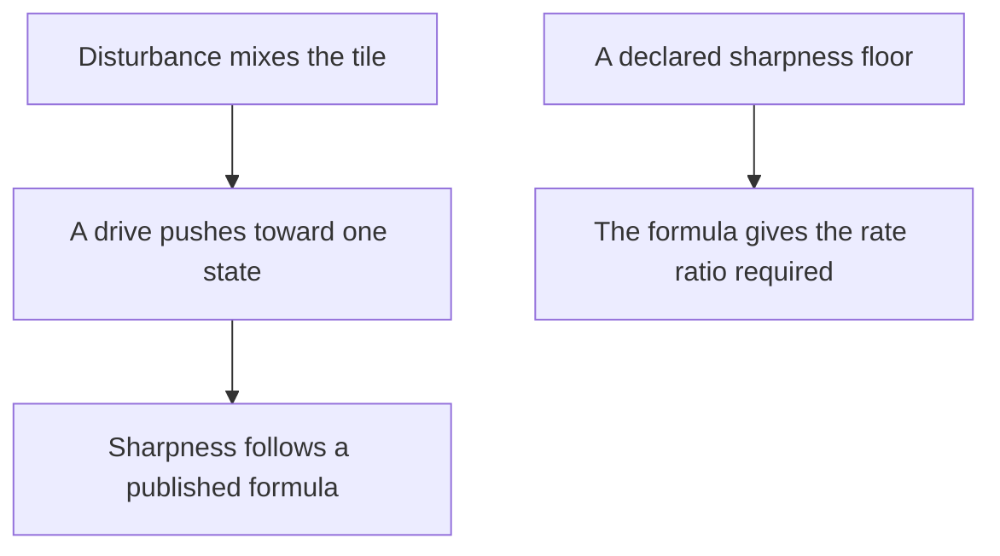
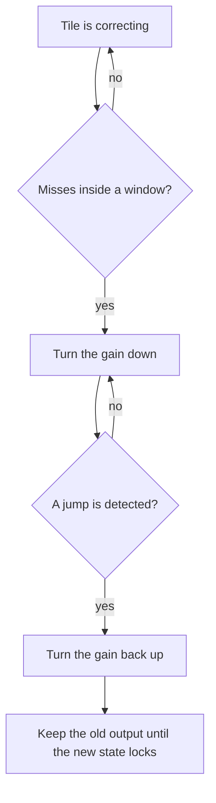
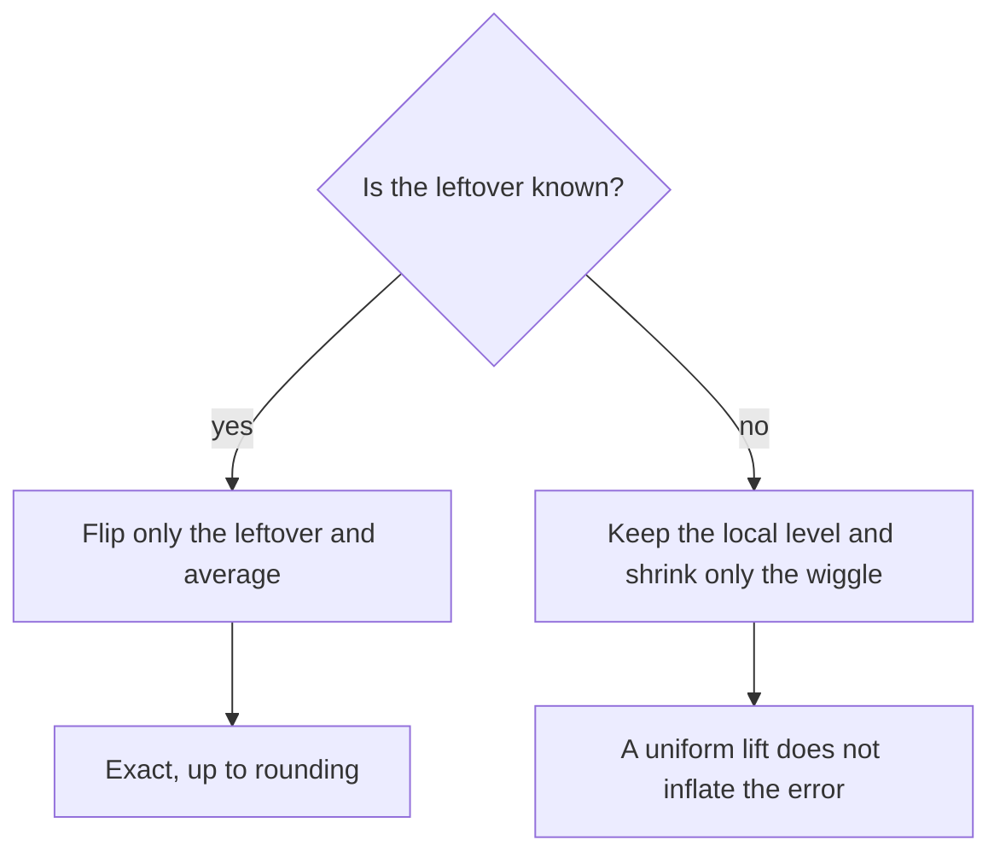
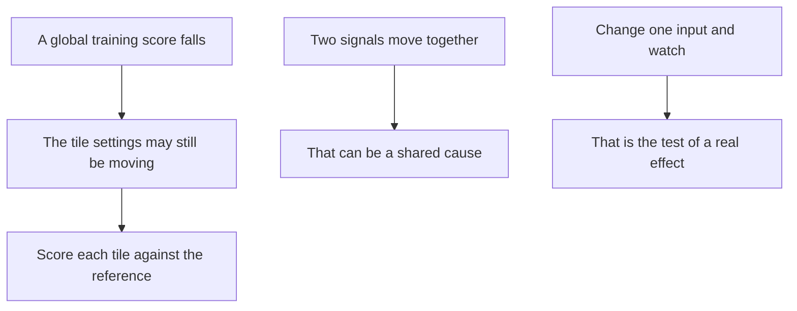
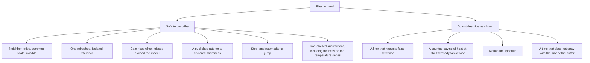

# Plain-language brief for a provisional

SRI version 5. Ceraph Corporation, Kerala, India. 15 November 2026. For patent counsel. Not a filed application. Not legal advice. chief@ceraphco.com. www.ceraphco.com.

Inventor, as the company names him for this draft: Hari Krishna. Please confirm the legal name, the address, and the assignment.

Version 5 is the design the company now stands on. Earlier drafts described a constant-time quantum cancellation and a guarantee against false sentences. Those descriptions are withdrawn. Please do not carry them into the claims.

The design was organized in a conversation that read a classical Indian philosophical text, the Darśana Mālā, with a modern commentary. The commentary supplied a discipline: state a model, then remove what a test does not support. The claims below are the engineering rules that survived that discipline. The philosophical text is not an element of the invention, and it should not appear in the claims. Thirty-two mathematical checks of those rules were run on a CPU. Twenty-four passed in full. Eight missed one pre-registered check. Every passing check is known mathematics. The inventive step, if counsel finds one, is the arrangement: a tile that estimates a relative error, pins an otherwise invisible common scale with an isolated reference, raises its gain when its misses exceed its model, and stops without freezing so hard that it cannot rearm.

## The picture

## Claim 1. Compare neighbors, and accept that a common scale is invisible

In ordinary words: several tiles look at the same unknown thing through different veils. Each pair forms a ratio. Multiplying every veil by the same number, or shifting every veil by the same angle, does not change any ratio. So the tiles cannot discover their absolute veil. They can discover how they differ.

What was measured. On a 64-tile grid the phase error before fixing the common scale was 0.82. After fixing it, 0.017. The fix is not optional if an absolute number is required.

What to leave out. Do not say the tiles measured a quantum phase. This is linear algebra on complex numbers.

## Claim 2. Pin the scale with a reference that is kept out of the work

In ordinary words: to get an absolute number, designate at least one reference whose veil is known, and do not let the data channel or the control channel leak into it. A leak biases the answer in proportion to the leak. Refresh the reference when the world drifts. One bad reference ruins a pin that uses only that reference.

What was measured. One good reference cut absolute error from a free range of about 0.09 to 3 down to about 0.001. More references cut the remainder about as one over their count. A reference frozen at the start let the error grow to 0.49, against 0.037 when refreshed. One faulty reference gave error 0.25. Leakage of 0.02, 0.05, 0.1, and 0.2 produced bias 0.013, 0.038, 0.081, and 0.170, matching a formula. A correction that knows the leak cut the worst case to 0.002.

A calibration that used only itself, or that fed itself, could not see enough to solve the problem. Two known levels on an independent reference could. One pre-registered check of the error floor was badly aimed and is reported as a miss. The rank result stands.

What to leave out. A hub that distributes the reference is cheaper in links and is a single point of failure. When the hub was removed, that design kept no relative calibration. Please do not claim the hub is more accurate. An all-to-all wiring was as accurate and used many more links.

## Claim 3. Turn the gain up when the misses get worse

In ordinary words: the tile keeps a model of how noisy the world is. If the new misses are larger than that model, the world has sped up, and the tile should trust the new data more, not less. An earlier rule did the opposite and fell behind.

What was measured. After a tenfold jump in how fast the veil wandered, the old rule’s late error was 0.59. A standard adaptive filter that estimates that speed from the misses, and a corrected version of the company’s own statistic with the sign fixed, both stayed near 0.054, with the oracle. On a partial overlap the same three still matched the oracle down to a 25 percent overlap. The old rule did not.

What to leave out. Do not claim this statistic detects a false sentence. On language-model answers an earlier use of a related statistic scored at chance.

## Claim 4. Hold a selected state with a drive, and publish the rate

In ordinary words: a tile can be pushed toward one preferred state while a disturbance keeps mixing it. The sharpness of the hold depends on the ratio of the push to the disturbance, and on how many states there are. The formula is simple enough to put in the specification. The push is a rate in the model. It was not measured in joules.

What was measured, in a CPU simulation, seed 11. For a floor of 0.90 the rate ratios were 4.00, 5.67, 6.50, and 7.75 at 2, 3, 4, and 8 states. The simulated generator matched the formula. Sharpness above 0.99 was not reached on the rates that were scanned. A memory attached to the disturbance helped when the memory was slow and stopped helping when the memory forgot quickly. A drive that did not watch the disturbance lost the floor when the disturbance jumped. A rule that watched only a noisy report of the sharpness recovered after the jump and chattered when nothing was changing.

What to leave out. Do not describe this as a quantum computer. The model is a standard open-system equation used as a design calculator. Do not say one quarter of the tile is protected. A protected-subspace check gave 3/8 at two qubits, and only when most of the noise was shared.

## Claim 5. Stop, but stay able to start again

In ordinary words: once the misses have settled, turn the gain down so the tile does not keep chasing noise. If the target then jumps, notice the jump and turn the gain back up. While a new state is still locking, keep the old state so the output does not fall into a gap.

What was measured. On a stationary problem the annealed error was 0.0011, a constant gain 0.0256, and a high gain 0.328. After a jump, a gain that was frozen and not rearmed stayed at 2.08. The rearmed rule recovered to 0.061. Keeping the old output until the new one locked limited the worst excursion to 0.201, against 0.309 for an instant switch and 2.157 if a gap was left. One pre-registered check of a “too short” overlap failed because that overlap was already long enough. The rule still matters when the new state is not yet locked.

A far target should be approached in grades or with a damped step. A plain aggressive step converged on 14.2 percent of starts. Graded targets and a damped step converged on all of them.

## Claim 6. Two different subtractions, each labelled

In ordinary words: there are two ways to subtract, and they must not be described as one.

The first way applies when the leftover is known. Flip only the leftover and average. If you flip the whole mixture you destroy the part you meant to keep. On a graphics chip this flip of a known number is the sign bit.

The second way applies when you do not know the leftover, but you do know a local level. Shrink the wiggle around that level and add the level back. Lifting the whole record then lifts the answer by the same amount. A rule that shrinks the whole record, including the level, gets worse when the record is lifted.

What was measured. The first way, on an RTX PRO 6000, with the clean part known, gave the ratios in the investor note: 26 through about 10,000, in about 0.022 milliseconds, with agreement to the true clean part at or above 0.99979. Those ratios match one plus the square of the noise setting. They are not a discovery of an unknown leftover.

The second way, on a synthetic series, held an error of 1.472 across a lift of 5. On a 3,650-day temperature series it held an error of 5.819 across a lift of 5 °C. The rule that shrinks the whole reading moved from about 136 to about 267. A goal that the wiggle fall by half or more was missed: about 51 to 52 percent of the variance remained. Please put the miss in the specification.

Four such boards, on a heavy job, finished about four times as many jobs in five minutes as one board, and stayed under 50 °C. A long pass moved data at about 91 percent of the board’s stated peak. A short message between boards is a different measurement and a much lower rate. Please do not add the two rates.

What to leave out. A peak of 958,874 times, and an H100 figure of 35,037 times, are in other documents and were not this table. A learned estimator near 94 percent squared-error reduction is an internal note on a different chip and was not repeated by the graphics-board table. Do not put them in an example unless the inventor deposits the file.

## Claim 7. Report the tile, not the training score

In ordinary words: a score that says the system is trained can fall long before each tile’s settings have actually settled. Judge each tile against the reference. Also judge whether a change in the output was caused by the input you think, by intervening, not by watching two things move together.

What was measured. In one ill-conditioned fit the global score settled at step 60 and the settings at step 28,200. Watching correlations called a confounded component real every time in 100 trials. Intervening named the real driver every time in 100 trials. An integrity channel for planted evidence scored 0.929, short of a pre-registered 0.95. Please cite 0.929, not a rounded success.

## What not to claim

## Embodiments

Measured, CPU. The neighbor ratios, the reference pin, the gain sign, the selection-rate formula, the stopping rule, and the thirty-two-test scoreboard.

Measured, graphics board. The known-leftover subtraction and the level-preserving shrinkage, with the temperatures, the four-board rate, and the missed variance bar.

Not yet measured. The whole arrangement against periodic recalibration, a PID loop, and a Kalman filter on an array of tiles. A digital tile on an FPGA. A tape-out. Please do not draw those as built.

Not the invention. The education product and the safety product named in a venture memorandum. They are commercial intentions.

## Abstract

Several tiles estimate how their veils differ. A common scale is invisible until one known reference pins it. The reference is kept out of the data path and the control path, and it is refreshed when the world drifts. The gain rises when recent misses exceed the model. A drive holds a preferred state at a rate given by a formula. The tile turns the gain down after it settles and turns it back up if the target jumps. If the leftover is known, it is flipped and averaged. If only a local level is known, the wiggle around that level is shrunk and the level is kept, so a uniform lift does not inflate the error. On a temperature series that second rule missed a goal of cutting the wiggle in half, and the specification says so.
