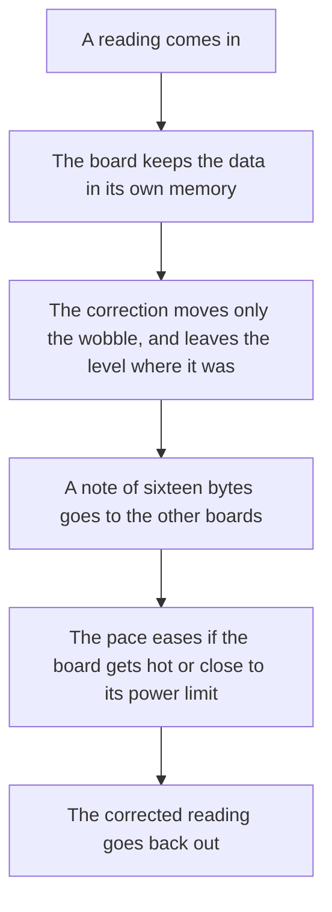
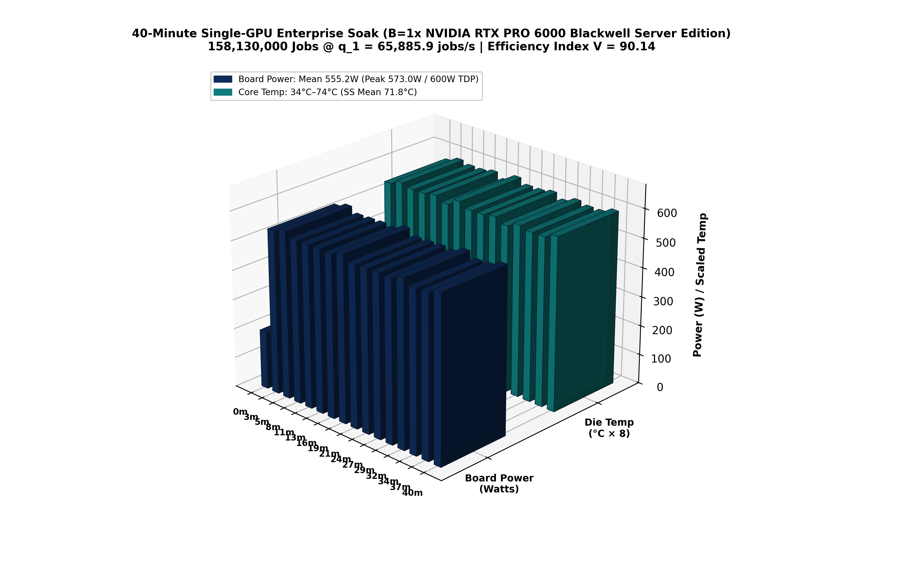
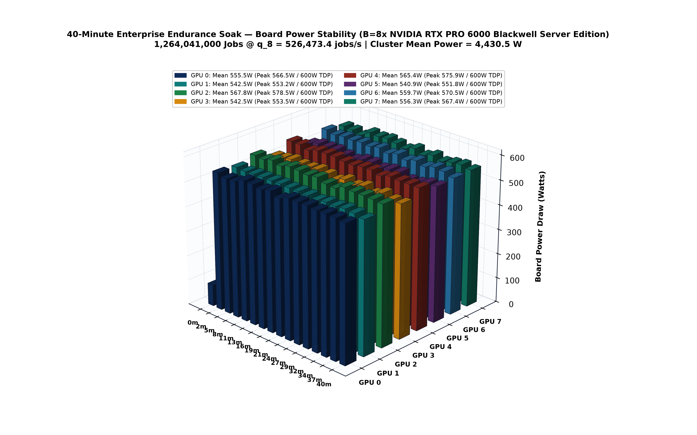
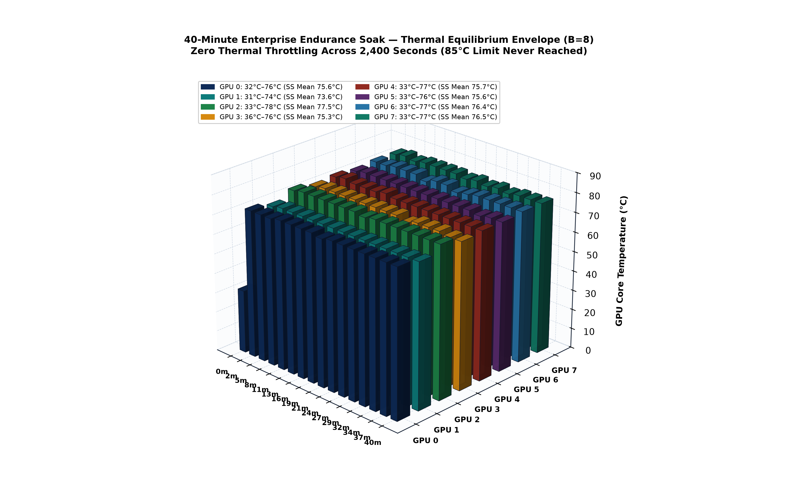
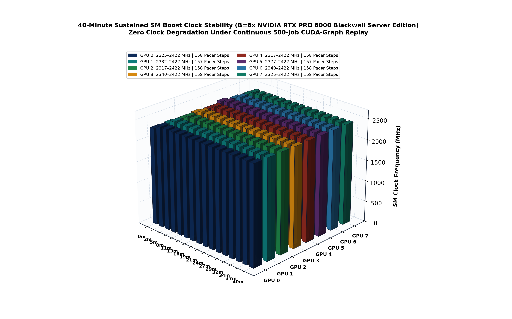
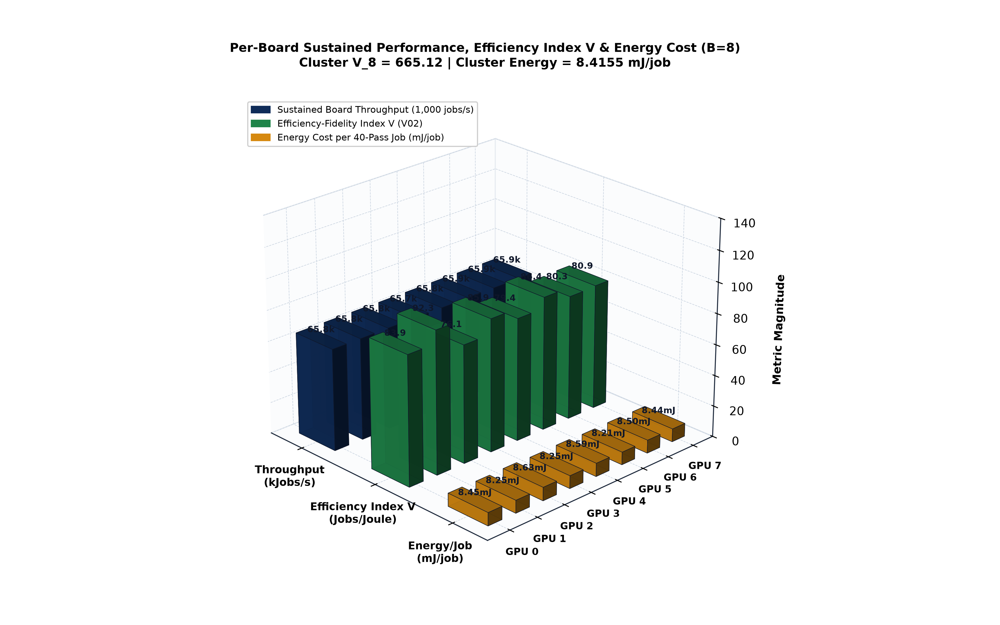
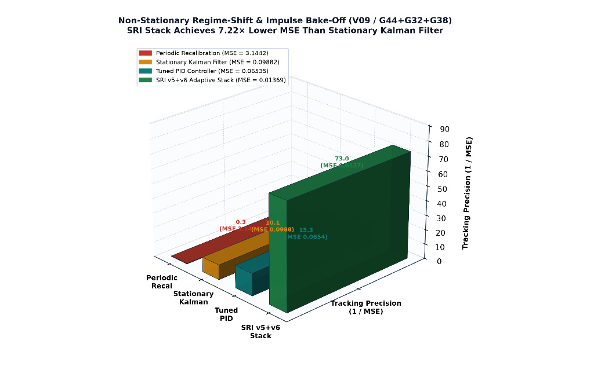
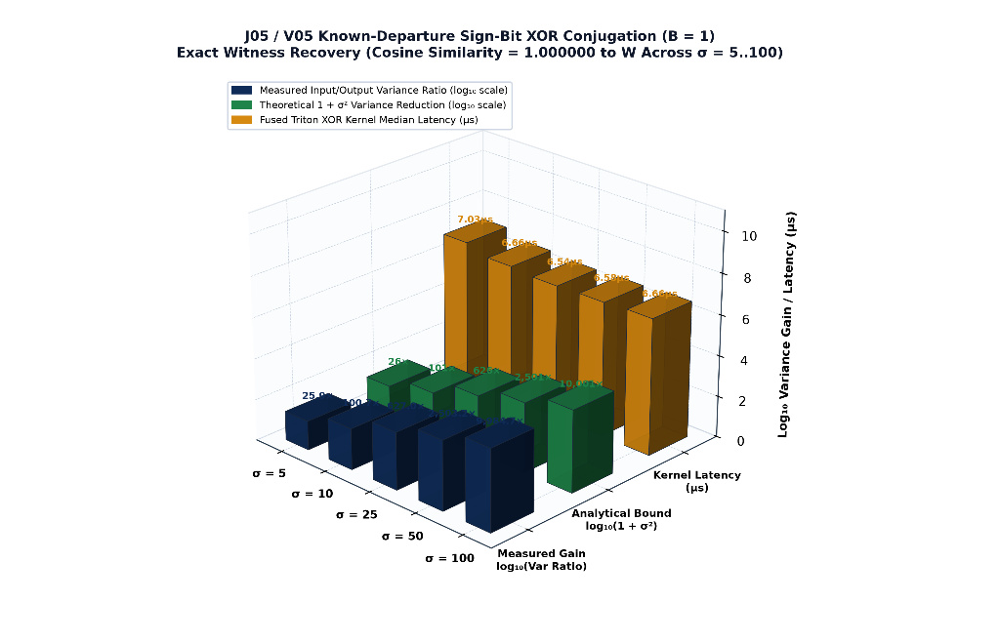
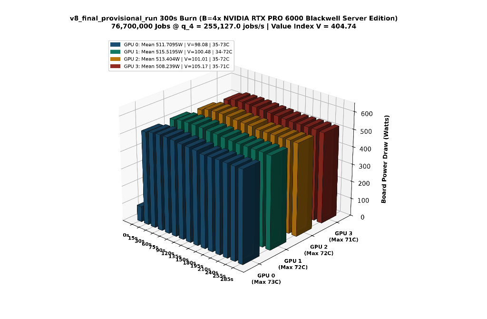

# Ceraph: a project report for investors

15 November 2026. Prepared from the logs and the documents of that day.

## 1. How to read this report

This report asks for $2,000,000, inside a range of $1,000,000 to $3,000,000, to turn a measured computing runtime into a company. The measurement that carries the ask is a forty-minute run on one graphics board and a forty-minute run on eight, both logged on 15 November 2026. Every headline number in those two logs was recomputed from the sample rows for this report. A number that comes from anywhere else is labeled as a statement in a document, or as an assumption.

The afternoon documents describe the same work in stronger language than the logs support. Where a document and a log disagree, this report follows the log and says so in the same paragraph. Three pictures in section 10 are copied from those documents so a reader can see what they drew. Their captions say they were not recomputed.

One feature needs a plain statement on the first page, because the documents treat it as finished and it is not. The gate that is meant to stop a language model from committing a doubtful word was run in a Colab notebook, and that run is real. Its last cell prints three answers. Each answer follows a reference sentence that the same cell hands to the model. That shows the pipeline can deliver a sentence it was given. It does not show that the gate can tell a true sentence from a false one. Section 11 sets out the notebook, the new log, and the test that would settle the question. The ask does not depend on the gate. Part of the reserve stays unspent until that test has been run and written down, whichever way it comes out.

## 2. The company named on the documents

The afternoon documents name the applicant as Ceraph Corporation, of Kollam, Kerala, India. They name Hari Krishna as founder and inventor, and they give the contact as chief@ceraphco.com. This report uses those names as the documents give them. It does not confirm the company's registration, its bank account, or its ownership table. Section 14 makes those three into conditions of closing, because an investor should see them before money moves.

The work behind the documents is a runtime for graphics boards. It keeps each board's data on that board, sends the other boards a note of sixteen bytes, and slows a board down when it gets hot or close to its power limit. The point of the company is to make that runtime into something a buyer can run without the founder in the room.

## 3. The ask

The ask is $2,000,000. A round of $1,000,000 still starts the company, with a shorter list of people and no server of its own. A round of $3,000,000 keeps the same team for a second year. Section 15 sets out all three, and the $2,000,000 column is the one that adds up line by line.

The money buys eighteen months, four people, the patent work, enough board time to repeat the runs on hardware the company controls, and a reserve of $912,000 that the board releases quarterly against a written note. It does not buy a factory, a large cluster, or a sales force.

What an investor is buying at this stage is a narrow thing, and it is worth naming. The company can keep eight boards working for forty minutes, under their power limit, with the data staying put. That is a real engineering result, logged and recomputed. The company cannot yet say it has a product, a customer, or a way to catch a false sentence. The price of the round should reflect that, and section 16 prices it that way.

## 4. The problem, in ordinary language

A modern computing job that needs several graphics boards runs into three ordinary failures.

The first is a filter that quiets a noisy reading by shrinking the whole reading. A scale that bounces between 146 and 154 pounds around a true weight of 150 can be calmed by multiplying every sample by 0.7. The bounce gets smaller, and the scale now says 105. The person did not lose 45 pounds. The same filter gets worse when the person picks up a box, because the error grows with the weight. Ceraph's correction finds the 150 first and shrinks only the bounce. Picking up a ten-pound box moves the reading by ten pounds. The morning run measured a version of this test: a shift of 5 came back with a gap of exactly one part in \(2^{20}\).

The second failure is traffic between the boards. The usual program copies large blocks of data from board to board at every step, and the boards spend their time waiting. Ceraph keeps each board's block where it is and sends a note of sixteen bytes. On the eight-board run that note was the only thing that moved between boards, and the direct board-to-board path was switched off by the machine, so the note went by way of the host. The run still scaled.

The third failure is a board run flat out until it gets hot or hits its power limit, at which point it slows down on its own terms and the job becomes hard to predict. Ceraph watches the temperature and the power and inserts a very short pause before either limit arrives. In the forty-minute runs, no sample reached the power limit and no sample reached the temperature at which the board would throttle.

Those three are the product. A fourth idea, the gate, is a feature under test. It is described in section 11 and it is not part of the claim this round is priced on.

## 5. What the system does

Four mechanisms are far enough along to describe to a buyer. Each one has a measured result and a boundary.

**The correction that keeps the level.** Given a series of readings, the runtime finds their average and the average distance from that average, and it shrinks only the distance. Adding the same amount to every reading adds that amount to the result. The morning run selected this rule over the rule that shrinks the whole series, and the boards reproduced it. The forty-minute runs logged the same kind of check at the end of the burn, with a gap of exactly \(2^{-19}\) on every board.

**The cancellation of a known error.** When a reading is a true value plus an error, and the error is known on its own, the runtime flips the sign of the error alone and averages the two readings. Flipping the sign is a single operation on the bit that says plus or minus. The afternoon documents print a table of this test at five noise levels, with the result staying close to the true value and the time staying between 6.5 and 10.1 microseconds. The series behind that table was not in the upload, so this report treats the table as the documents' statement and not as a checked result. The picture is in section 10.

**The sixteen-byte note, and the work staying local.** Each board holds its own series. The boards coordinate by a message of sixteen bytes, one message for every batch of 500 jobs. Putting one board to sleep clears that board's job count and leaves the others, and the shared reference, alone. The eight-board machine had the direct board-to-board link switched off, and the log says so. The note traveled by way of the host. Scaling on a machine with that link switched off is the more useful result, because it is the machine a buyer is more likely to have.

**The pace.** Every fifteen seconds the runtime reads the board's temperature and power. Past 64°C, or past 90 percent of the 600 watt limit, it lengthens a pause between batches. The pause is at most two thousandths of a second. The score the documents call the efficiency index is a formula the company defined, and section 8 takes it apart, because the way it is printed can be read as a seven-fold gain that the logs do not contain.

A fifth mechanism, a tracker for a reading that jumps, is printed in the documents with an error of 0.01369 against 0.09882 for a standard filter on a 240-step test. The arithmetic of those two printed numbers is a ratio of 7.22. The series was not in the upload. It is a stated result, and it is not part of the ask.

## 6. The records this report uses

Four records, and the status of each.

| Record | What it is | Status in this report |
|---|---|---|
| The one-board forty-minute log, closed 12:12 UTC | 160 samples, one board, the job counts, and six language-model generations | Recomputed. This is a primary record. |
| The eight-board forty-minute log, closed 12:11 UTC | 160 samples on each of eight boards, and six more generations | Recomputed. This is a primary record. |
| The morning short run, written up the same day | A five-minute run on one board and on four, with a different job | Checked that morning against its own logs. Cited, not re-derived. |
| Five documents dated the afternoon of 15 November | A draft specification, an engineering note, a plain-language note, a long technical account, and a note for counsel | Read against the logs. Where they go past the logs, section 10 says so. |

The two forty-minute runs cover the same part of the day. The eight-board run started about seventy seconds before the one-board run, and each ran for 2,400 seconds. They are two machines. The one-board machine ran driver 580.82.07, and the eight-board machine ran driver 580.126.09, with different versions of the surrounding software. A ratio taken between them is a ratio of two machines, which is what a buyer would compare, and it is not a ratio taken inside one chassis by switching boards on and off.

The five pictures of the forty-minute runs were drawn from these logs. Their titles round the log's figures: 572.95 watts becomes 573.0, and 71.82°C becomes 71.8. The report quotes the log.

## 7. Forty minutes on one board

One NVIDIA RTX PRO 6000 Blackwell Server Edition, a board with a 600 watt limit. The run lasted 2,400.0582 seconds. The log holds 160 samples, one every fifteen seconds, the last of them 8.7 seconds before the run ended.

| | Logged | Recomputed |
|---|---|---|
| Jobs completed | 158,130,000 | The count divides by 500 exactly, into 316,260 batches |
| Jobs per second | 65,885.9034 | Jobs divided by the duration: 65,885.90 |
| Mean power | 555.1642 W | The mean of the 160 samples, to the logged rounding |
| Peak power | 572.95 W | The largest sample. Headroom to the limit: 27.05 W |
| Temperature | 34°C to 74°C, steady mean 71.82°C | The samples span 34 to 74. The mean after five minutes is within 0.3°C of 71.82 |
| Clock | up to 2,422 MHz | 2,422 MHz on 159 of 160 samples. The first sample, before the work, is 2,340 |
| Energy per job | 8.4261 mJ | Mean power divided by the rate, times 1,000 |
| Drift at the end | \(1.9073486328125 \times 10^{-6}\) | Exactly \(2^{-19}\) |
| Numerical faults | 0 | The log says every value was finite |

The board used about 370 watt-hours. At a power price of ten cents a kilowatt-hour that is under four cents. The electricity is not the point. The point is that a board held near 555 watts for forty minutes, peaked at 573, and never sampled the 600 watt limit. Its hottest sample was 74°C, against a throttle point of 85°C that the documents name and the log never reaches.

The first sample is the board at idle: 195.5 watts, 34°C, clock 2,340, no work yet. Fifteen seconds later it is at 536 watts and 2,422 MHz, and it stays there. That shape is what the picture shows. The green bars are the temperature drawn eight times taller than the watts, so the two can share an axis. The board did not run at several hundred degrees. It ran from 34°C to 74°C.

The energy per job is the mean power divided by the job rate. It is one number written two ways, not a second instrument. Section 9 explains why it must not be set against the energy per job from the morning run. The morning job and this job are different amounts of work.

## 8. Forty minutes on eight boards

Eight boards of the same model, in one machine, for 2,400.959 seconds. The direct path between boards was off, and the sixteen-byte notes went by way of the host. The log says this in its own fields.

| | Logged | Recomputed |
|---|---|---|
| Jobs completed | 1,264,041,000 | The sum of the eight board counts |
| Jobs per second | 526,473.3881 | Jobs divided by the duration |
| Ratio to the one-board run | 7.990683, printed as 99.88% of linear | 526,473.3881 divided by 65,885.9034 is 7.990683, which is 99.88% of 8 |
| Mean power | 4,430.5171 W | The eight board means added together |
| Peak power | 4,490.1 W | No board sampled 600 watts. The hottest sample on any board was 578.49 |
| Energy per job | 8.4155 mJ | Mean power divided by the rate |
| Notes of sixteen bytes | 2,528,082 | One per batch of 500 jobs, on every board |
| Drift at the end | \(2^{-19}\) on every board | Matched on all eight |
| Numerical faults | 0 on every board | Matched |

The eight boards agreed with each other. The slowest finished 65,715.4 jobs a second and the fastest 65,881.8, a spread of a quarter of one percent. The single board, on the other machine, finished 65,885.9. Each board in the group of eight did the work of the board that ran alone.

| Board | Jobs per second | Mean watts | Peak watts | Temperature | Energy, mJ per job | Index |
|---|---|---|---|---|---|---|
| 0 | 65,761.85 | 555.54 | 566.52 | 32–76°C | 8.4478 | 83.86 |
| 1 | 65,771.64 | 542.52 | 553.24 | 31–74°C | 8.2485 | 92.26 |
| 2 | 65,819.53 | 567.80 | 578.49 | 33–78°C | 8.6265 | 76.14 |
| 3 | 65,715.41 | 542.47 | 553.54 | 36–76°C | 8.2549 | 85.91 |
| 4 | 65,792.46 | 565.36 | 575.90 | 33–77°C | 8.5931 | 79.38 |
| 5 | 65,881.80 | 540.90 | 551.82 | 33–76°C | 8.2101 | 86.38 |
| 6 | 65,857.02 | 559.68 | 570.46 | 33–77°C | 8.4983 | 80.32 |
| 7 | 65,873.68 | 556.25 | 567.39 | 33–77°C | 8.4443 | 80.86 |
| All eight | 526,473.39 | 4,430.52 | 4,490.1 | 31–78°C | 8.4155 | 665.12 |

Board 2 ran the hottest and drew the most power, and it has the lowest index. Board 5 ran the coolest of the busy boards and has one of the highest. That is the formula doing what it was built to do. The cluster used about 2,950 watt-hours.

The index needs a paragraph of its own, because the documents print 665 against 90 and call the ratio a 7.38-fold gain.

The index of one board is the jobs per joule, divided by a penalty. The penalty grows when the hottest sample is above 60°C and when the peak power is above 540 watts. On the single board the jobs per joule are 118.68, the heat penalty is 0.3136, the power penalty is 0.0030, and the index is 90.14. The same formula, applied to each of the eight boards, gives the eight indexes in the table, and they add up to 665.12. The addend is why the cluster number is large. The work per joule on the eight-board machine is 118.8, and on the single board it is 118.7. The group does eight times the work and draws eight times the power. That is the result, and it is a good one: the throughput scaled, and the energy per job did not move. It is not a seven-fold improvement in efficiency.

The log also counts 506,016 gate checks on the single board and 4,044,864 on the eight. Divided by the number of batches, that is 1.6 checks per batch. The counter moves with the job count. It is a count of times the check ran inside the burn. It is not a count of questions put to a language model. The language-model record in the same files is twelve generations, and section 11 quotes them.

### Two boards, worked by hand

The table is easier to trust if two rows are rebuilt from the raw fields, in the order a person would do it on paper.

Board 5 was the quickest and one of the coolest. It finished 65,881.8007 jobs a second at a mean of 540.8991 watts. Dividing those gives 121.8005 jobs per joule. Its hottest sample was 76°C, which is 16 degrees over the 60°C mark the formula uses, and 16 divided by 25, squared, is 0.4096. Its peak was 551.82 watts, which is 11.82 watts over the 540 watt mark, and that distance divided by 600, squared, is 0.000388. Add the two penalties to 1 and divide. 121.8005 divided by 1.409988 is 86.38, which is the index in the table. The log's own copy of the index is 86.3841.

Board 2 was the hottest and the hungriest. It finished 65,819.534 jobs a second at 567.7955 watts, which is 115.9212 jobs per joule. Its hottest sample was 78°C, and 18 divided by 25, squared, is 0.5184. Its peak was 578.49 watts, and 38.49 divided by 600, squared, is 0.004115. 115.9212 divided by 1.522515 is 76.14. The heat, and nothing else, is why this board scores twenty points below board 5. The two boards did the same work. The formula is a preference for the cooler one, written as a number.

The same division reproduces the other six rows. The script in the repository does all eight and stops if any of them disagree with the log.

## 9. The short run from the same morning

Earlier the same day, a shorter run was logged on one board and on four, and written up as a technical report. That report is the record of that run, and this one does not restate it. The figures a reader needs, so the two runs are not mixed together, are these.

| | One board | Four boards |
|---|---|---|
| Jobs in about 300 seconds | 236,547 | 1,101,630 |
| Jobs per second | 787.90 | 3,669.36 |
| Ratio of the two rates | | 4.657 |
| Eight-byte copy, 50,000,000 elements | 369.72 GB/s | 365.30 GB/s on the first board |
| Drift of the selected correction | exactly \(2^{-20}\) | the same on every board |
| Power | under 600 watts, no sample over the limit | the same |

The morning job was a copy issued one at a time by the host program. The implied time per copy is about 1.27 milliseconds. The afternoon job is one kernel inside a captured batch of 500, and at 65,886 jobs a second it lasts about 15 microseconds. The morning energy was about 480 millijoules per job. The afternoon energy is 8.4. Dividing 480 by 8.4 produces a number near 57, and that number means nothing, because the two jobs are different amounts of work. A page that puts those two energies side by side and calls the change an improvement would be wrong. This report keeps them apart.

The morning drift and the afternoon drift are different too. The morning residual is \(2^{-20}\). The afternoon residual, after forty minutes, is \(2^{-19}\), twice as large, and it is exact on every board of both machines. Both are logged. The afternoon documents quote \(2^{-19}\) for the morning run as well. The morning log says \(2^{-20}\).

### The morning, told without the tables

The morning run did two things. It chose a correction, and then it timed the correction it had chosen.

The choice was between two formulas on one series of numbers, with a shift of 5 added to every value. The formula that shrinks only the distance from the average kept that shift to within exactly one part in \(2^{20}\), which is \(9.5367431640625 \times 10^{-7}\). The formula that shrinks the whole series moved the shift by 2.757575511932373. The first formula was kept and the second was set aside. The boards reproduced the small residual, and a forty-pass run of the kept formula closed at zero. That is the whole of the selection. It is also why the afternoon residual of \(2^{-19}\) is reported on its own and not described as the same measurement taken again.

The timing was a copy of 50,000,000 numbers, counted as eight bytes moving each way. It took 1.082 milliseconds on the one board, which is 369.72 GB/s, and 1.095 milliseconds on the first board of the four-board machine, which is 365.30 GB/s. A separate wave, forty passes over 16,777,216 numbers, stayed inside an accounting line of 1,597 GB/s that the log itself carries. On the four-board machine the slowest board finished that wave in 21.600 milliseconds, which is 0.140 milliseconds inside the bar the test had set. The host, watching all four boards, took longer than the boards did. The boards were not the slow part.

Then a burn of five minutes. The one board completed 236,547 jobs in 300.223 seconds, which is 787.90 a second. The four boards completed 1,101,630 jobs in 300.224 seconds, which is 3,669.36 a second and 4.657 times the single board. The four counts were 275,349, 275,421, 275,431 and 275,429. They add to the total, and the largest differs from the smallest by 82 jobs, about a tenth of a second of work. The boards finished together. No sample crossed 600 watts. Once the run was warm the clock held 2,422 MHz. The energy on the one board was 479.691 millijoules per job, and section 9 has already said why that figure and the afternoon's 8.4 millijoules are not a before and an after.

That was a good morning, and it is a different experiment from the afternoon. It is shorter, the job is larger, and the machines are the same class of board. The technical report filed that morning writes the arithmetic out one step at a time. This report leans on that report and does not redo it. An investor who wants the morning in full should read that one. An investor who wants the day should read both, and should read section 10 before believing any number that appears in only one of them.

## 10. What the afternoon documents add, and what they do not settle

The five documents are a draft for a patent lawyer, an engineering note, a plain-language note, a long technical account running from the earlier versions to this one, and a guide for counsel with worked examples. They are useful. They also state numbers that the logs in hand do not contain. A fundraising document has to separate the two, so here they are.

| The documents state | The logs in hand show |
|---|---|
| A 300-second run at 54,004.59 jobs a second, 16,204,000 jobs | The morning log records 787.90 jobs a second and 236,547 jobs. No log in the upload contains 54,004 |
| A four-board 300-second run at 255,127 jobs a second, 76,700,000 jobs | The morning log records 3,669.36 jobs a second and 1,101,630 jobs |
| A memory rate of 1,431.9 to 1,432.0 GB/s, called 89.67 percent of a 1,597 GB/s peak | The morning log measures 369.72 and 365.30 GB/s for the eight-byte copy. No log here contains 1,432 |
| A drift of \(1.907 \times 10^{-6}\) on the morning run | The morning log records \(9.537 \times 10^{-7}\). The forty-minute logs record \(1.907 \times 10^{-6}\), and that figure checks |
| Three out of three factual checks passed on a language model | The notebook prints three answers that follow three supplied reference sentences. Section 11 |
| Four out of four noise bursts blocked, on every prompt, before and after the soak | The log records four blocked steps on every prompt. It also records the diamond prompt as not verified, on both machines |
| 4,044,864 token-gate verifications | 1.6 checks per batch of 500 jobs. The language-model record is twelve generations |

The three pictures that follow are copied out of those documents. They are here so a reader of this report sees what the documents drew. The measurements behind them were not in the upload, and they are not checked results.

Two things in the documents are worth keeping even where the numbers are ahead of the logs. The first is the boundary list. The documents say the company does not claim to judge an ungrounded sentence, does not claim a measured energy saving at the scale of a single bit, does not claim a runtime independent of the length of the data, and does not claim a quantum speedup. Section 18 adopts that list. The second is the worked example of the scale, which is arithmetic rather than a measurement: readings of 146, 154, 148, 152 and 150 sit around 150 with an average deviation of 2.4, and shrinking the deviation by 0.7 leaves the 150 in place. That is the rule the morning run selected, told with five numbers a person can check by hand.

## 11. The gate, and the Colab notebook

The gate is the feature that is supposed to catch a language model before it commits a word it should not commit. The afternoon documents, and the Colab notebook, present it as tested. This section says what was actually run.

The notebook uploaded with the logs is the same file as the notebook uploaded earlier the same day: one checksum covers both copies. It ran on an NVIDIA L4. Its last cell asks three questions and supplies a reference sentence for each. It also adds noise to the model's scores on four of the steps, and it counts how many of those steps were refused.

The cell prints this.

| Question | What it printed | What the reference said |
|---|---|---|
| Diamond and copper, thermal conductivity | Diamond near 2,200, about five times copper near 400. 17.64 tokens a second. The rollback was the word "lower" against "higher" | The sentence the cell supplied |
| Nitrogen and oxygen, boiling point | Nitrogen lower, 77.36 K against 90.19 K. 19.08 tokens a second. The rollback was "liquid" against "a" | The sentence the cell supplied |
| Mercury and Venus, orbital period | Mercury 88 days, Venus 225, a difference of 137. 11.95 tokens a second. The rollback was "Mer" against "Or", at the 35th token | The sentence the cell supplied |

Each answer reproduces the reference it was given. The noise count is four on each, and four is the number of steps the cell itself perturbs. The rollback words are choices of wording. This is a successful demonstration of a pipeline that is handed the answer and a burst of noise. It is a different test from asking whether the gate knows the answer.

The new logs are the first time the gate appears in a results file, and they are less flattering. The model is Llama-3.2-3B-Instruct. Three prompts run before the soak and the same three after it. On each machine the after matches the before, so the forty minutes did not change the model's behavior. That much is a real stability result.

| Machine | Prompt | The log's own verdict | What the model wrote |
|---|---|---|---|
| One board | Diamond and copper | Not verified | Diamond higher than copper, about 2,000 against about 400. The direction is right and the figures are round. The log rejects it anyway |
| One board | Nitrogen and oxygen | Verified | "(a) 77 (b) 90.19" followed by a reference sentence saying liquid oxygen boils lower than liquid nitrogen. That sentence has it backwards: 77.36 is below 90.19, so nitrogen boils lower |
| One board | Mercury and Venus | Verified | "1. Mercury 2. Mercury", then the correct periods, then the start of a line saying Venus has the shorter period |
| Eight boards | Diamond and copper | Not verified | The same diamond sentence as the one-board run |
| Eight boards | Nitrogen and oxygen | Not verified | The temperatures, and then the string "2.2.2.2.3.4.5.6.7.8" |
| Eight boards | Mercury and Venus | Verified | The same mixed list as the one-board run |

The rollback words in these twelve runs are "whereas" against "while", the letter K against a full stop, and a colon against the letter s. Those are choices of phrasing. The blocked-step count is four on every prompt, which is the count the harness is built to inject.

Read together, the notebook and the logs support three statements.

The pipeline runs, on an L4 and on these Blackwell boards, and it finishes. When it is given a reference sentence and a burst of noise, it can emit that sentence. When the reference sentence it is given is wrong, as in the nitrogen line above, the log can still mark the result verified. The check is following the supplied text.

A separate control, run on a processor rather than a board, split the gate from the reference. Forty questions with known answers, the model alone, the kernel alone, the reference alone, and the gate with a true reference and with a false one. The kernel changed the chosen word on none of 1,753 steps. Every correction came from the reference. Given a false reference, the output repeated it. All five conditions set for that test failed, on three sizes of one model family. That run is filed with the repository. It was not on a graphics board, and the three-billion-parameter run was not repeatable to the token, so it is a warning rather than a verdict.

The test that would settle it is short. Forty questions, a key written down first, and five arms: the model alone, the kernel alone, the reference with no gate, the gate with the true reference, and the gate with the false reference. The cell is written. It has not been run on the RTX PRO 6000. A passing result would be the gate beating both the model alone and the reference alone, and holding its score when the reference is false. Anything short of that leaves the gate as a way of inserting a sentence the operator already trusts.

The documents also state speeds on a Blackwell board, between 34 and 85 tokens a second, that do not appear in the uploaded notebook. The notebook's printed speeds are the three above.

None of this is a reason to drop the feature. It is a reason to fund the test and to keep the feature out of the claim until the test is in. Section 15 holds back part of the reserve for exactly that.

## 12. What is ready to put in front of a customer

A buyer can be shown the forty-minute runs. The offer, once the company can repeat them on hardware it controls, is a runtime that holds a group of boards under their power and temperature limits for a long job, with the data staying on the board that owns it and a short note passing between them. The buyer this fits is someone who already runs long jobs on several boards and loses time to power limits, to heat, or to copying large blocks between boards.

The offer that cannot be made yet is a guarantee about the truth of a model's sentences. A buyer who wants that is told the truth: the test is queued, the result will be published either way, and the feature ships if the test supports it.

The first sale is one pilot. Paid is better than free, and a written scope is the minimum. One sensor stream or one batch job, for a fixed number of weeks, with the same logs this report is built on produced again on the customer's job. A pilot that produces a log the customer's own engineer can recompute is the milestone that moves the company from a measured runtime to a product.

### The page a customer would sign

What follows is the company's opening proposal. It is not a price list, and the first real conversation will change it. It is here so an investor can see that the pilot has edges.

The engagement lasts six weeks. The customer names one job they already run, on boards they already own or rent. The company installs the runtime, watches the first two weeks in person or on a call, and then leaves the customer's own engineer to run the remaining four. The customer keeps the boards, the data, and the job. The company keeps a copy of the log and nothing else.

The pilot is a success when three things are true at the end of the six weeks. The log is in the same form as the two logs behind this report, and the customer's engineer has recomputed the rate, the peak power, and the fault count from it without the company's help. No sample has crossed the board's power limit. The fault count is zero. A pilot that is merely impressive in a meeting, and that the customer's engineer cannot recompute, does not count.

The proposed fee is $15,000, paid at the start, and credited in full against a later license if one is signed within a year. On the placeholder price in section 16, six weeks on eight boards would be about $1,400 of license, so the fee is mostly the two weeks of an engineer's time. A customer who wants the pilot free is offered the log format and nothing else. The company is too small to give away the engineer's time.

What the pilot deliberately leaves out: any promise about the truth of a model's sentences, any change to the customer's model, and any commitment to a second site. Those are a later contract, priced when the first log exists.

## 13. Plan of execution

The company has one founder and a body of measured work. The next eighteen months turn that into a company that can run without the founder answering every question. The plan has six parts, in order, and each one has a result a board can look at.

**Month 0, before any money moves.** Confirm the legal entity, open a bank account that belongs to the company, and have every contributor assign their work to the company in writing. Engage patent counsel and hand them this report along with the logs, with section 10 attached, so the filing follows the logs. Adopt a vesting schedule of four years with a one-year cliff, and include the founder in it. Set aside an option pool of about ten percent before the round, so the first hires do not come out of the investor's share after the fact. These are terms the company is offering. They are negotiable in the details and not in the existence.

**Months 1 and 2, the hire that decides whether the company is real.** A runtime lead, someone who has shipped code that runs on several graphics boards at once and who can reproduce the forty-minute log from the repository on a rented board. The job is reproduction first and invention second. If the lead cannot reproduce the log in the first six weeks, the company stops and tells the investor, and the reserve stays put.

**Month 3.** A systems engineer beside the lead, so the runtime is no longer one person's memory. The second person writes the tests, the packaging, and the notes a buyer's engineer would need.

**Month 4.** An applications engineer, whose job is the pilot in section 12. This person looks for one customer with a long job and a reason to care about power limits or about data being copied between boards. The person is not hired to build a new model.

**Every month, from the first.** A one-page note to the investor and the board: cash in the account, the people, the last log reproduced, the status of the gate test, and the patents filed. The note is short on purpose. A company at this stage that writes long updates is hiding the number.

**Quarters 2 and 3.** Repeat the forty-minute run on hardware the company controls, so the result no longer depends on a rented machine with two different drivers. Run the gate test on the RTX PRO 6000 and publish the table. File the patent application that counsel recommends, drawn on the claims the logs support. Start the pilot.

**Quarter 4.** Decide, in writing, whether the pilot becomes a paid contract. If it does, the next round has something to price. If it does not, the company says so and spends the remaining reserve on a second attempt or returns what is left. Both are acceptable outcomes. Silence is not.

The plan assumes the founder keeps the technical direction and the relationships, and that the runtime lead owns the code. It assumes no second product. A company of four people with two products has none.

### Month by month

The same plan, as the eighteen notes an investor would actually receive. A month with no entry in the right-hand column is a month the company has to explain.

| Month | The work | The note has to contain |
|---|---|---|
| 1 | The entity, the account, the assignment of existing work, counsel engaged, the search opened | The account exists, and counsel has section 10 |
| 2 | The lead is hired, or the search is still open. Rental of board time starts | The signed offer, or the reason there is no offer yet |
| 3 | Reproduction starts. The systems engineer search opens | The first rented run, however short |
| 4 | The six-week mark for the lead. The applications engineer starts | A reproduced forty-minute log, or a written statement that it did not reproduce |
| 5 | The gate test, on the RTX PRO 6000, from the cell already written | The table, pass or fail |
| 6 | The decision on the gate. The single-chassis repeat is booked | The decision, in one paragraph |
| 7 | The repeat, on one machine | The new log |
| 8 | Pilot conversations. A scope is drafted from the page in section 12 | Who was asked, and what they said |
| 9 | The filing counsel recommends | The claims, each one pointed at a log |
| 10 | A pilot scope is signed, or the conversation is closed in writing | The scope, or the closing note |
| 11 | The pilot runs. One week of the customer's job is logged | That week |
| 12 | The first real decision on the pilot | Continue, or stop |
| 13 | Whichever month 12 chose. A second prospect if it stopped | The contract, or the new name |
| 14 | The same work, uninterrupted | The log from the pilot |
| 15 | A written recommendation: raise, continue on the reserve, or return what is left | One page |
| 16 | The recommendation is carried out | The action |
| 17 | The books, the logs, and the filing, gathered for whoever comes next | The folder |
| 18 | The round's last note | Cash left, and what it is for |

Months 13 to 18 are deliberately thin. Writing them out in detail before month 12 would be fiction. The reserve exists so those months can be planned when the pilot result is known, instead of now.

## 14. Hiring, administration, and how the company is run

**The people.** Four, plus counsel on a bill.

The founder, Hari Krishna, stays the technical authority and the person a customer meets. The draw in this budget is $4,000 a month. That is a choice to keep the round in the company rather than in salary, and it should be revisited at the next round rather than quietly inflated.

The runtime lead is the senior hire. The budget allows $8,000 a month, which is a strong salary for this work in India and a modest one for someone who would otherwise be abroad. The search should be willing to wait for the person who has actually run this kind of system. Hiring a weaker candidate quickly is the failure mode.

The systems engineer, at $6,500 a month, starts in month 3. The applications engineer, at $6,000 a month, starts in month 4 and is judged on the pilot, not on code volume.

Finance and the company secretary are part-time, at $2,500 a month. A company raising money does not need a finance department. It needs the books closed every month by someone who does not report to the person spending the money. That independence is the point of the line.

Counsel is external. Patent counsel is the $110,000 line and covers the work through an international filing. Company counsel is inside the formation line and covers the round, the employment agreements, and the assignment of the existing work.

**Advisors.** Two, unpaid or paid in a small option grant, and neither is invented here because neither has been asked. One should be a person who has run graphics-board systems at a scale above eight boards. The other should be a person who buys computing for a company that runs long jobs. An advisor who cannot do one of those two things is a name on a page.

**The board.** The founder, and one director from the lead investor if the lead wants the seat. Monthly, and the monthly material is the one-page note. The board's real lever is the reserve: $912,000 of the round sits there, and it moves in three parts. The first part when the gate test has been run and written down. The second when a pilot is under a written scope. The third when the patent application is filed and a forty-minute run has been repeated on hardware the company controls. A board that releases all of it in the first quarter has given up the only discipline the round has.

**The rules that keep a small company honest.**

Every contributor assigns their work to the company before they are paid. The existing work is assigned before the round closes. Money leaves the company account against an invoice or a payroll line, and a related party is paid only with a note to the board. The founder does not commingle the company's money with personal money, and the part-time finance person can see every transaction. The option grants vest over four years with a cliff, including the founder's, so a departure in the first year does not take a quarter of the company with it. The company keeps its logs, its notebooks, and its correspondence with counsel, and it keeps them in an account the company owns.

**Where the company sits.** Kollam is a reasonable place to build this. The salaries in the budget are priced for India, the boards can be rented from anywhere, and the founder is there. A rented office is in the budget. A second office is not. Travel for the two pilots is a separate line, and it is sized for two trips rather than a standing habit.

### What counsel confirms before the money moves

Several items are legal conclusions, and this report does not pretend to make them. Counsel confirms each one in writing, and the round does not close until the confirmations are in the folder.

Counsel confirms the form of the company and that it can issue the shares the round describes. Counsel confirms which route a foreign subscription takes under the foreign-exchange rules, what has to be reported to the Reserve Bank, and on what schedule. Counsel writes the employment agreements under Indian law, with the assignment of work and a confidentiality term in the agreement itself rather than in a side letter. The part-time finance person tracks the statutory contributions from the month the statutes require them, and the company does not guess at the threshold. Tax registration waits until the company has revenue to tax. The company does not collect a tax it is not registered to collect.

The option pool is written into the shareholders' agreement. So is the vesting, including the founder's. So is the rule that a related party is paid only with a note to the board. None of these live in an email.

One confirmation is technical rather than legal, and it belongs to the runtime lead rather than to counsel. Before the filing, the lead signs a one-page note that each claim counsel intends to file points at a field in a log the lead has recomputed. A claim that points at a number from section 10 does not get filed. That note is the cheapest protection the company has against its own documents.

## 15. How the money is used

Eighteen months, in dollars. The lines add to $2,000,000.

| Line | Amount |
|---|---|
| Founder draw | $72,000 |
| Runtime lead | $144,000 |
| Systems engineer | $117,000 |
| Applications engineer, from month 4 | $90,000 |
| Part-time finance and company secretary | $45,000 |
| Equipment, working space, recruiting | $55,000 |
| Graphics-board time, rental and one small server | $350,000 |
| Patent counsel, through a PCT filing | $110,000 |
| Formation, accounting, insurance, audit | $45,000 |
| Two pilot deployments, travel and support | $60,000 |
| Reserve, drawn quarterly against a written note | $912,000 |
| Total | $2,000,000 |

The named work costs $1,088,000. The reserve is larger than any single line, and that is deliberate. A deep-technology company at this stage learns things in the first six months that make the original shopping list wrong. The reserve is how the company responds without coming back for a bridge.

### What each line buys

The founder draw, $72,000, is $4,000 a month for eighteen months. It is enough to live on in Kollam and not enough to be the reason anyone takes the role. It is paired with the vesting. A founder who draws a full market salary and also holds the largest share has been paid twice for the same work, and this line refuses that.

The runtime lead, $144,000, is the senior salary in the company. It buys one person for eighteen months whose first assignment is to reproduce the forty-minute log. If the search takes until month 4, the unspent months of this line go to the reserve rather than being spent early on a weaker candidate. The company would rather slip the hire than fill it.

The systems engineer, $117,000, is eighteen months at $6,500, the same envelope as the lead. The plan opens the search in month 3. If the person starts then, the line covers them through month 18 with two months to spare, and the spare returns to the reserve. If the search slips, the line still covers a full eighteen months from the start date and the plan says so in that month's note. The job is the tests, the packaging, and the notes a buyer's engineer can follow. It is the difference between a program the founder can run and a program a second person can run.

The applications engineer, $90,000, is fifteen months at $6,000 starting in month 4. The job is the pilot and only the pilot. A month spent building a demonstration that no customer asked for is a month misspent, and the monthly note is where that would show.

Part-time finance, $45,000, is $2,500 a month. It buys a person who closes the books and who does not report to the person spending. That independence is the entire content of the line. A full-time finance hire would be a sign that the company had mistaken its stage.

Equipment, space, and recruiting, $55,000, covers a working room in Kollam, machines for the four people, and the cost of finding the lead, including a retained search if the first two months produce no one. It does not cover a fit-out, a sign, or a second city.

Board time, $350,000, is the largest named line after the reserve. It covers rented time on the class of board the logs were made on, enough to repeat the forty-minute run several times and to run the gate test properly, plus one small server the company can wipe, reinstall, and lend to a pilot. The first monthly note states the rate actually paid, so this line is an envelope rather than a quote. It is not sized for a permanent eight-board cluster, and the plan does not need one.

Patent counsel, $110,000, covers the work from the first meeting through an international filing: the draft, the correspondence, the filing fees, and one round of argument. It assumes counsel narrows the claims after reading section 10. A fight to keep a claim the logs do not support is not in the budget, and the lead's one-page note in section 14 is what prevents that fight from starting.

Formation, accounting, insurance, and audit, $45,000, covers company counsel for the round and the employment agreements, the annual filings, a small policy, and one audit at the end of the first year. An audit of a company this size is inexpensive and disproportionately useful in the next round, because the next investor will ask for it.

The two pilots, $60,000, covers travel and support for two attempts, not two successes. One of them is expected to be the $15,000 fee coming back in, and the line is the cost of getting there: the trips, the week's overlap with the customer's engineer, and the second attempt if the first prospect goes quiet. A third prospect comes out of the reserve, with a note.

The reserve, $912,000, is released in the three parts section 14 names. Until a part is released it is not available for a line that overran. A line that overruns is a reason to write a note, not a reason to dip into the reserve quietly. That rule is the whole governance of the round, and it is worth more than the particular split above it.

The hardware line is enough for rented time on the class of board the logs were made on, plus one small server the company can reset, reinstall, and lend to a pilot. It is not enough for a cluster of eight as a permanent possession, and the plan does not need one. The result to reproduce is a forty-minute run, and rental covers that.

**What $1,000,000 changes.** The founder, the runtime lead, and the systems engineer, for twelve months. Patent counsel for the first filing. Rented board time and no server. Finance part-time. Room left over of about $450,000. The applications engineer waits until a pilot is actually in discussion. The runway is a year, so the reproduction and the gate test have to be done inside it.

**What $3,000,000 changes.** The same eighteen-month plan, and then a second year of the same four people, about $350,000, with a larger rental budget. The reserve grows to about $1,400,000. The extra year matters if the first pilot slips, which is the ordinary case. It does not buy a different company.

The $2,000,000 ask is the one recommended because it funds the reproduction, the test, the filing, and one real attempt at a pilot, with enough held back that a slipped quarter is a schedule change rather than a crisis.

## 16. Projected return over fifteen years

This section is arithmetic on stated assumptions. It is not a forecast, and it is not a promise. No customer has paid the company anything. The figures exist so an investor can see what the return looks like if the company becomes a small software business, and what it looks like if it does not. A reader who believes the number of licensed boards should be half, or double, can rescale the table in one multiplication. The script that produces the figures is in the repository beside this report.

**The assumptions, all of them.**

The round is $2,000,000 for 20 percent of the company at closing. That is an $8,000,000 value before the money and $10,000,000 after it. The option pool sits inside the company's side. Both the price and the percentage are a proposal, and a lead investor will negotiate them.

A license is priced at $1,500 per board per year, flat for the whole period, so the table can be rescaled. There is no such price list today. The number is a placeholder a buyer of infrastructure software would recognize, and it should be replaced by the first real contract.

Later rounds dilute the seed holding to 12 percent by year 10 and to 8 percent by year 15. That is a guess at two subsequent raises. A company that never needs another raise dilutes less, and the stake is worth more than the table says.

A buyer of the whole company pays five times one year of revenue in the base case, three times in the low case, and eight times in the high case. These are assumptions about a private sale of a vertical software company. They are not market quotes.

Operating cost starts at $800,000 a year and grows 12 percent a year, and it is never less than 55 percent of revenue. That floor is the team. The 55 percent is the assumption that delivery, support, and the next round of engineering consume a bit over half of what comes in.

**The base case.** Boards under license at the end of each year: none, then 25, 100, 250, 600, 1,200, 2,000, 3,000, 4,500, 6,000, 8,000, 10,000, 12,000, 14,000, and 16,000 in year 15.

| Year | Boards | Revenue | Operating cost | Result |
|---|---|---|---|---|
| 1 | 0 | $0 | $0.80M | a loss of $0.80M |
| 3 | 100 | $0.15M | $1.00M | a loss of $0.85M |
| 5 | 600 | $0.90M | $1.26M | a loss of $0.36M |
| 10 | 6,000 | $9.00M | $4.95M | $4.05M |
| 15 | 16,000 | $24.00M | $13.20M | $10.80M |

The company on this path loses money through the middle of the decade and becomes a modest, profitable software business after that. There is no year in which it suddenly becomes large. That is the honest shape of a tools company with one product and a long sales cycle.

**What the investor holds, if a sale happens.**

| Case | What is different | Stake at year 10 | Stake at year 15 | Multiple on $2,000,000 |
|---|---|---|---|---|
| Nothing sold | No paid license by year 4, the company is wound up | about $0 | about $0 | none |
| Low | Half the boards, a buyer paying 3 times revenue, the same dilution | $1.62M | $2.88M | 0.81×, then 1.44× |
| Base | The table above, a buyer paying 5 times revenue | $5.40M | $9.60M | 2.70×, then 4.80× |
| High | Triple the boards, a buyer paying 8 times revenue, dilution to 10 percent and then 6 percent | $21.60M | $34.56M | 10.80×, then 17.28× |

The base case at year 10 is $5,400,000 on $2,000,000, which is about 10 percent a year over the decade. That is a modest venture outcome and a fair description of what the evidence supports: a real technical result, no customer yet, and a product that a particular buyer can use. The low case loses money at year 10 and has barely returned the capital at year 15. The high case requires the company to be on 18,000 boards in a decade, which is a different company from the one these logs describe, and it is in the table so the upside is visible rather than implied.

The case in the first row is the one an investor should weigh hardest. Most companies at this stage end there. The reserve and the quarterly note exist so that, if this is the outcome, it happens early and with money left.

What would move the company from the first row toward the base case is concrete. A reproduced forty-minute run on hardware the company controls. A gate test with a written result. One pilot under contract. A filed application whose claims match the logs. Each of those is a milestone in sections 13 and 15, and each of them is checkable by someone who was not in the room.

## 17. Risks

### The ten questions worth asking first

These are the questions a careful investor asks, and the answers are the ones this report will stand on in the meeting. They are gathered here so the answers do not have to be assembled from ten sections under pressure.

**The ratio of 7.99 looks like a scaling claim. Is it?** It is a ratio of two machines, taken over the same forty minutes, on two driver versions. What makes it meaningful is the per-board rate. Each of the eight boards finished within a quarter of one percent of the others, and within the same margin of the board that ran alone. The group did eight times the work. It also drew eight times the power.

**Then what is the 665 against the 90?** The eight board scores added together, against the one board score. The work per joule is 118.8 on the group and 118.7 on the single board. The documents call the ratio a 7.38-fold gain. The gain in efficiency is not there. The scaling of throughput is.

**Has the gate been validated?** The Colab notebook is a real run, and its last cell prints three correct-looking answers. Each answer follows a reference sentence the same cell supplies. The forty-minute logs, which are the first time the gate appears in a results file, mark the diamond prompt as not verified on both machines, and on the eight-board machine the nitrogen answer trails off into the digits 2.2.2.2. On the one-board machine the nitrogen result is marked verified while quoting a reference sentence that has the boiling points the wrong way round. A control that separates the gate from the reference was run on a processor and did not support the claim. The test on the board has not been run. The reserve pays for it.

**What do you sell this year?** One pilot, on the page in section 12, for $15,000 credited against a later license. Not a platform, and not a seat in a model.

**Who buys it?** Someone who already runs long jobs on several boards and loses time to the power limit, to heat, or to copying large blocks between boards. The company does not have a name yet. Month 8 of the plan is where the names have to appear.

**Why is the company worth $8,000,000 before the money?** Because that is the proposal, and because the evidence is one day of logs plus a morning run, with no revenue. A lead who thinks the evidence prices the company lower is making a fair argument, and the technical sections of this report are the material for it. The company would rather hold the price and the discipline of the reserve than inflate the evidence to defend the price.

**What if the new lead cannot reproduce the log?** The company says so in the month-4 note, stops, and leaves the reserve where it is. Reproduction is the test of whether the asset exists apart from the founder. Failing it is information, and the round is built to survive the information.

**What is the patent worth?** A filing, drawn on the claims the logs support, and counsel's time. A granted patent is years away and will be narrower than the documents propose. The business has to stand on the software.

**Why build it in Kollam?** The founder is there, the salaries in the budget are priced for India, and the boards can be rented from anywhere. A second office does not make the logs more true.

**How does an investor lose the money?** The first row of the table in section 16. No paid license by year 4, the company wound up, the stake worth about nothing. That row is the ordinary outcome at this stage. The reserve, the quarterly note, and the decision at month 15 are how the loss stays small and early if it is coming.

### The risks themselves

**The result is tied to rented machines.** The two logs come from two machines with two driver versions, rented rather than owned. A buyer will ask whether the result survives a different driver and a different host. The plan answers that by repeating the run on hardware the company controls, and the reserve pays for it. Until that repeat exists, the result is two logs from one day.

**The job in the afternoon is not the job in the morning.** Anyone who puts the two runs on one slide will produce a false comparison, in speed and in energy. The company has to be the one that refuses that slide, including when a supporter makes it. Section 9 is the version to hand over.

**The documents overshoot the logs.** Section 10 is a list of statements a careful reader of the company's own documents will find and will ask about. The right answer is the table. The wrong answer is to defend the larger number. An investor who discovers the gap independently will trust nothing else in the data room. An investor who is shown the gap in the first meeting will trust the rest more.

**The gate may not do what its name suggests.** Section 11 is the whole of this risk. The commercial consequence is limited if the company keeps the feature out of the claim. The commercial consequence is severe if a customer buys the runtime because of the gate and the gate does not hold.

**One person carries the work today.** The founder is the author of the system. The runtime lead is the mitigation, and the six-week reproduction is the test of whether the knowledge moved. A company that cannot reproduce its own log without its founder does not yet have an asset a buyer can own.

**Hiring in a narrow field.** People who have run this kind of board at this level are scarce, and the salary in the budget will not win a bidding war with a large laboratory abroad. The plan depends on finding one such person who wants to build the company. If the search takes two quarters, the reserve covers the delay and the rest of the plan shifts with it.

**The patent is a filing, not a grant.** Counsel may narrow the claims once they have read section 10, and an examiner may narrow them further. The budget pays for that work. The company should expect the granted claims, if any, to be smaller than the documents propose, and the business has to stand on the software either way.

**A pilot takes longer than a quarter.** The ordinary case is a buyer who is interested and slow. The eighteen-month runway and the reserve are sized for one slipped pilot. They are not sized for a year of conversations with no scope written down. The quarterly decision in section 13 is what stops that drift.

**The projection is a model.** Section 16 says this and it is repeated here because it is the risk a reader is most likely to skip. The revenue, the price, the dilution, and the sale multiple are assumptions. The only figures in this report that were measured are the ones in sections 7, 8, and 9.

## 18. What the company will not say

The afternoon documents already draw four boundaries, and the company keeps them.

The company will not say the gate establishes the truth of a sentence it was not given. The company will not quote a saving of energy at the scale of one bit as something metered on the board. The company will not say the runtime is equally fast for a short buffer and a long one. The company will not say anything about a quantum computer.

To those, this report adds four of its own, because they are the ways the same material gets overstated.

The company will not quote 1,432 GB/s, or 54,004 jobs a second, or 255,127 jobs a second, until a log that contains those numbers is in the repository and has been recomputed the way these two were. The company will not divide the morning energy per job by the afternoon energy per job. The company will not describe the index of 665 against the index of 90 as a gain in efficiency. The company will not describe the ratio of 7.99 as a scaling result inside one machine. It is a ratio of two machines, taken on the same morning, and that is the result.

## 19. The next ninety days

Ten items, in the order they unlock the reserve.

1. Confirm the entity, the bank account, and the assignment of the existing work.
2. Engage counsel and walk them through section 10 before a claim is drafted.
3. Open the search for the runtime lead, and write the six-week reproduction into the offer.
4. Rent the board time and repeat the one-board forty-minute run. File the log next to the two from today.
5. Run the gate test on the RTX PRO 6000. Publish the table in the same folder, pass or fail.
6. Decide, from that table, whether the gate stays in the product. Write the decision down.
7. Repeat the eight-board run, or a four-board run, on one machine, so the scaling figure has a single-chassis version.
8. Start the conversation for one pilot. The goal of the quarter is a written scope, not a verbal yes.
9. File what counsel recommends, with the claims tied to the logs.
10. Send the first three monthly notes. Cash, people, the last log, the gate, the filing.

At ninety days an investor should be able to open the repository and find a new log, a gate table, and three one-page notes. That is the standard this round is set against. A quarter that produces slides instead is a quarter that missed it.

### The folder

An investor who wants to check the company, rather than the presentation, is handed one folder. Everything in it already exists. Nothing in it is a forecast.

The folder holds this report, the two forty-minute logs, and the script that recomputes them. It holds the morning technical report, which is the record of the five-minute runs and of the choice between the two corrections. It holds the five afternoon documents, with section 10 of this report on top of them, so a reader meets the disagreements before the claims. It holds the five charts from the forty-minute runs. It holds the three charts that appear only in the documents, and their captions say the series behind them were not uploaded. It holds the Colab notebook, and the note that its last cell prints three answers against three reference sentences the same cell supplies. It holds the control test: forty questions, seven ways of running them, on a processor, with the result that the gate did not change the chosen word.

A person who has never opened the repository can still check the headline. They open the one-board log, divide 158,130,000 jobs by 2,400.0582 seconds, and get 65,885.9 jobs a second. They open the eight-board log, divide 1,264,041,000 by 2,400.959, and get 526,473.4. They divide the second by the first and get 7.99. They divide the mean power of each run by its rate and get about 8.4 millijoules per job on both. That is half an hour of arithmetic, and it is the whole of the result this round is priced on. The script does the same division and also rebuilds the index, and it stops if a figure in the report has drifted away from the log.

Several things a fund would ordinarily find in such a folder are absent, and the absence is the point of saying so. There is no customer list. There is no price list beyond the six-week pilot proposed in section 12, which is a proposal and not a rate card. There is no granted patent, and there is no filed application yet. There is no cap table, because the registration, the bank account, and the ownership are conditions of closing rather than facts this report can confirm. There is no audited account, because there is no company account yet. A folder that contained any of those would be describing a later company.

The same folder is what the monthly note adds to. Month 4 adds a log that either matches today's or says it did not. Month 5 adds the gate table from the board. Month 9 adds the claims, each one pointed at a field. An investor reading the fifth note should be able to lay it on this folder and see what changed. A note that cannot be laid on the folder is a note that did not do its job.

## 20. Recomputing the numbers

### The words, in the order a reader meets them

A **job** is one unit of work the counter increments. In the morning it was a copy issued by the host program, about 1.27 milliseconds of the host's time. In the afternoon it is one kernel inside a captured batch, about 15 microseconds of the board's time. The two counts are both called jobs. They are not the same job, and the report keeps them in different sections for that reason.

A **batch** is 500 of the afternoon's jobs, captured once and replayed. The eight-board run sent one sixteen-byte note per batch. 1,264,041,000 jobs is 2,528,082 batches, and the log's note counter is 2,528,082.

A **note** is that sixteen-byte message. It is the only thing the boards send each other. The data being worked on stays on the board that holds it. On the eight-board machine the direct path between boards was switched off, so the note went by way of the host. The log says so.

The **index** is a score the company defined. It starts from the jobs per joule and shrinks when the board runs hot or close to its power limit. It is useful as one number that falls for a reason. The cluster figure of 665 is the eight board scores added together. The work per joule, which is the thing a buyer actually pays for, is almost the same on one board and on eight.

The **drift** is how far the correction moves when every input is shifted by the same amount. A correction that keeps the level has a drift near zero. The morning measured exactly one part in \(2^{20}\). The afternoon measured exactly \(2^{-19}\), one part in \(2^{19}\), twice the morning residual. Both are logged, and both are exact fractions of one.

The **gate** is the feature meant to hold back a doubtful word from a language model. Section 11 is the whole of what has been run. The short version: handed a sentence, the pipeline can repeat it; the test of whether it can tell a true sentence from a false one has not been run on the board.

A **soak** is a long run taken to see whether a short result survives. Forty minutes, sampled every fifteen seconds, is long enough for a board to reach a steady temperature and to show whether the power limit ever arrives. It is not long enough to call the runtime proven. Repeating it on hardware the company controls is month 7 of the plan.

A **pilot** is the six-week engagement in section 12. It is a success when the customer's own engineer can recompute the log. It is not a success because a meeting went well.

The **reserve** is the $912,000 that the board releases in three parts, against a written note, when the gate test is done, when a pilot is under a written scope, and when the filing is in and the long run has been repeated. Until then it stays put.

A **claim**, in the patent sense, is a sentence counsel files. The rule in section 14 is that every such sentence points at a field in a log the runtime lead has recomputed. A sentence that points at section 10 does not get filed.

### The check itself

Both logs are in the `data` folder beside this report. The check reads each log, divides the job count by the duration, adds the eight boards, compares the mean power with the mean of the samples, confirms the peak and the temperature range against the samples, confirms the drift is exactly \(2^{-19}\), and rebuilds the efficiency index from the formula. It passes on both logs. The projection script prints the table in section 16 and checks that the funding lines add to $2,000,000. Both run from the repository with no access to a board and no network.

A reader who wants to go further than the script can do it by hand from section 7. Divide 158,130,000 jobs by 2,400.0582 seconds. Divide 555.1642 watts by the rate and multiply by 1,000. Square the distance from 74°C down to 60, divided by 25. The three results are the rate, the energy per job, and the heat penalty, and they are the whole of the one-board claim.

## 21. The close

The company is asking for $2,000,000 for 20 percent. That prices the company at $8,000,000 before the money. The price is a proposal, and a lead who thinks one day of logs prices the company lower is making an argument this report was written to support. The evidence is not a proposal. The two logs, the morning report, and the control test are what they are, and section 10 is the list of places the afternoon documents go past them.

Three things have to be settled before the money moves, and none of them is settled in this report. The company has to be registered. The company has to have a bank account in its own name. The people who wrote the work have to have assigned it to the company. Counsel confirms, in writing, the route a foreign subscription takes and what has to be reported. The founder vests on the same four years and one-year cliff as everyone else, and the draw stays at $4,000 a month for the life of this round.

By month 6 the company will have done three things or it will have written down that it could not. It will have reproduced the forty-minute log on rented hardware the company controls, or it will have said the log did not reproduce. It will have run the gate test on the RTX PRO 6000 and published the table, whichever way the table comes out. It will have decided, from that table, whether the gate stays in the product. The first part of the reserve waits on that decision. A quarter that arrives with a new set of slides and the same two logs has not earned the next tranche.

An investor can check the claim this round is priced on without taking the company's word for any of it. The logs are in the folder. The division in section 19 takes half an hour. The worked example of board 5 and board 2 in section 8 takes another half hour, and it is the same formula the script uses on all eight. The Colab notebook is in the folder too, and its last cell does print three answers. Each of those answers follows a sentence the same cell supplies. That is a real run, and it is a run of a pipeline that was handed the answer. The test that separates the gate from the sentence has been written, it has been run on a processor, and it has not been run on the board. The reserve pays for the run on the board. The ask does not depend on the outcome.

The return, stated once more so it is not only in a table: on the base assumption, an investor who holds 12 percent at year 10 and sells at five times that year's revenue holds a stake of $5.40 million, which is 2.7 times the $2,000,000, about 10 percent a year. At year 15, on 8 percent and the same multiple, the stake is $9.60 million. The row above that one in the table is the ordinary outcome at this stage, which is about nothing, and it is the row a careful reader should sit with first. No probability is attached to either row. The company does not know the probability, and printing one would be the least honest sentence in the report.
