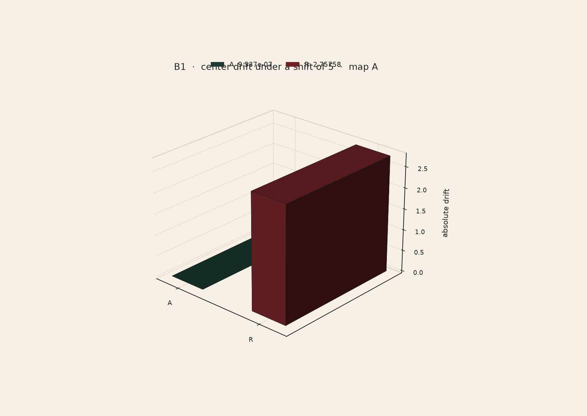
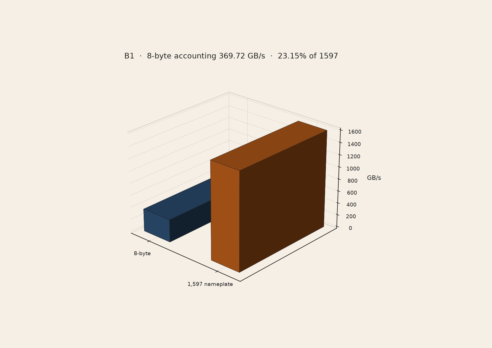
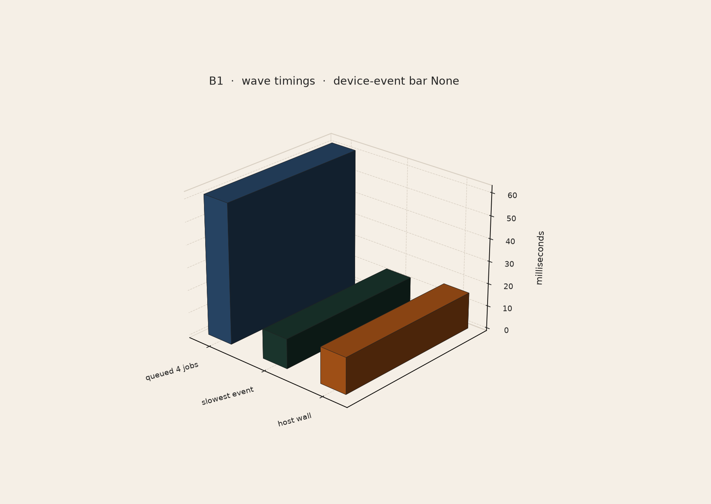
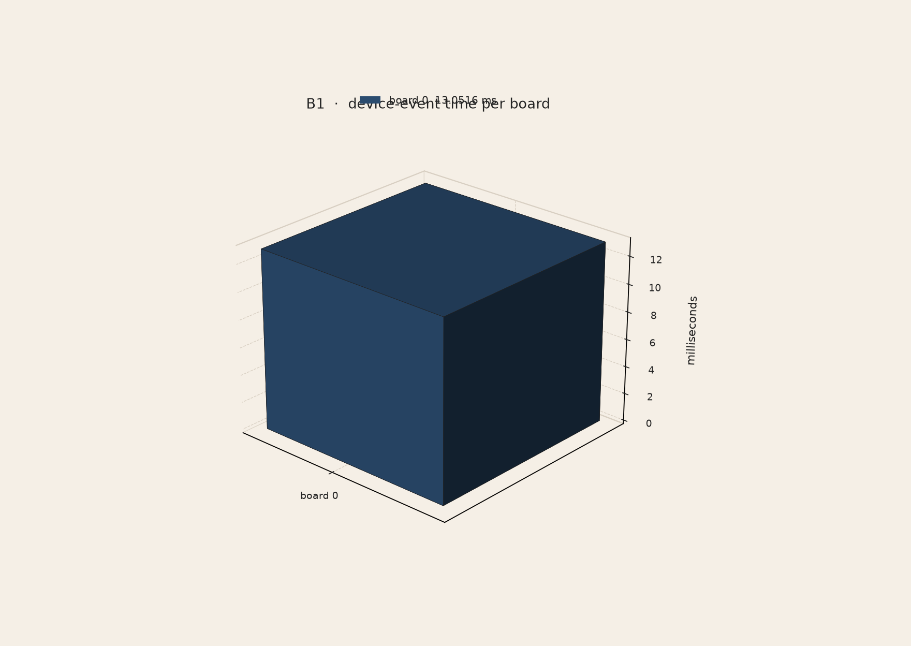
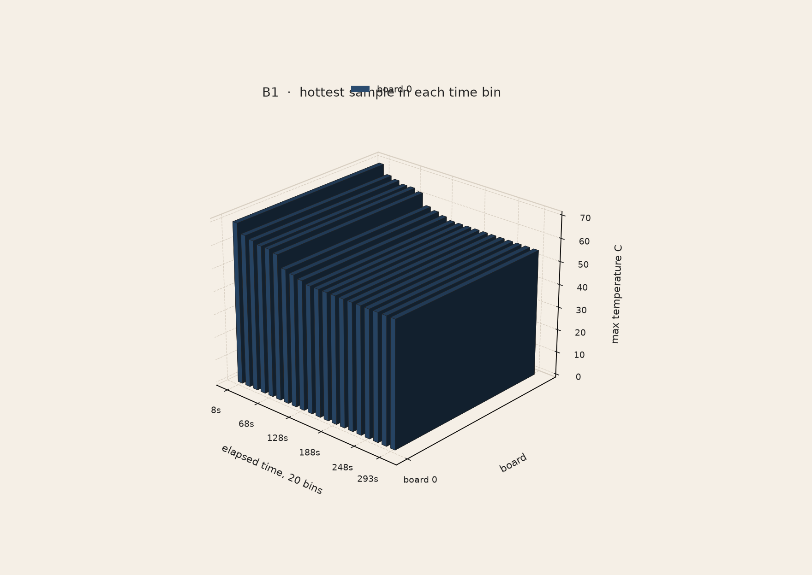
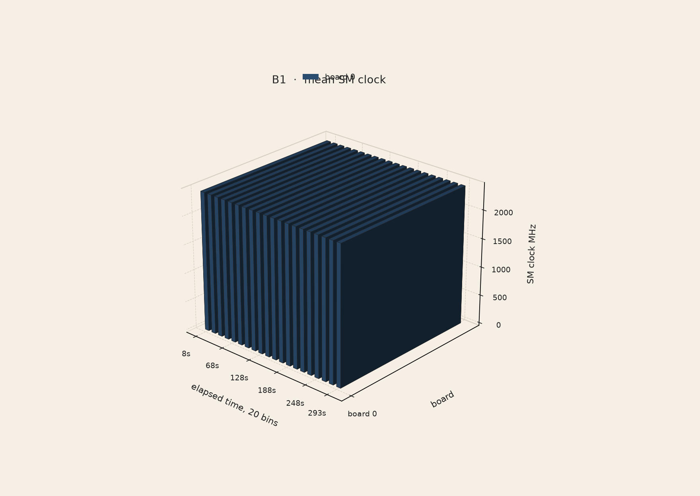
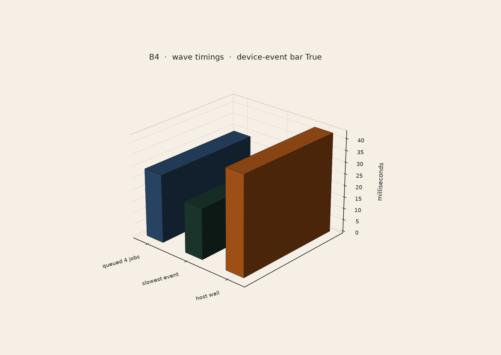
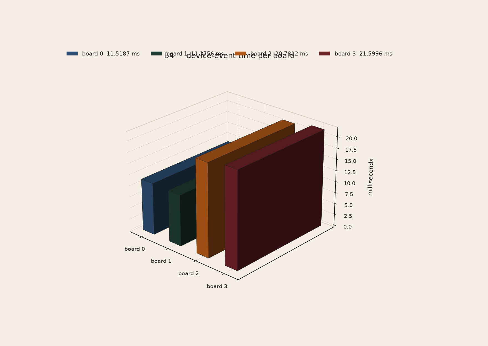
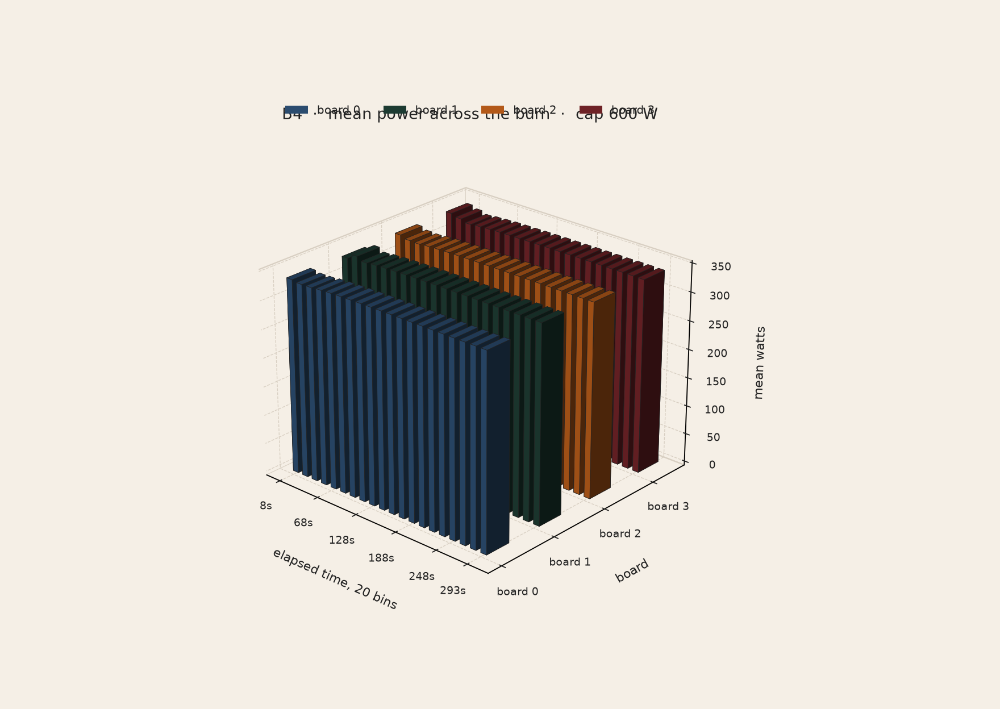
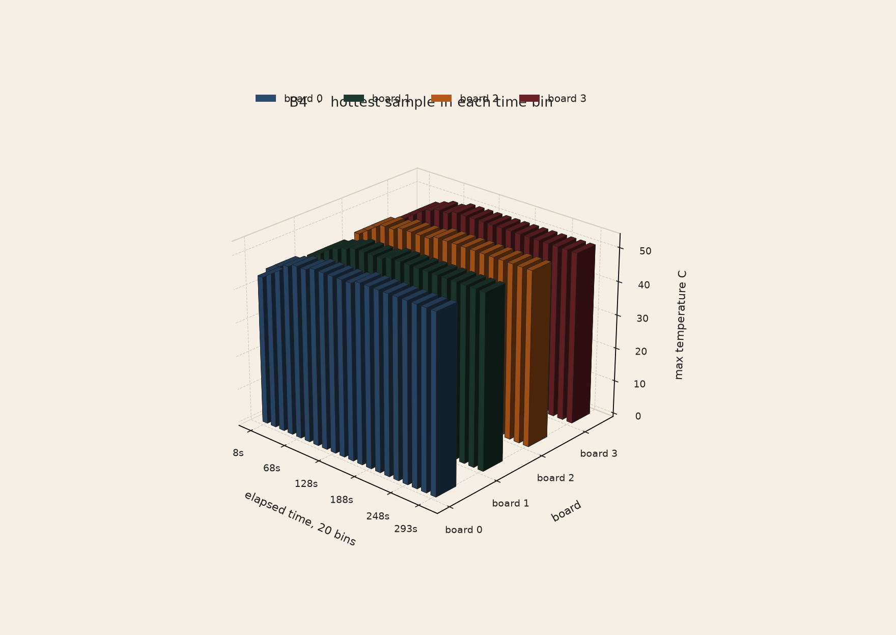

# Draft specification for counsel

**Title.** Center-keeping correction of a numeric series, with separate accounting of device time, sustained job rate, power, and temperature.

**Applicant work product.** Ceraph Corporation. This draft is for counsel. It is not a filed application. The reduction to practice described here is the pair of runs logged on 15 November 2026.

**Sheets.**

- One graphics board: `v8_final_provisional_run_B1_2026-11-15T092041Z.json`, started 2026-11-15T09:20:41Z.
- Four graphics boards: `v8_final_provisional_run_B4_2026-11-15T092049Z.json`, started 2026-11-15T09:20:49Z.

Both machines identified the processor as an NVIDIA RTX PRO 6000 Blackwell Server Edition. The run compared memory-accounting rates with a nameplate of 1,597 GB/s and power samples with a nameplate of 600 W. Software on both machines was Python 3.12.16 and PyTorch 2.15.0 built with CUDA 13.2.

## Field

The method sits in numerical correction of a stored series, and in the way a graphics processor reports the time, the sustained rate, the power, and the temperature of that correction.

## The problem the logged method addresses

A series has a center and a spread around that center. One family of corrections multiplies every value, including the center, by a scale smaller than one. A uniform shift in the input then comes back smaller than the shift that was applied. Another family multiplies only the departures from the center. A uniform shift is kept, apart from ordinary rounding, and the departures shrink.

A second problem is reporting. A short device event, a five-minute job count, and a power sample answer different questions. A byte count that is larger than the comparison nameplate is not, by itself, a measurement of memory throughput.

## Summary of the method

A user query supplies a numeric series. The method computes the center as the arithmetic mean and the spread as the mean absolute deviation from that center. It forms two candidate maps. Map A adds the center to the scaled departures. Map R multiplies the whole series by the same scale. The method then adds a known uniform shift to a copy of the series, runs both maps, and keeps the map whose output center moves less. In the logged runs that map is A.

The selected map is the only map launched on the graphics processor. The spread computed on the input is held fixed for every repeated pass. After forty passes the device result is compared with the closed form that uses the same fixed spread. The logged device residual was zero on every board.

Timing is stored in three separate fields. A short timed copy of the selected expression is converted to a rate with an explicit count of eight bytes per element. A forty-pass wave is timed with device events, and on four boards it is also compared with a queued run of four jobs. A five-minute loop counts completed jobs and, on the same interval, samples driver power and temperature. The ratio of the four-board job rate to the one-board job rate is computed only after both sheets exist. It is not written into either sheet by the run itself.

## Drawings to attach

Counsel can attach the histograms already rendered from these sheets.

- One board: power, temperature, SM clock, map drift, eight-byte rate against the 1,597 GB/s nameplate, wave timings, and the single device-event bar.
- Four boards: the same set.
- Fleet chart: add it when both sheets are in one folder. The separate packs do not contain it. The ratio is computed in the technical report from the two job rates.

### One board

### Four boards

## Detailed description

### 1. User query

The query is a finite series of numbers \(y\). In the selection test the series has length 8,192 and is drawn from a normal generator with seed 11, then shifted by \(+2\). On the device, the same seed is used for a parity probe of length 262,144. The timed copy uses 50,000,000 normally drawn values. The wave uses 16,777,216 values. The five-minute loop uses 50,000,000 values. These lengths are the ones in the sheets.

### 2. Center and spread

For a series \(y\),

\[
\mu = \operatorname{mean}(y), \qquad \xi = \operatorname{mean}(|y - \mu|).
\]

Both are computed in 32-bit floating point for the selection test. The scale at unit strength is \(\exp(-\xi)\).

### 3. The two maps

Map A, the map that was selected:

\[
A(y) = \mu + (y - \mu)\,\exp(-\lambda \xi),
\]

with \(\lambda = 1\) in the logged selection, and with \(\xi\) taken from the input and then held fixed if the map is repeated.

Map R, the map that was rejected:

\[
R(y) = y\,\exp(-\lambda \xi).
\]

Map R multiplies the center by the scale. Map A does not.

### 4. Selection

Form \(y' = y + 5\). Let \(A(y)\) and \(A(y')\) be the one-pass results, and likewise for \(R\). The drift of a map is the maximum absolute difference between the shifted result and the unshifted result plus 5. The center-keeping score used for the comparison is the negative of that drift. The smaller drift wins. Ties keep map A.

Logged CPU result, identical on both machines:

| Map | Drift under a shift of 5 |
|---|---|
| A | \(9.5367431640625 \times 10^{-7}\), which is \(2^{-20}\) |
| R | 2.757575511932373 |

Map A was selected. The same drift of map A, \(2^{-20}\), was then measured on the device on board 0 of the one-board machine and on boards 0, 1, 2, and 3 of the four-board machine.

### 5. Repeated passes

For pass \(k = 1 \ldots n\), the spread and the scale stay at the values computed from the original input. The logged check uses \(n = 40\). The closed form is

\[
\mu + (y - \mu)\,\exp(-40\,\xi).
\]

The maximum absolute residual of forty iterated passes against that closed form was 0.0 on the CPU on both machines, and 0.0 on every graphics board in `correctness_per_board`.

### 6. What is launched

The device section runs map A. Map R is scored so it can be refused. It is not the kernel named in the device records. Each device record sets `kernel` to `appreciate_A`, `xi_held_fixed` to true, `same_seed_on_every_board` to true, and `independent_physical_noise` to false. The identical residuals are execution parity under one seed. They are not five independent noise trials.

### 7. Eight-byte timing

Outside the timed interval, the method computes \(\mu\) and \(\xi\) of a buffer of 50,000,000 values and the scale \(\exp(-\xi)\). The timed interval copies \(\mu + (x - \mu)\,\mathrm{scale}\) into a second buffer. Seven device-event samples are taken. The median is the time used in the rate.

The accounting rate uses eight bytes per element: a 32-bit load and a 32-bit store. With \(N = 50{,}000{,}000\),

\[
\text{GB/s} = \frac{8N}{t_{\text{seconds}} \times 10^{9}}.
\]

A sixteen-byte column is stored beside it by doubling that rate. The sheet tells the reader that a sixteen-byte figure above 1,597 GB/s is not a memory measurement. On these two sheets the doubled column is still below 1,597 GB/s, so the Boolean `gbps_16B_is_physical_dram` is true. The headline field remains the eight-byte rate.

| Machine | Median time | Eight-byte rate | Share of 1,597 | Sixteen-byte column |
|---|---|---|---|---|
| 1 board | 1.08188796043396 ms | 369.7240514993388 GB/s | 23.15116164679642% | 739.4481029986777 GB/s |
| 4 boards | 1.0949759483337402 ms | 365.3048275705898 GB/s | 22.874441300600488% | 730.6096551411796 GB/s |

No driver counter of bytes moved on the memory bus was logged. The rate is the eight-byte accounting of the timed copy.

### 8. Wave timing

The wave buffer holds 16,777,216 values. Five warmup calls of forty passes run first. A queued interval then runs four successive forty-pass calls on board 0. A concurrent interval runs one forty-pass call on every board, timed with a device event per board. The host clock starts before the worker threads are started and stops after they join.

On one board the concurrent bar is stored as null. The bar is defined only when at least four boards are present. On four boards the bar is met when the slowest device event is strictly under three quarters of the queued time and every output is finite.

| | 1 board | 4 boards |
|---|---|---|
| Queued four jobs | 61.85414505004883 ms | 28.98624038696289 ms |
| Device events | 13.051615715026855 ms | 11.518688201904297, 11.37558364868164, 20.78121566772461, 21.599647521972656 ms |
| Slowest event | 13.051615715026855 ms | 21.599647521972656 ms |
| Three-quarter bar | 46.39060878753662 ms | 21.739680290222168 ms |
| Bar met | null | true |
| Host wall | 16.015084000173374 ms | 42.44150900012755 ms |
| Host wall slower than the queue | false | true |
| Outputs finite | true | true |

The uncached bound treats forty passes as a read and a write of the whole buffer on every pass: \(16{,}777{,}216 \times 4 \times 40 \times 2 = 5{,}368{,}709{,}120\) bytes. Dividing by the slowest event gives 411.3444064874502 GB/s on the one-board machine and 248.55540418141442 GB/s on the four-board machine. Both are under 1,597 GB/s. The sheet field `exceeds_1597` is false in both files. The queued-to-slowest ratio is 4.739194472208804 on one board and 1.3419774724321811 on four boards. The sheet marks that ratio as a wave ratio, not the five-minute fleet ratio.

### 9. Five-minute job rate

Each board repeats the selected copy until 300 seconds have elapsed. The logged durations were 300.22318226900006 s and 300.22373933100016 s. Completed jobs:

| Machine | Jobs | Jobs per second |
|---|---|---|
| 1 board | 236,547 | 787.9038461062404 |
| 4 boards | 1,101,630 | 3669.3633969612247 |

Per board on the four-board machine: 275,349, 275,421, 275,431, and 275,429 jobs, which is 917.1459945624904, 917.3858157044175, 917.4191241963518, and 917.412462497965 jobs per second.

### 10. Power, temperature, energy, clock

Driver samples were taken about once a second: 300 samples on the one-board machine and 299 samples on the four-board machine. The throttle-reason mask was 0 on every sample. No sample was over 600 W.

| Board | Mean W | Peak W | Headroom from peak | Temperature range | Energy counter delta | SM clock |
|---|---|---|---|---|---|---|
| B1 board 0 | 378.49887666666666 | 528.754 | 11.874333333333329% | 55 to 70 °C | 113,469,550 mJ | 2,422 MHz on all 300 samples |
| B4 board 0 | 341.0063946488294 | 360.501 | 39.916500000000006% | 34 to 53 °C | 102,619,137 mJ | 2,422 MHz on 285 of 299 samples |
| B4 board 1 | 344.52072909698995 | 360.743 | 39.87616666666667% | 32 to 52 °C | 103,669,604 mJ | 2,422 MHz on 280 of 299 samples |
| B4 board 2 | 338.9707859531773 | 365.275 | 39.12083333333334% | 34 to 52 °C | 101,991,141 mJ | 2,422 MHz on 285 of 299 samples |
| B4 board 3 | 337.918856187291 | 371.24 | 38.126666666666665% | 34 to 51 °C | 101,662,568 mJ | 2,422 MHz on 286 of 299 samples |

The energy figure is the change in the driver energy counter over the burn, in millijoules. Dividing by the job count gives 479.6913509788752 mJ per job on the one-board machine and 372.6875238333896, 376.4041376656101, 370.296520725699, and 369.1062596894299 mJ per job on the four boards.

### 11. Fleet ratio

Each sheet stores `j24_rho_q4_over_q1` as null. The ratio is formed afterward:

\[
\rho = \frac{3669.3633969612247}{787.9038461062404} = 4.65712080870646.
\]

Using the integer job counts, \(1{,}101{,}630 / 236{,}547 = 4.657129449961318\). The two quotients differ because the durations differ by about 0.56 ms. The runs were on two machines. Before the burns, `nvidia-smi` on the one-board machine reported driver 580.178.04, and on the four-board machine driver 580.126.09. Both reported a CUDA version of 13.0 and a power cap of 600 W. The ratio is a cross-machine job-rate ratio for this kernel. It is not a wave-event ratio, and it is not a measurement taken by switching one chassis from one board to four boards.

## Example

A user query supplies the seed-11 series of length 8,192. The method scores map A at a drift of \(2^{-20}\) and map R at a drift of about 2.758. It selects A, launches A, and returns a finite buffer. On the device the same shift test returns the same \(2^{-20}\) drift, and forty passes match the closed form exactly in the logged residual. The sheet that accompanies the result separates the 1.08 ms accounting copy, the wave events, and the 300-second job count.

## Claims

**Claim 1.** A computer-implemented method, comprising: receiving a numeric series from a user query; computing a center and a spread of the series; forming a first map that scales departures from the center and a second map that scales the series as a whole; adding a predetermined uniform shift to a copy of the series; measuring, for each map, the departure of the shifted output from the unshifted output plus the shift; selecting the map with the smaller measured departure; executing only the selected map on at least one graphics processor while holding the spread fixed across a plurality of passes; and storing, in separate fields, a device time for a copy of the selected expression, a sustained job count over a requested interval, and driver samples of power and temperature.

**Claim 2.** The method of claim 1, wherein the first map is \(\mu + (y-\mu)\exp(-\lambda\xi)\), the second map is \(y\exp(-\lambda\xi)\), \(\mu\) is the mean, \(\xi\) is the mean absolute deviation from \(\mu\), and the logged comparison at \(\lambda = 1\) with a shift of 5 selects the first map.

**Claim 3.** The method of claim 1, wherein a forty-pass iteration of the selected map is compared with the closed form that applies the forty-fold scale once, and the recorded maximum absolute residual on each graphics board is zero for the logged seed.

**Claim 4.** The method of claim 1, wherein the device-time field is converted to a rate by dividing an explicit byte count by the measured seconds, the explicit count used for the headline rate is eight bytes times the number of elements, and a second column formed by doubling that rate is stored with a comparison against a stated nameplate of 1,597 GB/s.

**Claim 5.** The method of claim 1, wherein a wave of forty passes on a buffer of 16,777,216 elements is timed with a device event, and wherein a rule that compares the slowest of those events with three quarters of a queued four-job time is evaluated when four graphics processors are present and is stored as null when fewer than four are present.

**Claim 6.** The method of claim 1, wherein a ratio of sustained job rates is computed from a one-processor sheet and a four-processor sheet only after both sheets have been written, and the ratio is not written into either sheet by the run that produced it.

**Claim 7.** A system comprising one or four graphics processors, each an NVIDIA RTX PRO 6000 Blackwell Server Edition in the logged runs, a host program that performs the method of claim 1, and a driver interface that supplies power, temperature, SM clock, throttle-reason mask, and an energy counter, the logged runs having recorded a throttle-reason mask of 0 and a power sample count of zero above 600 W.

**Claim 8.** The system of claim 7, wherein each graphics processor executes the selected map on the same seeded input, and the stored record marks that shared seed as execution parity rather than as independent physical noise.

## What this draft does not ask to be claimed from these sheets

The sheets do not contain a hardware counter of DRAM bytes. They do not show an accounting rate at the 1,597 GB/s nameplate. They do not show a power sample above 600 W. They do not identify the fleet ratio with the wave-event ratio. They do not record the two machine sizes on one chassis.
