# What happens when you send a series of numbers

This note is for a reader who does not need the formulas first. The formulas are in the technical specification. The pictures named here are the histograms rendered from the 15 November 2026 sheets. Put those PNG files in `figures/` before making a PDF.

Two computers were used. One had a single NVIDIA RTX PRO 6000 Blackwell Server Edition board. The other had four of the same board. Each board is rated at 600 watts. The program's comparison line for memory accounting is 1,597 GB/s. Nothing in these runs reached that line, and nothing drew more than 600 watts.

## The user query is the starting piece

You send a list of numbers. That list is the query. The program does not grade the list as a good or bad question. It finds the average, finds how far the numbers sit from that average, and then chooses a correction that shrinks the departures and leaves the average where it was.

There is a second correction that shrinks everything, including the average. The program calculates both. It keeps the one that does not move a known shift. On this test the shift was five. The correction that scales only the departures moved the result by \(0.00000095367431640625\), which is exactly \(2^{-20}\). The correction that scales the whole list moved the result by about 2.76. The program kept the first correction and did not run the second one on the graphics boards.

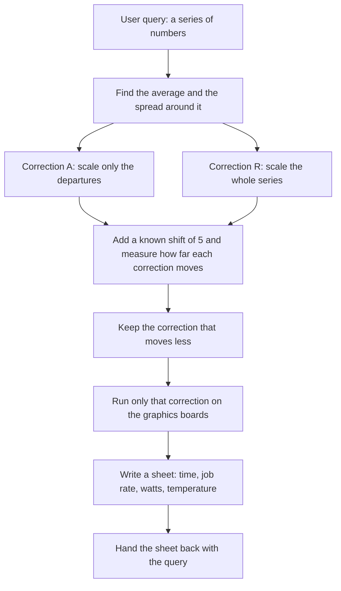

The query stays in the path. It is not replaced by a score of how pleasing the output looks. The only score used to choose the correction is how still the average stays when the input is shifted by a known amount.

## What "kept the average" looks like

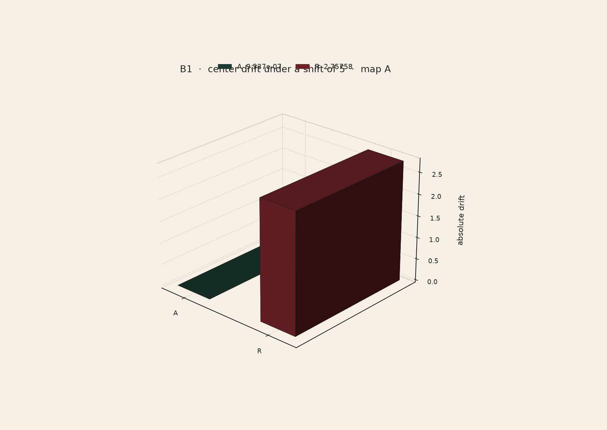

The short bar is correction A. The tall bar is correction R. The same short bar came back from the processor itself, on the single board and on all four boards of the other machine. The forty-step repeat of correction A matched its closed form with a difference of zero in the logged residual. That means the repeat did the same arithmetic the formula describes, on this seed, in this precision.

## What the machine is asked to report

After the choice, the program times three different things and refuses to mix them up.

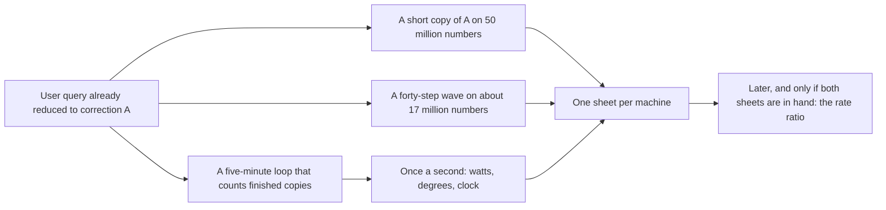

The short copy answers: if we count one 32-bit read and one 32-bit write per number, what rate does the stopwatch imply? On the single board that was 369.7 GB/s. On the four-board machine, timing board 0, it was 365.3 GB/s. The comparison line drawn next to those bars is 1,597 GB/s. The measured bars are about 23 percent of that line.

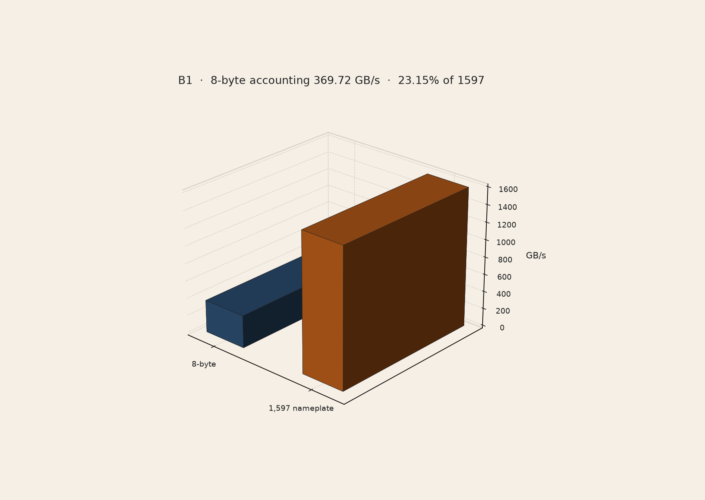

Doubling the byte count, which some drafts did when they counted a read and a write twice, still lands near 730 to 739 GB/s on these sheets. That doubled column is under 1,597. The sheet says so. The column that belongs to this correction is the eight-byte one. No instrument in the sheet counted bytes on the memory bus itself.

The wave answers a different question: how long does a forty-step run take, and on four boards does the slowest board finish inside three quarters of the time it took to run four jobs in a row on one board? On the single board that comparison is left blank, because the comparison is defined for four boards. On the four-board machine the slowest event was 21.60 ms and the three-quarter line was 21.74 ms, so the comparison passed, by 0.14 ms. The host's own clock for starting and joining the four workers read 42.44 ms, which is slower than the queued device time of 28.99 ms. Those are both real. They are not the five-minute rate.

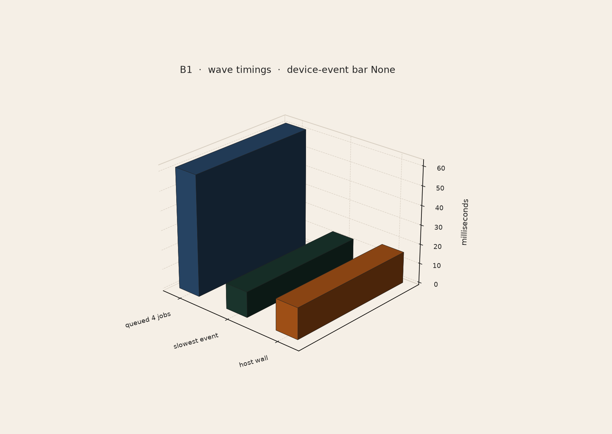

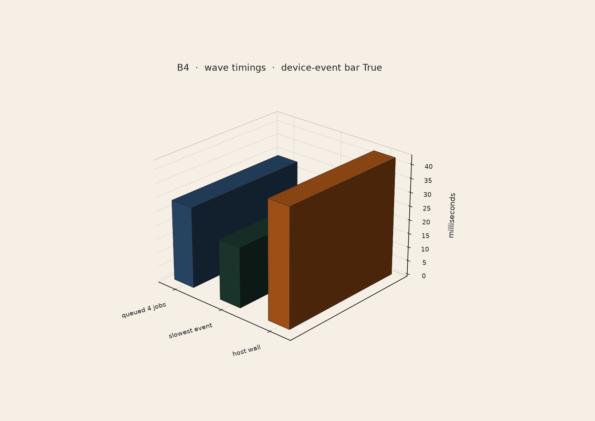

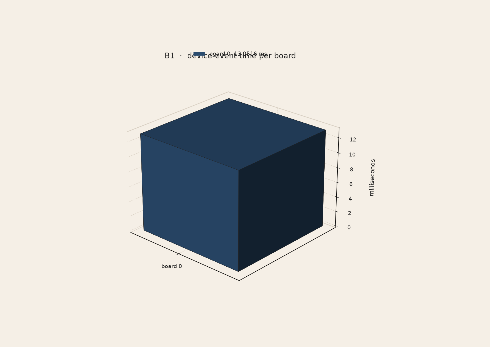

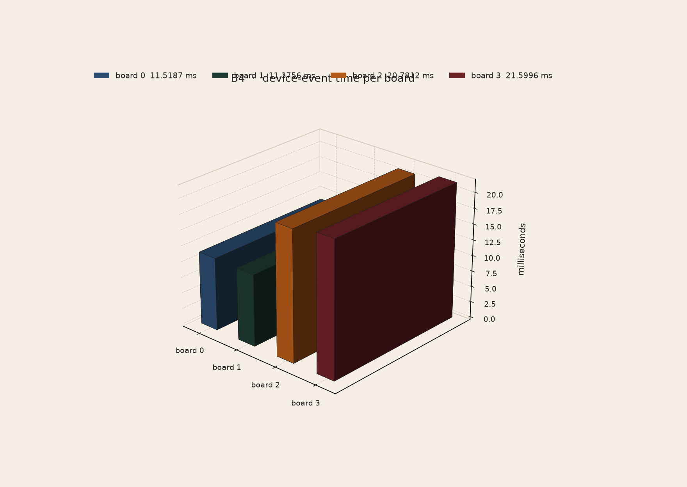

## Five minutes of work, heat, and watts

The long loop ran for 300.22 seconds on each machine. The single board finished 236,547 copies, 787.9 per second. The four boards together finished 1,101,630 copies, 3,669.4 per second. Each of those four boards finished about 917 copies per second, and their four counts differ by fewer than a hundred jobs.

While that happened, the driver was read about once a second.

The single board's power samples ran from 354 W to a peak of 528.8 W. The average was 378.5 W. Temperature ran from 55 °C to 70 °C. The clock sat at 2,422 MHz for all 300 samples. The energy counter advanced by 113,469,550 millijoules, about 31.5 watt-hours, or 480 millijoules per copy.

Each of the four boards peaked between 360.5 W and 371.2 W, averaged about 338 to 345 W, and reached 51 to 53 °C. Their clocks were at 2,422 MHz for about 94 to 96 percent of the samples. The other samples are the short climb at the start. The throttle field was 0 on every sample on every board. No sample crossed 600 W.

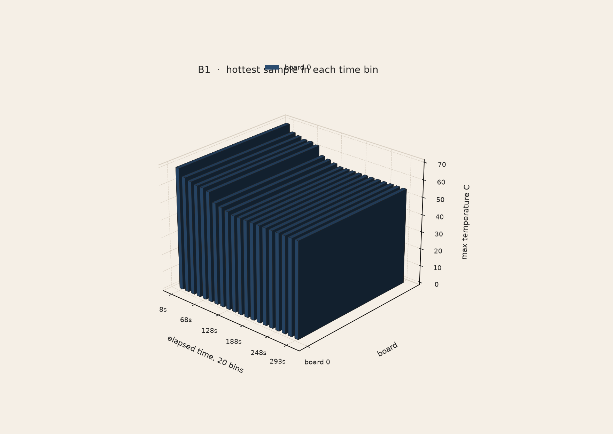

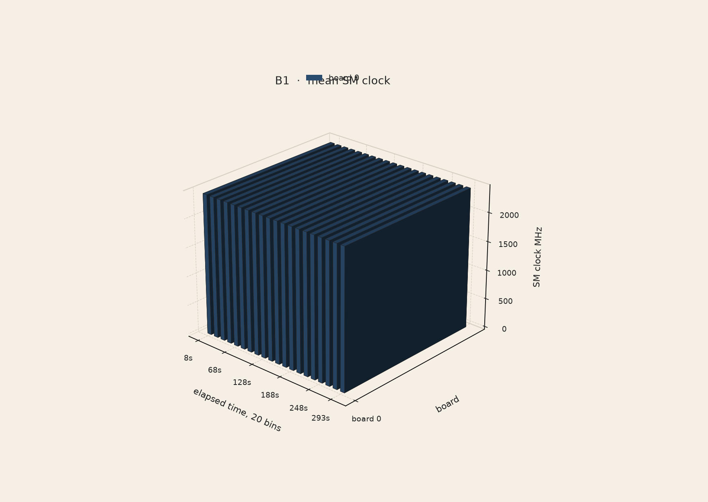

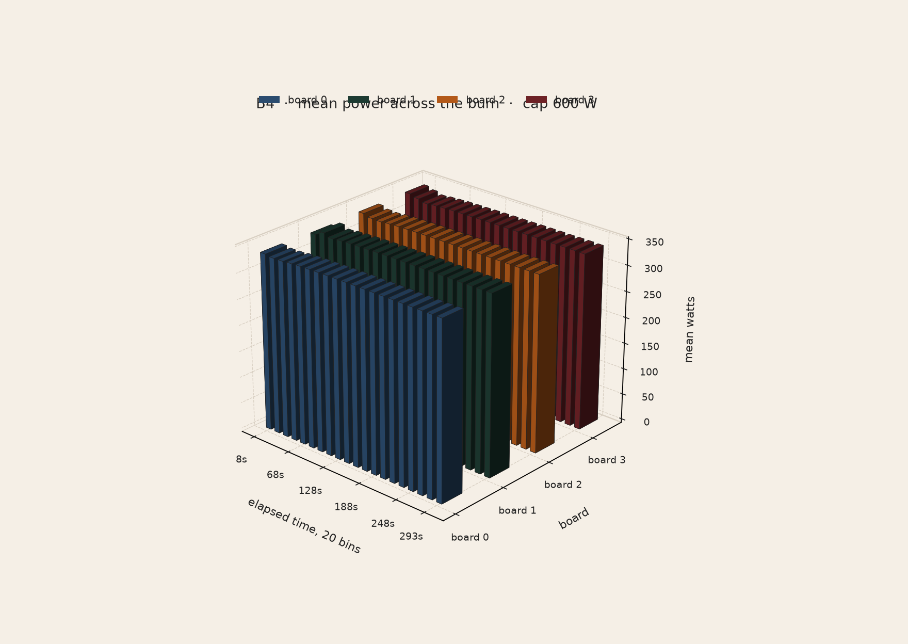

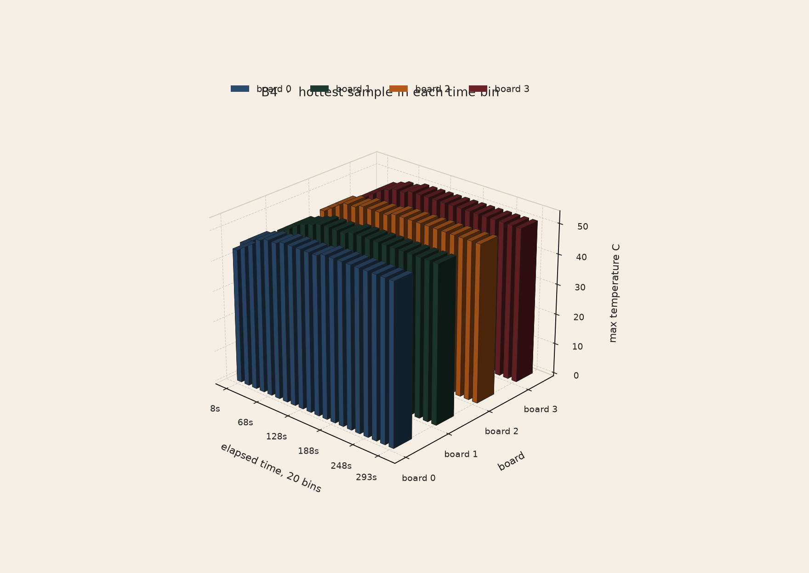

The single board was the hotter, thirstier run, and it finished fewer copies per second than each board on the four-board machine. Both machines spent the steady part of the run at the same 2,422 MHz graphics clock. The sheets do not name a cause for the rate gap. They do show that the gap is not a story about one clock being far above the other, and not a story about a board crossing its 600 W cap.

## Two machines, then one ratio

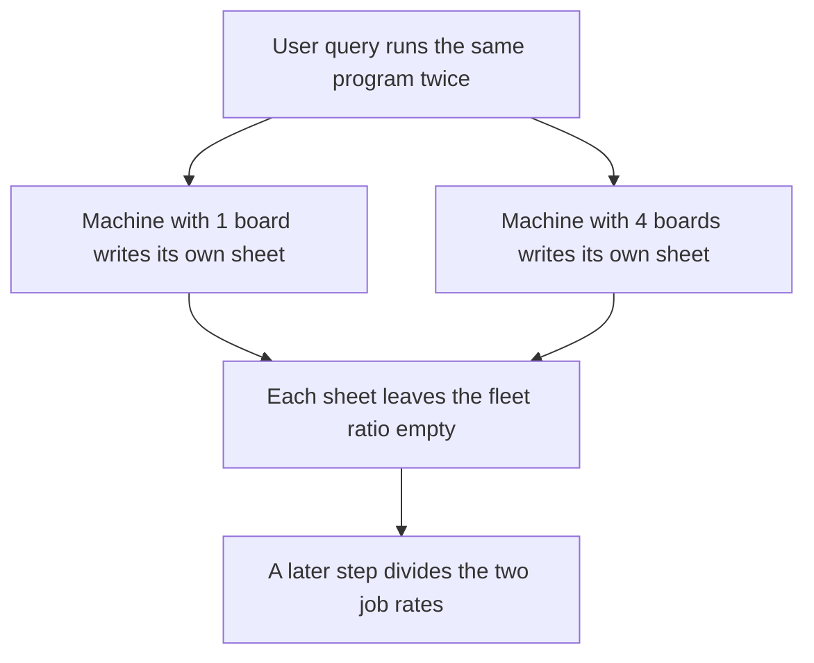

Divide 3,669.363 by 787.904 and the quotient is 4.65712. Divide the raw job counts, 1,101,630 by 236,547, and the quotient is 4.65713. The run does not pick one of those and hide the other. Both are on the page because the two runs are 0.56 ms apart in length.

This ratio compares two rented machines. The one-board machine reported driver 580.178.04. The four-board machine reported driver 580.126.09. Both reported CUDA 13.0 from the driver and both ran PyTorch's CUDA 13.2 build. The ratio is not "four boards inside one computer are 4.66 times one board in that same computer." That experiment was not the one in the sheets.

The packs that were zipped on each machine have an empty fleet ratio, because each zip contained only one sheet. That empty field is correct.

## What you can tell someone, and what you should not

You can say: we sent the same kind of numeric query to one board and to four boards; the program kept the correction that preserves a shift of five; every board agreed on that arithmetic down to a residual of zero for the forty-step check; the boards stayed under 600 W; the eight-byte stopwatch rate was about 370 GB/s; the five-minute rate on the four-board machine was 4.657 times the five-minute rate on the one-board machine.

You should not say: the boards ran at the memory ceiling; the doubled byte-count is a bus measurement; the short wave proves the five-minute scaling; four boards in one chassis were measured against one board in that chassis; the identical decimals are four independent rolls of a die. They are one seeded calculation, repeated.
