# Technical report

**Center-keeping correction on one and four NVIDIA RTX PRO 6000 Blackwell Server Edition boards**

**Date of the runs.** 15 November 2026, 09:20 UTC.

**Sheets.**

- `v8_final_provisional_run_B1_2026-11-15T092041Z.json`
- `v8_final_provisional_run_B4_2026-11-15T092049Z.json`

**Documents beside this report.** A counsel draft, a technical specification, and a plain-language note. This report is the numerical record. Histogram files belong in `figures/` and are referenced by name so a later PDF can bind them.

---

## 1. What this report covers

On the morning of 15 November 2026 the same host program ran on two rented machines. One machine exposed a single graphics board. The other exposed four. The program did three things that this report keeps separate.

First, it chose a correction. Two formulas were scored on a seeded series. The formula that scales only the departures from the mean kept a uniform shift of 5, apart from a residual of exactly \(2^{-20}\). The formula that scales the whole series moved that shift by 2.757575511932373. The first formula was selected. Only that formula was launched on the boards.

Second, it timed the selected formula in two short tests: a seven-sample copy of 50,000,000 elements, and a forty-pass wave of 16,777,216 elements. The copy is reported as an eight-byte accounting rate. The wave is reported as device-event milliseconds, with an optional concurrency bar that is defined only for four boards.

Third, it counted how many copies finished in a requested 300 seconds, and on that same interval it sampled the driver for power, temperature, SM clock, throttle reasons, and energy.

The report then divides the two sustained rates. That division was not stored in either sheet. Both sheets leave `j24_rho_q4_over_q1` null. The quotient is computed here.

The report does not use any earlier laboratory sheet as evidence. Where a field in these sheets could be misread, the misreading is named next to the field.

## 2. Machines and software

| | One-board machine | Four-board machine |
|---|---|---|
| Board | NVIDIA RTX PRO 6000 Blackwell Server Edition | Four of the same board |
| Board count stored | 1 | 4 |
| Memory reported by `nvidia-smi` before the run | 97,887 MiB | 97,887 MiB on each board |
| Power cap reported before the run | 600 W | 600 W |
| Driver reported before the run | 580.178.04 | 580.126.09 |
| CUDA version string reported by the driver | 13.0 | 13.0 |
| Compute capability read after PyTorch loaded | (12, 0) | (12, 0) on each board |
| PyTorch | 2.15.0+cu132 | 2.15.0+cu132 |
| PyTorch CUDA build | 13.2 | 13.2 |
| Python | 3.12.16 | 3.12.16 |
| Driver library for power | NVML, through `pynvml` | NVML, through `pynvml` |
| Sheet time | 2026-11-15T09:20:41Z | 2026-11-15T09:20:49Z |

The architecture list printed when PyTorch loaded included `sm_120`. That is the code for compute capability 12.0, which is the capability these boards reported. A one-element-million probe of the selected copy on the one-board machine returned a finite buffer before the long run. The four-board sheet shows finite wave outputs and a zero closure residual on every board, so the selected copy did execute on those four devices during the logged program.

The two driver patch levels are not the same. Any comparison of the machines includes that difference, the difference in host, and the difference in board count. The sheets do not include a run that disables three boards on the four-board machine.

## 3. The user query and the correction

The user query is a finite series \(y\). From it the program computes

\[
\mu = \operatorname{mean}(y), \qquad \xi = \operatorname{mean}(|y-\mu|), \qquad s = \exp(-\lambda \xi)
\]

with \(\lambda = 1\) in every logged test.

Correction A, selected:

\[
A(y) = \mu + (y-\mu)\, s.
\]

Correction R, rejected:

\[
R(y) = y\, s.
\]

If the same correction is repeated, \(s\) is not recomputed from the shrinking series. It stays at the value taken from the original input. After \(n\) repeats the closed form is \(\mu + (y-\mu)\, s^{n}\). For the unit-\(\lambda\) case, \(s^{n} = \exp(-n\xi)\). The logged check uses \(n = 40\).

The selection test adds 5 to every element and measures

\[
\delta(f) = \max |f(y+5) - (f(y)+5)|.
\]

The smaller \(\delta\) wins. On the logged series, \(\delta(A) = 2^{-20}\) and \(\delta(R) = 2.757575511932373\). The negative of \(\delta\) is what the file stores under the selection key `center_appreciation`. That key is a name in the file. The quantity is the drift.

A reader who wants the path from the query to the sheet can follow this and then ignore it in favor of the tables:

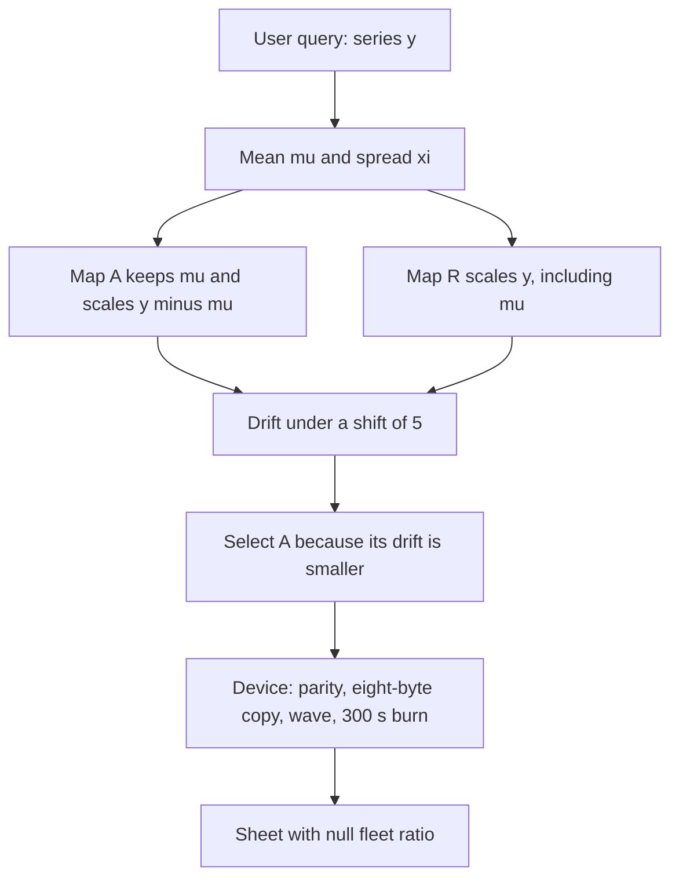

## 4. Selection numbers, CPU and device

The CPU series has length 8,192, seed 11, plus a constant 2. Both machines printed the same line before touching the long timers:

`drift_A 9.5367431640625e-07`, `drift_R 2.757575511932373`, `forty_err 0.0`.

\(9.5367431640625 \times 10^{-7}\) is exactly \(2^{-20}\). It is the residual of this float32 test, not a measured noise floor from the room.

The device probe has length 262,144 and the same seed. Every board stored:

| Machine | Board | Device shift drift | Forty-pass max error | Spread held fixed |
|---|---|---|---|---|
| 1 | 0 | \(9.5367431640625\times 10^{-7}\) | 0.0 | true |
| 4 | 0 | \(9.5367431640625\times 10^{-7}\) | 0.0 | true |
| 4 | 1 | \(9.5367431640625\times 10^{-7}\) | 0.0 | true |
| 4 | 2 | \(9.5367431640625\times 10^{-7}\) | 0.0 | true |
| 4 | 3 | \(9.5367431640625\times 10^{-7}\) | 0.0 | true |

Five identical residuals are what one deterministic program does when it is copied onto five processors. The sheet sets `same_seed_on_every_board` true and `independent_physical_noise` false. A later statistical claim would need distinct seeds or a noise source that is not this generator. This report does not make that claim.

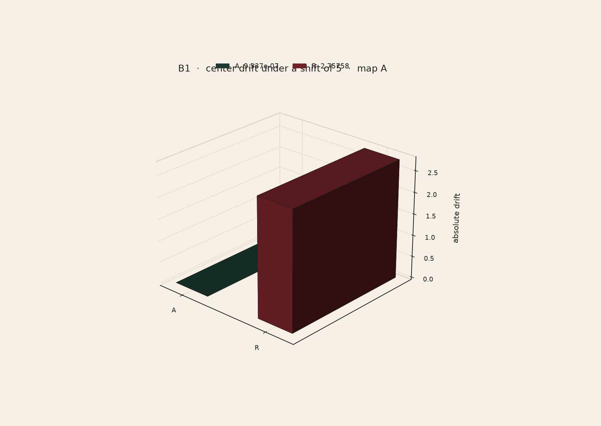

## 5. Eight-byte accounting

### 5.1 Procedure

A buffer of \(N = 50{,}000{,}000\) float32 values is filled with normal draws on board 0. The mean, the spread, and the scale are computed before the timer. The timed work is one copy:

`destination = center + (source - center) * scale`.

Seven device events are recorded. The median event is \(t\). The headline rate counts eight bytes per element:

\[
r_{8} = \frac{8 \times 50{,}000{,}000}{t_{\text{ms}} \times 10^{-3} \times 10^{9}}.
\]

The sixteen-byte column is \(2 r_{8}\). It is stored so that a reader can see the doubled arithmetic. It is not a second measurement.

### 5.2 Samples

One board, milliseconds:

1.0824320316314697, 1.075935959815979, 1.0842880010604858, 1.0714240074157715, 1.08188796043396, 1.0733760595321655, 1.081984043121338.

Median: 1.08188796043396 ms.

\[
r_{8} = \frac{400{,}000{,}000}{0.00108188796043396 \times 10^{9}} = 369.7240514993388 \text{ GB/s}.
\]

That is 23.15116164679642 percent of 1,597. The doubled column is 739.4481029986777 GB/s, 46.30232329359284 percent of 1,597.

Four-board machine, board 0, milliseconds:

1.101631999015808, 1.096351981163025, 1.0963200330734253, 1.0943039655685425, 1.0939199924468994, 1.0926400423049927, 1.0949759483337402.

Median: 1.0949759483337402 ms. Headline rate: 365.3048275705898 GB/s, 22.874441300600488 percent of 1,597. Doubled column: 730.6096551411796 GB/s.

### 5.3 How to read the Boolean

`gbps_16B_is_physical_dram` is true on both sheets. The flag is true when the doubled column is less than or equal to 1,597. Both doubled columns are near 735 GB/s, so the flag is true. The note stored next to the flag says the selected map is an eight-byte load plus a store, and that a sixteen-byte figure above 1,597 is not DRAM. On these sheets the sixteen-byte figure is not above 1,597. The headline remains 369.7 and 365.3 GB/s.

No NVML field, and no profiler field, of bytes transferred on the memory controllers was written. The accounting rate can sit at 23 percent of the comparison nameplate because the timed expression is a short elementwise copy, because the launch is included, and because the eight-byte numerator is an assumption about traffic rather than a counter. This report states the assumption and the stopwatch. It does not promote the result to a roof measurement.

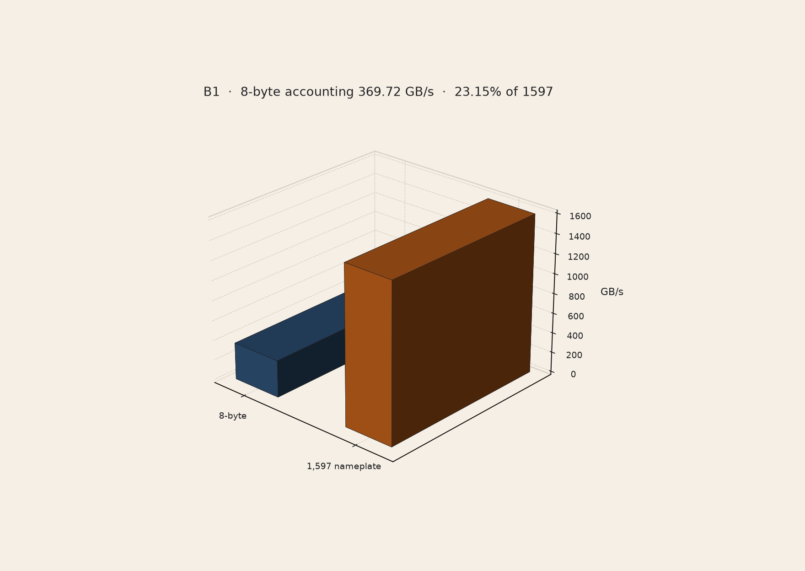

## 6. The forty-pass wave

### 6.1 Sizes

The buffer length is \(16{,}777{,}216\) elements, 64 MiB of float32. Forty passes, counting a read and a write on every pass, are

\[
16{,}777{,}216 \times 4 \times 40 \times 2 = 5{,}368{,}709{,}120 \text{ bytes}.
\]

That product is the uncached bound's numerator. It is a hypothesis about traffic, used only to test whether the stopwatch would require more than 1,597 GB/s. It did not.

### 6.2 One board

| Field | Value |
|---|---|
| Queued four jobs on board 0 | 61.85414505004883 ms |
| The one device event | 13.051615715026855 ms |
| Three quarters of the queued time | 46.39060878753662 ms |
| Bar | null |
| Host wall, including thread start and join | 16.015084000173374 ms |
| Host wall slower than the queue | false |
| Outputs finite | true |
| Uncached accounting | 411.3444064874502 GB/s, 25.75732038118035% of 1,597 |
| Above 1,597 | false |
| Queued divided by the event | 4.739194472208804 |

The null bar is the specified value for a machine with fewer than four boards. The host wall of 16.02 ms is longer than the 13.05 ms device event, which is the cost of the thread, and shorter than the 61.85 ms queued block of four jobs.

### 6.3 Four boards

| Field | Value |
|---|---|
| Queued four jobs on board 0 | 28.98624038696289 ms |
| Board 0 event | 11.518688201904297 ms |
| Board 1 event | 11.37558364868164 ms |
| Board 2 event | 20.78121566772461 ms |
| Board 3 event | 21.599647521972656 ms |
| Slowest | 21.599647521972656 ms |
| Three-quarter bar | 21.739680290222168 ms |
| Margin | 0.140032768249512 ms |
| Bar met | true |
| Host wall | 42.44150900012755 ms |
| Host wall slower than the queue | true |
| Outputs finite | true |
| Uncached accounting at the slowest event | 248.55540418141442 GB/s, 15.563895064584496% of 1,597 |
| Above 1,597 | false |
| Queued divided by slowest | 1.3419774724321811 |

Boards 0 and 1 finished the wave in about 11.5 ms. Boards 2 and 3 took about 21 ms. The bar uses the slowest, and the slowest clears the line by 0.14 ms. That is a pass on the written rule. It is a narrow pass. The host wall of 42.44 ms is the wall clock of the threaded launch, and it is slower than the 28.99 ms queued device interval. The sheet stores both facts.

Four times the fastest event is about 45.5 ms. The queued interval on board 0 was 28.99 ms, which is not four times board 0's own concurrent event of 11.52 ms. The queued loop and the threaded loop are different schedules. The report leaves them as different numbers.

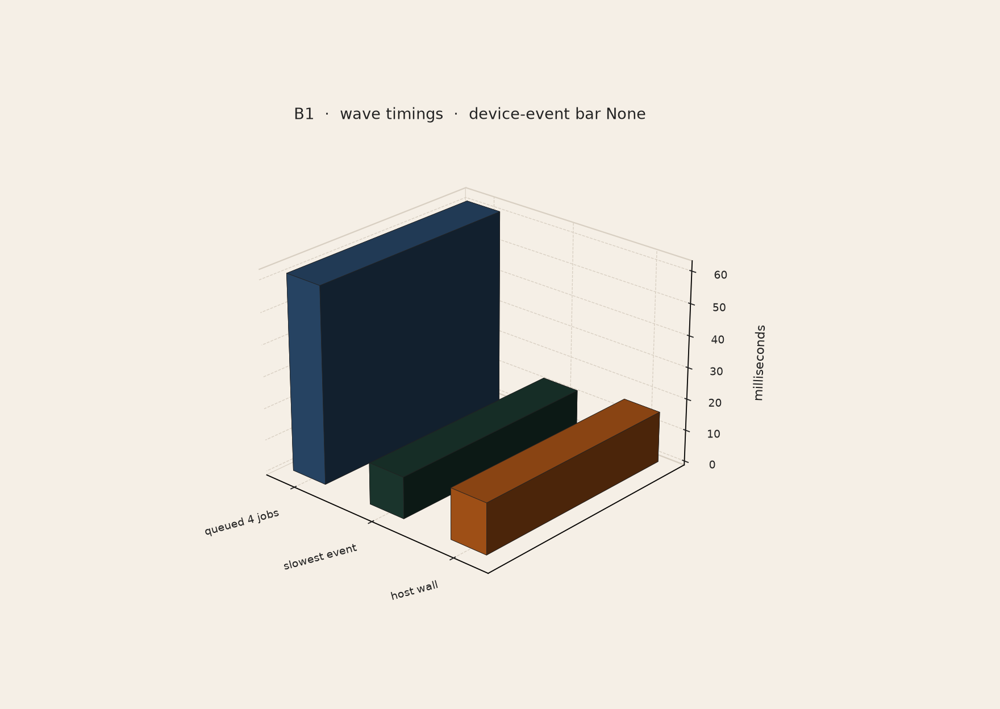

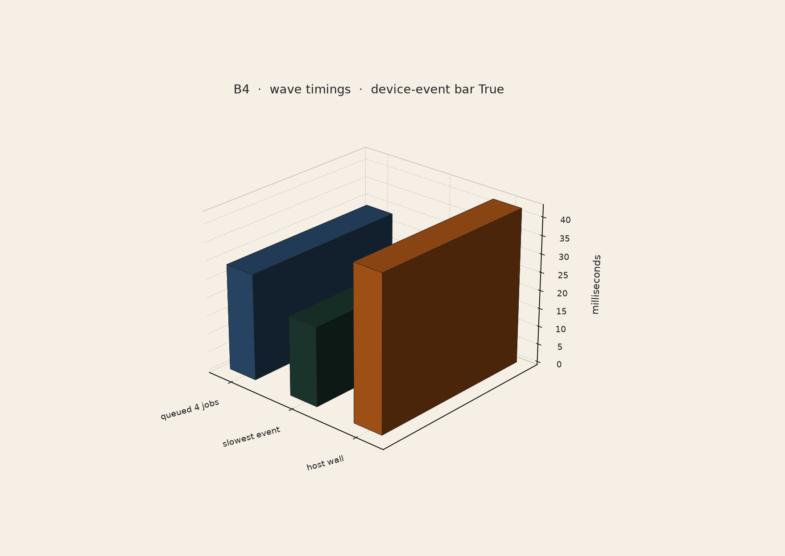

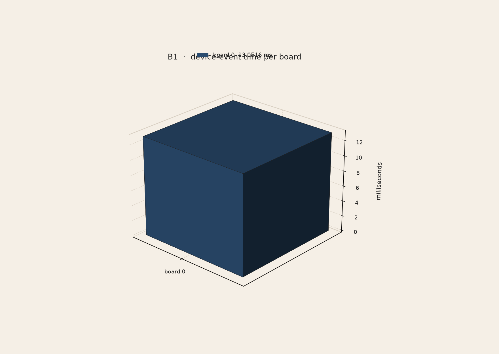

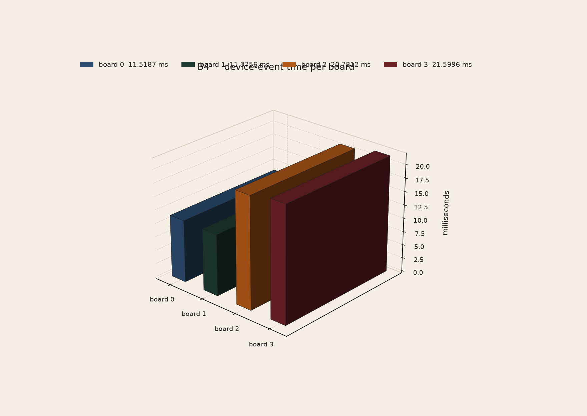

## 7. The five-minute burn

### 7.1 Counts

The deadline was 300 seconds after the worker threads were ready to start. Both runs overshot that request by a fraction of a second because the last copy is allowed to finish and the device synchronize follows the loop.

| | One board | Four boards |
|---|---|---|
| Requested | 300 s | 300 s |
| Duration | 300.22318226900006 s | 300.22373933100016 s |
| Jobs | 236,547 | 1,101,630 |
| Jobs per second | 787.9038461062404 | 3669.3633969612247 |
| Kernel length | 50,000,000 | 50,000,000 |

Check: \(236547 / 300.22318226900006 = 787.9038461062404\), and \(1101630 / 300.22373933100016 = 3669.3633969612247\). The printed rates are the counts divided by the durations, not a second estimator.

Per board on the four-board machine:

| Board | Jobs | Jobs per second |
|---|---|---|
| 0 | 275,349 | 917.1459945624904 |
| 1 | 275,421 | 917.3858157044175 |
| 2 | 275,431 | 917.4191241963518 |
| 3 | 275,429 | 917.412462497965 |

Sum of jobs: \(275349 + 275421 + 275431 + 275429 = 1101630\). The spread from the lowest count to the highest is 82 jobs, about 0.03 percent of a board's count. Over five minutes the four boards stayed together, even though the short wave had split into a pair near 11.5 ms and a pair near 21 ms. The wave and the burn are different tests. The burn equalized. The wave did not, on that single sample.

### 7.2 Why the per-board burn rate is higher on the four-board machine

Each four-board processor finished about 917 copies per second. The single processor finished 787.9. The ratio of those per-board rates is \(917.3408492403062 / 787.9038461062404 = 1.164280202176615\).

The sustained SM clock does not explain a 16 percent gap. Section 8 shows both machines at 2,422 MHz for the steady part of the window. The one-board machine drew more power at that same clock and posted fewer jobs. The hosts and the driver patch levels differ. The burn loop is a Python `while` around a device copy, so the host's ability to issue the next copy is part of the job count. This report records the gap and does not assign it to a single cause the sheets do not contain.

## 8. Power, temperature, clock, energy

### 8.1 Sample counts

The one-board series has 300 samples, from elapsed 0 to 299.43781137899987 s. The four-board series has 299 samples, from elapsed 0 to 299.9885844610003 s. The sampler waits one second between reads. A 300-second burn therefore holds about 300 reads. That is what was stored.

### 8.2 One board

| Quantity | Value |
|---|---|
| Power min, max, mean | 354.279 W, 528.754 W, 378.49887666666666 W |
| Samples over 600 W | 0 |
| Headroom from the peak | 11.874333333333329% |
| Headroom from the mean | 36.91685388888889% |
| Temperature min, max | 55 °C, 70 °C |
| SM clock | 2,422 MHz on 300 of 300 samples |
| Throttle-reason mask | 0 on 300 of 300 samples |
| Energy counter delta | 113,469,550 mJ |
| Energy-implied average | \(113469.550 / 300.223182269 = 377.951\) W |
| Energy per job | 479.6913509788752 mJ |

The energy-implied average and the mean of the power samples differ by about 0.55 W. Both are in the sheet's family of measurements. The window never sampled a cool idle: the lowest power is 354 W and the lowest temperature is 55 °C. Whatever warmed the board did so before the first sample of this burn. This report does not invent an idle baseline from a snapshot taken earlier in the morning.

Watt-hours from the counter: \(113469.550 / 3600 = 31.5193\) Wh.

### 8.3 Four boards

| Board | Power min–max | Mean W | Peak headroom | Temp min–max | Samples at 2,422 MHz | Other clocks | Energy mJ | mJ per job | Energy-implied W |
|---|---|---|---|---|---|---|---|---|---|
| 0 | 100.520–360.501 | 341.0063946488294 | 39.916500000000006% | 34–53 °C | 285 / 299 (95.3%) | 2,325 MHz ×13, 2,332 ×1 | 102,619,137 | 372.6875238333896 | 341.809 |
| 1 | 91.578–360.743 | 344.52072909698995 | 39.87616666666667% | 32–52 °C | 280 / 299 (93.6%) | 2,280 ×17, 2,295 ×1, 2,407 ×1 | 103,669,604 | 376.4041376656101 | 345.308 |
| 2 | 93.917–365.275 | 338.9707859531773 | 39.12083333333334% | 34–52 °C | 285 / 299 (95.3%) | 2,332 ×13, 2,340 ×1 | 101,991,141 | 370.296520725699 | 339.717 |
| 3 | 92.919–371.240 | 337.918856187291 | 38.126666666666665% | 34–51 °C | 286 / 299 (95.7%) | 2,347 ×7, 2,355 ×6 | 101,662,568 | 369.1062596894299 | 338.623 |

Samples over 600 W: 0 on each board. Throttle-reason mask: 0 on each sample. Mean headroom from the mean power is 43.16560089186176%, 42.57987848383501%, 43.504869007803784%, and 43.680190635451495%.

The clocks below 2,422 MHz are 13 to 19 samples, which is the opening climb. After that climb every board sits at 2,422 MHz, the same sustained clock as the one-board machine. The opening power samples near 92 to 100 W are in the series. They pull the mean down relative to a steady-state slice. The peak values, 360.5 to 371.2 W, are the right figures to place against the 600 W cap. The one-board peak of 528.754 W is closer to the cap and still under it.

The four counter deltas sum to 409,942,450 mJ, which is 409,942.450 J and 113.873 Wh over the burn. Per job, the four boards sit between 369 and 376 mJ, against 480 mJ on the one-board machine. A copy on the hotter machine cost more energy in this log. The sheets show that. They do not price a tariff.

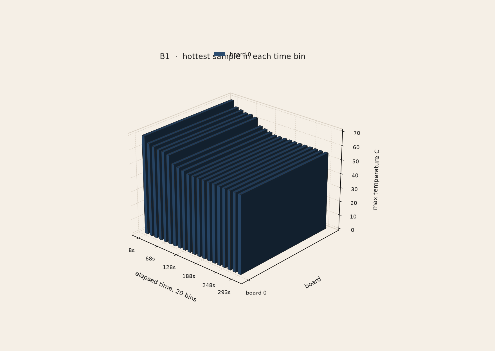

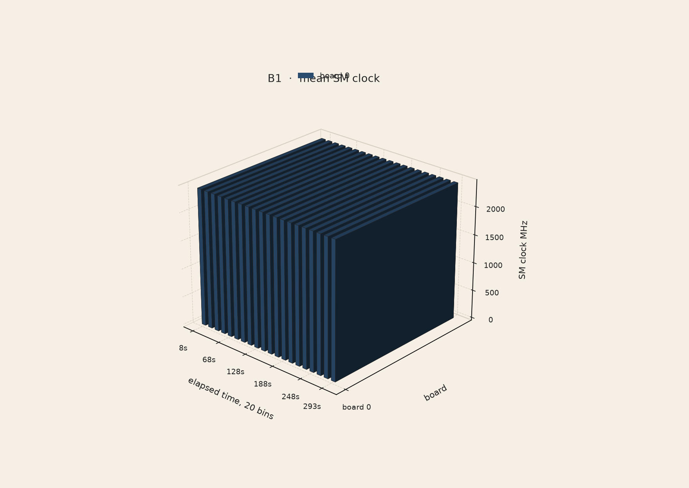

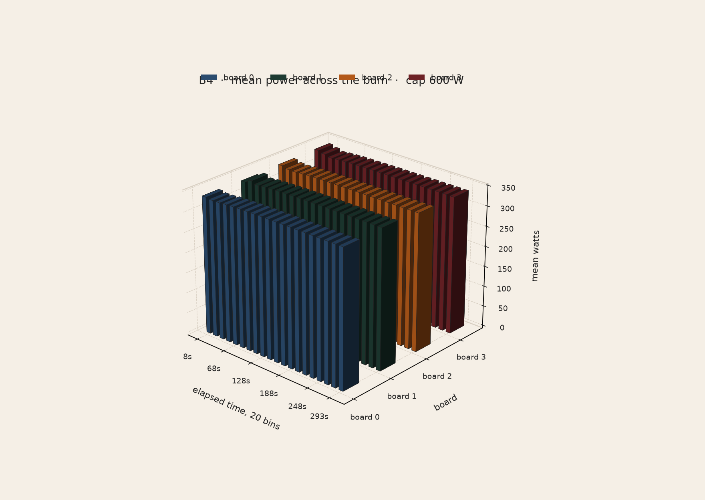

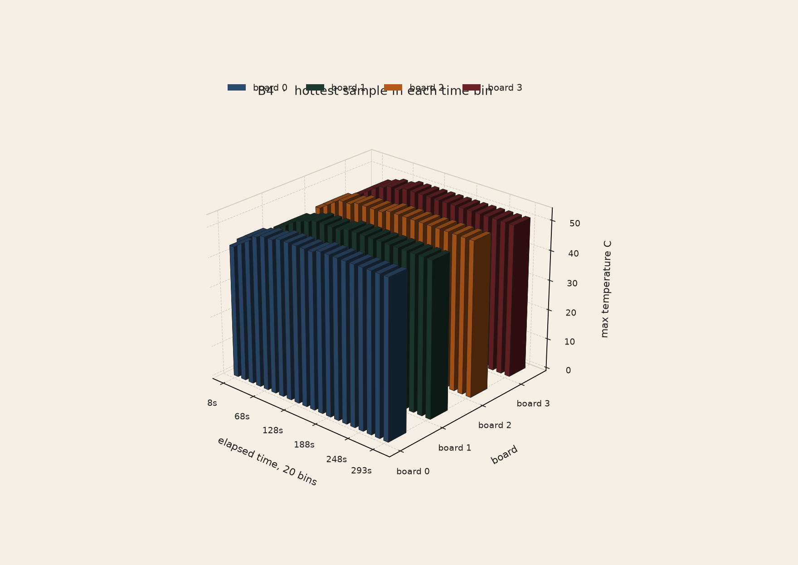

The histograms bin the one-hertz series into twenty windows. Power bars use the mean inside the window. Temperature bars use the maximum inside the window. Clock bars use the mean. The cap printed on the power chart is 600 W.

## 9. The fleet ratio, computed after the fact

\[
\rho_{\text{rates}} = \frac{3669.3633969612247}{787.9038461062404} = 4.65712080870646.
\]

\[
\frac{J_{4}}{J_{1}} = \frac{1101630}{236547} = 4.657129449961318.
\]

The second quotient ignores the 0.557 ms difference in duration. The first quotient is the one that matches `q_jobs_per_sec` in the files. Both say the same thing at four significant figures: 4.657.

Where the extra 0.657 above 4 comes from: each of the four boards ran at about 1.164 times the single board's rate, and \(4 \times 1.16428 = 4.65712\). The arithmetic is exact. The interpretation is not "the fourth board produced a bonus board." It is "the boards on the second machine each finished more copies per second than the board on the first machine."

The wave ratio on the four-board machine, queued time over slowest event, is 1.3419774724321811. Putting that number next to 4.657 and calling them one result would mix a 20 ms event with a 300 s count. The sheet sets `do_not_conflate_with_300s_rho` true. This report obeys that flag.

The zipped manifests, written at 09:26:46Z and 09:26:50Z, each list one source JSON and set `rho_q4_over_q1` to null. That is the correct contents of a one-machine pack.

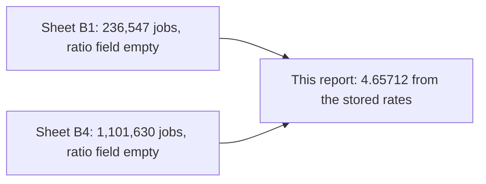

## 10. Cross-checks a reader can repeat without the boards

These checks use only the JSON.

1. Eight-byte rate. Multiply 50,000,000 by 8. Divide by the median in seconds. Divide by \(10^{9}\). The results are 369.7240514993388 and 365.3048275705898.
2. Job rate. Divide total jobs by duration. The results match `q_jobs_per_sec` exactly at the printed precision.
3. Four-board job sum. Add the four `jobs_completed` fields. The sum is 1,101,630.
4. Bar. Three quarters of 28.98624038696289 is 21.739680290222168. The slowest event, 21.599647521972656, is smaller. The bar is true. The margin is 0.140 ms.
5. Uncached bytes. \(16777216 \times 320 = 5368709120\). Divide by the slowest event in seconds and by \(10^{9}\). The results match the stored GB/s fields.
6. Energy-implied watts. Divide the millijoule delta by 1,000 and by the duration. The one-board result is 377.951 W, next to a sample mean of 378.499 W.
7. Map A residual. \(2^{-20} = 9.5367431640625 \times 10^{-7}\).

Any one of these failing on a re-export of the same file would mean the export, not the boards, had changed.

## 11. What the run establishes

On this seed, in float32, correction A keeps a shift of 5 to within \(2^{-20}\), and correction R does not. The device reproduces A's residual and a zero forty-pass closure on every logged board. The selected copy, timed as an eight-byte load and store of 50,000,000 elements, takes 1.082 ms on the one-board machine and 1.095 ms on board 0 of the four-board machine. The implied rates are 369.7 and 365.3 GB/s. A forty-pass wave stays inside an uncached accounting of 1,597 GB/s. On four boards the slowest wave event passes the three-quarter rule by 0.14 ms, and the host wall is slower than the queued device interval. Over 300.22 seconds the boards stay under 600 W, the throttle mask stays 0, and the four-board machine's combined rate is 4.657 times the one-board machine's rate, with both machines holding 2,422 MHz for the steady portion of the burn.

## 12. What the run does not establish

It does not establish a DRAM-controller throughput. The byte counts are accounting numerators.

It does not establish that the program reached the 1,597 GB/s comparison line. The headline rates are 23 percent of that line.

It does not establish a single-chassis scaling law. The two board counts lived on two machines with two driver patch levels.

It does not establish that the 4.657 ratio will recur on another host. It is the ratio of these two durations and these two job counts.

It does not establish independent physical noise. The residuals match because the seed matches.

It does not establish a thermal throttle. The mask was 0. The one-board machine was hotter and closer to 600 W. Those are observations beside a mask of 0, not a mask that says the clock was cut.

It does not establish an idle power for the one-board burn. The logged window opens at 354 W and 55 °C.

It does not treat the wave bar as comfortable margin. The margin is 0.14 ms.

## 13. Figure index for the PDF

Render order, one board then four boards.

| File | What the bars are |
|---|---|
| `figures/B1_map_drift_3d.png` | Drift of A and drift of R |
| `figures/B1_bandwidth_3d.png` | 369.7 GB/s beside the 1,597 line |
| `figures/B1_wave_3d.png` | Queued 61.85 ms, event 13.05 ms, host 16.02 ms |
| `figures/B1_event_boards_3d.png` | The single event |
| `figures/B1_power_3d.png` | Twenty bins of mean watts, cap 600 W |
| `figures/B1_temperature_3d.png` | Twenty bins of maximum °C |
| `figures/B1_clock_3d.png` | Mean SM clock, flat at 2,422 MHz |
| `figures/B4_map_drift_3d.png` | Same drifts, four-board sheet |
| `figures/B4_bandwidth_3d.png` | 365.3 GB/s beside the 1,597 line |
| `figures/B4_wave_3d.png` | Queued 28.99 ms, slowest 21.60 ms, host 42.44 ms |
| `figures/B4_event_boards_3d.png` | 11.52, 11.38, 20.78, 21.60 ms |
| `figures/B4_power_3d.png` | Twenty bins, four boards |
| `figures/B4_temperature_3d.png` | Twenty bins, four boards |
| `figures/B4_clock_3d.png` | Climb, then 2,422 MHz |

The fleet chart was not in either machine's zip, because each zip held one sheet. A PDF that wants it can build it from the two job rates in section 9. This report's numbers are enough to draw it: a bar at 787.904, a bar at 3,669.363, and a per-board pair at 787.904 and 917.341.

## 14. Records

One-board manifest, 2026-11-15T09:26:46Z: seven figures, one source JSON, fleet ratio null.

Four-board manifest, 2026-11-15T09:26:50Z: seven figures, one source JSON, fleet ratio null.

Figure captions shipped with the one-board pack state the median kernel time as 1.0819 ms, the queued wave as 61.8541 ms, the slowest event as 13.0516 ms, and the host wall as 16.0151 ms, and they state that the uncached bound does not exceed 1,597 GB/s. Those captions match section 6.2.

## 15. A four-number walkthrough

The logged series is 8,192 values long, so it does not fit on a page as a hand example. The same two formulas on a four-element series show the mechanism without pretending to be the board result. Take \(y = (1, 2, 3, 6)\) in float32.

The mean is 3. The mean absolute deviation is 1.5. The scale is \(\exp(-1.5) = 0.22313015162944794\).

Correction A returns approximately \((2.5537, 2.7769, 3.0000, 3.6694)\). The middle value, which already sat on the mean, stays on the mean. The values above and below move toward 3 and do not cross it.

Correction R returns approximately \((0.2231, 0.4463, 0.6694, 1.3388)\). Every value, including the center of the list, has been multiplied by 0.2231. The average of the output is no longer 3.

Add 5. The new series is \((6, 7, 8, 11)\). Its mean is 8 and its spread is still 1.5, because a uniform shift does not change absolute deviations from the mean. Correction A on the shifted series, minus 5, matches correction A on the original series with a maximum absolute gap of 0 on this example. Correction R misses by 3.8843493461608887. Forty repeats of A with the scale held fixed match the closed form with a gap of 0 on this example as well.

This example is a hand check of the algebra. The board result remains the seed-11 result in section 4: a drift of \(2^{-20}\) for A, a drift of 2.757575511932373 for R, and a forty-pass residual of 0.

## 16. Why the logged residual is exactly one part in \(2^{20}\)

Float32 keeps 24 bits of significand, including the hidden bit. A value near a few units cannot represent every real number, and a chain of add, subtract, and multiply ends on a representable number. For the seed-11 series the maximum gap left by correction A under a shift of 5 landed on \(2^{-20}\), and it landed there on the CPU and on every board. That agreement is the useful fact. The same gap is a representable float32 number. The sheets record that the test produced it. They do not record a search for a smaller representable gap.

The forty-pass residual of 0 is a stronger statement about this particular closed form. Holding \(\xi\) fixed makes the repeat a geometric contraction toward \(\mu\). Doing it forty times in a loop, and doing \(\exp(-40\xi)\) once, produced the same float32 buffer on the logged inputs. A different length, a different seed, or a spread recomputed every pass would be a different test. The sheets do not report those variants.

## 17. What one job is

A job in the five-minute count is one execution of the selected copy on a buffer of 50,000,000 float32 values that already resides on the device. The mean, the spread, and the scale are computed once, before the loop. The destination buffer is allocated once. Each trip through the loop is a device copy of \(\mu + (x-\mu)s\) and an increment of a host counter. When the deadline has passed, the thread synchronizes the device and publishes the counter.

The job is not the forty-pass wave. The wave is a separate, short test. The job is not the seven-sample timing used for the eight-byte rate, either. That timing also uses 50,000,000 elements, but it stores milliseconds rather than a five-minute count. Using one name for all three would make the 787.9 jobs per second look like a bandwidth. It is a count of copies issued by a Python loop.

On the one-board machine the loop issued 236,547 copies in 300.22318226900006 seconds. The mean time per copy implied by that count is \(300.223182269 / 236547 = 0.00126915\) seconds, about 1.269 ms. The median device event in the seven-sample test was 1.082 ms. The burn's implied time is longer. The burn includes the Python loop test, the counter increment, and whatever else the host did between copies. The seven-sample test is a device event around one copy, taken after the reductions. Both numbers are in the sheet. They are allowed to differ, and they do, by about 0.19 ms.

On each four-board processor the implied time per copy is about \(1/917.34 = 0.0010901\) seconds, about 1.090 ms, which sits next to that machine's median device event of 1.095 ms. The host on that machine kept up with the device event. The host on the one-board machine did not, at least not in this log. That is consistent with section 7.2 and still does not name the host difference beyond the driver patch levels already recorded.

## 18. Units, so the rate cannot be quietly rescaled

The headline rate divides bytes by seconds and then by \(10^{9}\). It is a decimal GB/s figure. It is not a GiB/s figure. Dividing by \(2^{30}\) instead of \(10^{9}\) would shrink the same byte count by the factor \(10^{9}/2^{30} \approx 0.9313\), and the one-board headline would print near 344 GiB/s. This report does not do that. The sheets use \(10^{9}\).

The comparison line of 1,597 is stored in the same unit as the headline. Percentages in the sheet divide the decimal rate by 1,597 and multiply by 100. Repeating that division is how section 10's first check is done.

A rate above 1,597 in this unit would mean the assumed byte count and the stopwatch cannot both be a description of streaming traffic against that nameplate. The logged headlines are below the line. The logged doubled columns are also below the line. The wave's uncached accounting is below the line. The report stops at those three statements.

## 19. The narrow pass on the four-board wave, board by board

Number the events again, slowest last:

| Board | Event ms | Gap to the 21.73968 ms bar |
|---|---|---|
| 1 | 11.37558364868164 | 10.364 ms inside the bar |
| 0 | 11.518688201904297 | 10.221 ms inside the bar |
| 2 | 20.78121566772461 | 0.958 ms inside the bar |
| 3 | 21.599647521972656 | 0.140 ms inside the bar |

Boards 0 and 1 would have passed with a wide margin. Board 2 would have passed by about a millisecond. Board 3 is the board that decides the bar, and it decides it by 0.14 ms. A second draw of the same test could land on the other side of the line. The sheet records one draw, and that draw passed. The report calls it a pass and records the margin in the same sentence.

The host wall of 42.44150900012755 ms is about twice the slowest device event. Starting four threads, recording four events, and joining four threads cost more wall time than the slowest kernel. That cost is why a fleet ratio is taken from a five-minute count and not from this wall clock. Over five minutes the thread start happens once. In the wave it is a large share of a 40 ms interval.

## 20. Opening climb on the four-board clock

Of 299 samples, the boards sat at 2,422 MHz for 285, 280, 285, and 286 samples. The remainder is 14, 19, 14, and 13 samples. At one sample per second, that remainder is a quarter-minute or less at the start of the window. The other clock values stored are 2,325, 2,332, 2,280, 2,295, 2,407, 2,340, 2,347, and 2,355 MHz. None of those is the steady value. The steady value matches the one-board machine, which never left 2,422 MHz in 300 samples.

Power at the first samples on the four-board machine is near 92 to 100 W. Power at the first sample on the one-board machine is already 354 W. The histograms' first bin therefore means something different on the two charts. On the four-board chart it includes the climb. On the one-board chart the climb, if there was one, happened before elapsed time 0 of this sheet.

## 21. Energy arithmetic, written out

NVML's total-energy counter advances in millijoules. The sheet stores the difference between the read after the join and the read before the burn.

One board: 113,469,550 mJ.

\[
\frac{113469550}{1000 \times 300.22318226900006} = 377.951 \text{ W}.
\]

The mean of the 300 power samples is 378.49887666666666 W. The two averages are 0.55 W apart. Sample mean weights each one-second read equally. The counter weights the true integral. Both stay in the sheet.

Joules per job: \(113469.550 / 236547 = 0.479691\) J, which is the stored 479.6913509788752 mJ.

Four boards, millijoules: 102,619,137, 103,669,604, 101,991,141, and 101,662,568. Sum: 409,942,450 mJ = 409,942.450 J.

\[
\frac{409942.450}{3600} = 113.873 \text{ Wh}.
\]

The one-board burn is 31.519 Wh by the same conversion. Four boards used 3.61 times that energy and finished 4.657 times as many jobs. Joules per job are therefore lower on the four-board machine, which is the same fact as section 8 stated in millijoules. It is not a claim about a data-center bill. The rental price is not in the sheet.

## 22. How to run the same sheet again

The host needs the driver, PyTorch with a CUDA build that can launch a kernel on compute capability 12.0, NumPy, and the NVML bindings. The logged build was PyTorch 2.15.0+cu132 on Python 3.12.16. The driver on the one-board machine reported CUDA 13.0 at patch 580.178.04. The four-board machine reported CUDA 13.0 at patch 580.126.09. A kernel launch was confirmed on the one-board machine before the burn, and the burn itself produced finite outputs on both machines.

Set the requested burn to 300 seconds. Point the output directory at the working directory. Refuse the launch if correction A loses the shift test or if the forty-pass CPU residual is not below \(10^{-5}\). Write one JSON per machine. Leave the fleet field null. Copy both JSON files to one directory before dividing the rates.

A regression that only checks the seed-11 drift can run on a CPU. A regression that checks watts, clocks, or the 4.657 ratio has to name the machine. Those quantities are not properties of the formula alone.

## 23. What counsel can attach, and only that

Attach the two JSON files, or the summaries plus the full files if the one-hertz series is kept. Attach the fourteen histograms named in section 13. Attach this report's tables for the ratio, since the histograms zipped on each machine do not contain the fleet chart.

The claim set that matches these attachments is the set in the counsel draft: select the map by the shift test, hold the spread fixed, time the copy with an eight-byte numerator, keep the wave bar null below four boards, sample power against 600 W, and compute the fleet ratio only after both sheets exist.

A sentence that says the boards saturated a 1,597 GB/s memory bus is not supported by an attachment in this folder. A sentence that says one chassis scaled by 4.657 when three boards were enabled is not supported either. The attachments support the sentences in section 11.

## 24. The seven samples, sorted, so the median is visible

A median of seven numbers is the fourth after sorting. The sheet stores the samples in the order they were taken and stores the median separately. Sorting them shows that the stored median is that fourth value, not a rounded stand-in.

One board, slowest last is the wrong order for a median. Sorted, fastest first:

| Order | Event ms |
|---|---|
| 1 | 1.0714240074157715 |
| 2 | 1.0733760595321655 |
| 3 | 1.075935959815979 |
| 4 | 1.08188796043396 |
| 5 | 1.081984043121338 |
| 6 | 1.0824320316314697 |
| 7 | 1.0842880010604858 |

The fourth row is the stored median, 1.08188796043396 ms. The fastest sample is 0.0105 ms under the median. The slowest is 0.0024 ms over it. The spread of the seven events is 0.0129 ms. The headline rate uses the middle one.

Four-board machine, board 0, sorted the same way:

| Order | Event ms |
|---|---|
| 1 | 1.0926400423049927 |
| 2 | 1.0939199924468994 |
| 3 | 1.0943039655685425 |
| 4 | 1.0949759483337402 |
| 5 | 1.0963200330734253 |
| 6 | 1.096351981163025 |
| 7 | 1.101631999015808 |

The fourth row is the stored median, 1.0949759483337402 ms. The spread of these seven events is 0.0090 ms. Both medians sit inside a hundredth of a millisecond of their neighbors. Replacing the median with the fastest or the slowest sample would move the headline by a few GB/s, not by a factor of two. The report uses the median the sheet stored.

## 25. Headroom, written as a subtraction from 600 W

Headroom from the peak is \((600 - \text{peak}) / 600 \times 100\). Headroom from the mean is \((600 - \text{mean}) / 600 \times 100\). Both are percentages of the nameplate, not percentages of the sample.

| Board | Mean W | Peak W | Peak headroom | Mean headroom |
|---|---|---|---|---|
| One-board, gpu 0 | 378.49887666666666 | 528.754 | 11.874333333333329% | 36.91685388888889% |
| Four-board, gpu 0 | 341.0063946488294 | 360.501 | 39.916500000000006% | 43.16560089186176% |
| Four-board, gpu 1 | 344.52072909698995 | 360.743 | 39.87616666666667% | 42.57987848383501% |
| Four-board, gpu 2 | 338.9707859531773 | 365.275 | 39.12083333333334% | 43.504869007803784% |
| Four-board, gpu 3 | 337.918856187291 | 371.24 | 38.126666666666665% | 43.680190635451495% |

The tightest peak on the morning is the one-board peak of 528.754 W, which leaves 71.246 W under the cap. The four-board peaks leave between 228.76 W and 239.50 W. Zero samples on any board crossed 600 W. The headroom percentages are that statement in another unit.

## 26. The four job counters add up, and they nearly match

The four counters are 275,349, 275,421, 275,431, and 275,429. Their sum is 1,101,630, which is the machine total stored on the sheet. The largest minus the smallest is 82 jobs. Over about 300 seconds, 82 jobs is a gap of roughly 0.09 seconds of work at 917 jobs per second. The boards finished the burn together for any purpose this report has.

Each board's jobs-per-second figure is its own counter divided by the shared duration 300.22373933100016 s. Adding the four rates gives 3,669.3633969612247 jobs per second, which is the machine rate stored on the sheet. The mean of the four rates is that total divided by four, 917.3408492403062. The fleet ratio in section 9 divides the machine totals, 3,669.3633969612247 by 787.9038461062404, and does not divide a single board by the one-board machine.

The wave on the same four boards did not finish together. Two events were near 11.5 ms and two were near 21 ms. The burn counters do not inherit that split. A reader who expects the slow wave boards to finish tens of percent fewer jobs will not find that in the five-minute count.

## 27. How to read the histograms when they are dropped in

Each machine pack contains seven pictures. The captions written beside the one-board pack, and the same layout on the four-board pack, say what the height means. The PDF should use those meanings and not invent a second scale.

Power. Twenty time bins. The height is the mean of the driver power samples that fell in that bin, per board. The cap drawn with the chart is 600 W. On the one-board picture the series never starts near idle: the first sample is already 354.279 W and the clock is already 2,422 MHz. On the four-board picture the first samples are near 92 to 100 W and the clock is still climbing, so the first bin is a climb, not a steady state.

Temperature. The height is the hottest sample in the bin, not the mean. The one-board range in the raw series is 55 to 70 °C. The four-board ranges are 34 to 53, 32 to 52, 34 to 52, and 34 to 51 °C. A bin that shows the top of the range is doing what the caption says.

Clock. The height is the mean SM clock in the bin. A flat bar at 2,422 MHz is the steady value on both machines. Short bars, if the four-board picture shows them, belong to the opening samples listed in section 20. The one-board series has no other value to average in.

Map drift. Two bars. Correction A is the short bar, \(9.5367431640625 \times 10^{-7}\). Correction R is the tall bar, 2.757575511932373. The picture is the selection, not a bandwidth.

Bandwidth. The measured column is the eight-byte headline. The comparison line is 1,597 GB/s. Median kernel time on the one-board caption is 1.0819 ms, which rounds the stored 1.08188796043396 ms. The four-board median is 1.0949759483337402 ms.

Wave. Three times: the queued run, the slowest device event, and the host wall. One board: 61.8541 ms, 13.0516 ms, 16.0151 ms. Four boards: 28.9862 ms, 21.5996 ms, 42.4415 ms. The caption's statement that the uncached accounting does not exceed 1,597 GB/s matches `exceeds_1597: false` on both sheets.

Event boards. One bar per board for the forty-pass device event. The one-board picture has a single bar at 13.051615715026855 ms. The four-board picture has four bars, and the rightmost of them is the one that clears the three-quarter line by 0.140 ms.

The fleet pictures, jobs and power-with-temperature, are not in either pack. Each manifest lists seven figures and a null ratio. Those two fleet pictures exist only if both JSON files are rendered in one folder. Until that render exists, section 9's table is the fleet figure.

## 28. What each stored field is, in ordinary words

The sheet is one JSON object. The names below are the names in the file. The sentence after each name is what this report treats the field as meaning. A later reader should be able to open the file and land on the same number.

`schema` is the string `v8_final_provisional_run`. It identifies the writer, not a version of an older sheet.

`date_utc` is the start stamp. One board: 2026-11-15T09:20:41Z. Four boards: 2026-11-15T09:20:49Z.

The selection object records `selected_map` A, `rejected_map` R, `drift_A`, `drift_R`, `forty_pass_max_err`, and a Boolean that the selection passed. The selection key's stored name is `center_appreciation`. This report uses the drift itself. An unused Boolean in that object is false and is not an input to any number in the tables.

`environment` records the board count, the processor name, the PyTorch build, the Python version, whether the driver library loaded, the 600 W nameplate, and the 1,597 GB/s comparison nameplate.

`correctness_per_board` is one record per board. It names the kernel `appreciate_A`, states that every board used the same seed, states that the test was not an independent noise trial, stores the device shift drift and the forty-pass residual, and states that the spread was held fixed. Five records exist across the two sheets. All five drifts equal \(9.5367431640625 \times 10^{-7}\). All five residuals equal 0.

`bandwidth_cells_j25` is the seven-sample timing on board 0. `nodes` is 50,000,000. `median_ms` and `samples_ms` are section 24. `gbps_8B_decimal` is the headline. `pct_of_1597_8B` is that headline divided by 1,597, times 100. `gbps_16B_synthetic_register_basis` is twice the headline. `gbps_16B_is_physical_dram` is the comparison of that double with 1,597, as section 5.3 describes. `headline_dram_gbps` copies the eight-byte figure. `mu_xi_reduction_excluded_from_timed_kernel` is true: the mean and the spread were computed before the timed copy.

`wave_scaling_j26` is the forty-pass test. `length` is 16,777,216. `passes` is 40. `warmup` is 5. `multi_board` is false on the one-board sheet and true on the four-board sheet. `t_queued_4jobs_ms` is the queued timing even when only one board is present; the name says four jobs because that is the comparison the bar uses, and the bar itself is null when fewer than four boards ran. `t_event_boards_ms` lists one event per board. `t_event_slowest_ms` is the max of that list. `t_host_wall_ms` includes thread start and join. `three_quarter_bar_ms` is 0.75 times the queued time. `j26_device_event_bar_met` is null or true. `host_wall_slower_than_queue` compares the host wall with the queued time. `outputs_finite` is true on both sheets. The uncached object stores 5,368,709,120 bytes, the rate those bytes imply on the slowest event, the percent of 1,597, and `exceeds_1597` false. `ratio_queued_over_slowest_event` is the queued time divided by the slowest event. `do_not_conflate_with_300s_rho` is true, and this report obeys it.

`burn` stores the measured duration, the requested 300 seconds, the total jobs, the jobs per second, and one record per board with jobs, rate, kernel, element count, mean watts, peak watts, samples over 600 W, both headrooms, minimum and maximum temperature, energy in millijoules, and millijoules per job.

`j24_rho_q4_over_q1` is null on both sheets. The ratio in section 9 is computed by this report from the two `q_jobs_per_sec` fields. It was not written by the run.

The one-board manifest, written at 2026-11-15T09:26:46Z, names the one-board JSON and the seven `B1_` pictures, and stores a null ratio. The four-board manifest, written at 2026-11-15T09:26:50Z, names the four-board JSON and the seven `B4_` pictures, and stores a null ratio. A manifest is a packing list. It is not a second measurement.

## 29. A reader checking one number at a time

The checks below use only arithmetic. They do not need the boards.

1. \(9.5367431640625 \times 10^{-7} \times 2^{20} = 1\). The logged drift of correction A is exactly \(2^{-20}\).
2. Sort either list of seven samples. The fourth entry equals `median_ms`.
3. \(8 \times 50{,}000{,}000 / (0.00108188796043396 \times 10^{9}) = 369.7240514993388\).
4. Twice that headline is 739.4481029986777, and 739.4481029986777 is less than 1,597.
5. \(16{,}777{,}216 \times 4 \times 40 \times 2 = 5{,}368{,}709{,}120\).
6. \(0.75 \times 28.98624038696289 = 21.739680290222168\), and 21.599647521972656 is smaller, by 0.14003276824951172 ms.
7. \(0.75 \times 61.85414505004883 = 46.39060878753662\), and the one-board bar field is null even though 13.051615715026855 is smaller than that line.
8. \(236547 / 300.22318226900006 = 787.9038461062404\).
9. \(1101630 / 300.22373933100016 = 3669.3633969612247\).
10. \(3669.3633969612247 / 787.9038461062404 = 4.65712080870646\).
11. \(1101630 / 236547 = 4.657129449961318\). The job-count ratio and the rate ratio differ because the durations differ.
12. \(275349 + 275421 + 275431 + 275429 = 1101630\), and \(275431 - 275349 = 82\).
13. \((600 - 528.754) / 600 \times 100 = 11.874333333333329\).
14. \(113469550 / 236547 = 479.6913509788752\).
15. The four energy counters sum to 409,942,450 mJ.

A PDF that reprints a rounded headline should keep one of these exact equalities next to the rounded sentence, so a later cut-and-paste does not become a new measurement.

## 30. Bottom of the page

The logged program receives a series, keeps the correction that does not swallow a uniform shift, runs that correction on the boards it is given, and writes time, rate, watts, and degrees in separate fields. On 15 November 2026 that program selected correction A, reproduced a \(2^{-20}\) shift residual on every board, stayed under the 600 W cap, reported about 370 GB/s in the eight-byte column, and, once both sheets were on the table, showed a sustained-rate ratio of 4.657.
